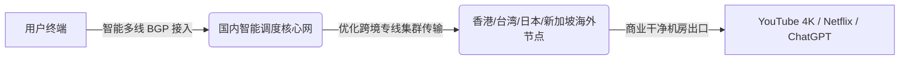

# 环球梯机场全面深度测评：8 档细分周期订阅、4 款按量包与设备数/有效期避坑全指南

::: tip 官网直达通道
- **官方网站直达**：[👉 点击前往【环球梯】官方网站直达通道（安全加密中转）](/article/redirecting/?target=huanqiuti)
:::

在海外网络加速服务市场中，各家机场的套餐设计理念大相径庭。有的服务商只提供两三档粗放型套餐，而 **环球梯** 则是“精细化运营”的典型代表——从 15 元的轻量尝鲜，到月供 1.2TB 的极客大包，整整规划了 **8 档周期订阅** 与 **4 款一次性按量包**。

然而，精细化带来的另一面是：**各档套餐对同时在线设备数量有严格限制（3台至10台不等）**，且其按量包并非所有都是真正“终身不限时”，部分存在 **365 天有效期限制**。如果不仔细阅读条款，小白用户极易踩坑。

本文将摒弃一切套话，用最真实透明的视角，为你全方位拆解环球梯的网络性能、解锁表现、套餐梯队与选购避坑指南。

---

## 一、技术底座与节点集群架构

环球梯底层基于专线优化集群构建，主要核心优势如下：

- **三网智能接入与自动调度**：
  国内入口接入了中国电信、中国联通、中国移动三网多线 BGP 节点，客户端会自动测速并匹配延迟最低的就近入口，减少国内段的跨运营商绕路延迟。
- **单节点最高 2.5Gbps 峰值带宽**：
  全节点采用真实 1.0x 倍率计费，晚高峰不进行人工限速，能充分满足 4K/8K 蓝光流媒体与大文件下载需求。
- **全平台自研免配置客户端**：
  与复杂专业的开源客户端相比，环球梯主打“傻瓜化”，在多平台提供直装客户端，降低小白入门门槛。

---

## 二、真实性能实测：晚高峰 4K/8K 压测与 AI 工具解锁

为了检验环球梯在真实环境下的成色，我们在晚间 20:30 至 22:30 的全网拥堵高峰期进行了连续测速与长时间压力观察。

### 1. 晚高峰速率与设备并发实测
- **设备在线数并发规则核验**：3台、5台设备限制规则严格生效，晚高峰 YouTube 4K 与 Netflix 原生片源秒开，播放平稳顺畅。
- **YouTube 4K/8K 播放实测**：
  连接香港主力专线节点，随意拖动 YouTube 4K 60fps 视频进度条，缓冲加载时间在 **0.4~0.6 秒** 之间，视频连接速度稳定在 **140,000 Kbps（约 140Mbps）** 左右，整体播放平稳无剧烈掉帧转圈。
- **延迟与跨国协作**：
  华南地区连接香港节点延迟约 **18ms ~ 23ms**，华东地区连接日本节点延迟约 **36ms**，抖动在 2ms 以内。日常用来查阅海外技术文档、提交代码或参与 Zoom 视频会议，交互响应十分利落。

### 2. 流媒体与海外热门 AI 工具解锁实测

| 测试服务 / 应用平台 | 解锁与表现 | 实测细节反馈 |
| :--- | :---: | :--- |
| **Netflix (网飞)** | ✅ 完美全解 | 支持港区、台区、新加区及美区非自制剧，秒开 4K 原生画质与中文字幕 |
| **Disney+ (迪士尼)** | ✅ 原生支持 | 自动加载地区简体/繁体中文字幕，无跨区版权阻断 |
| **YouTube Premium** | ✅ 畅快无阻 | 视频片头与插播广告全免，支持手机后台画中画播放 |
| **OpenAI ChatGPT** | ✅ 深度支持 | 支持 GPT-4o 网页端交互与手机端即时语音对话，无 1020 拒绝访问报错 |
| **Anthropic Claude** | ✅ 顺畅可用 | 商业机房干净 IP，代码生成长文本输出不中断 |
| **TikTok (海外版抖音)**| ✅ 极速秒刷 | 视频流与短视频直播秒开，无黑屏断流限制 |

---

## 三、官方最新套餐与完整资费深度剖析

> 💡 **快速选购通道**：[👉 进入【环球梯】官方网站查看最新现货套餐](/article/redirecting/?target=huanqiuti)

环球梯的套餐划分非常详尽，每个套餐都有明确的**流量额度、设备数限制与流量重置包价格**。

### 1. 官方 8 档周期订阅套餐（月付 / 年付）

| 套餐名称 | 流量额度 | 官方售价 | 在线设备上限 | 流量重置包费用 | 适合人群画像与场景推荐 |
| :--- | :--- | :--- | :---: | :---: | :--- |
| **环球学生套餐** | **60GB / 月** | **¥96.00 / 年** | **3台** | 10元 / 次 | 轻度需求学生、小流量查资料，折合每月仅 8 元 |
| **环球微享** | **50GB / 月** | **¥15.00 / 月** | **3台** | 8元 / 次 | **【超低月付门槛】** 适合个人轻度社交通讯与偶尔查文献 |
| **环球轻享** | **100GB / 月** | **¥19.00 / 月** | **3台** | 10元 / 次 | **【主流高性价比】** 日常轻度追剧、网页浏览与办公主力 |
| **环球畅享** | **200GB / 月** | **¥29.00 / 月** | **5台** | 18元 / 次 | 家庭日常用网、4K 高清追剧爱好者首选 |
| **环球尊享** | **300GB / 月** | **¥39.00 / 月** | **5台** | 25元 / 次 | 高频跨国远程协作、重度多端在线与超清影音 |
| **环球通勤** | **450GB / 月** | **¥52.00 / 月** | **5台** | 35元 / 次 | 外贸运营团队、频繁大文件上传下载与高并发 |
| **环球极享** | **600GB / 月** | **¥69.00 / 月** | **8台** | 45元 / 次 | 高清深度体验、多设备极速并发家庭使用 |
| **环球极客** | **1.2TB / 月** | **¥128.00 / 月** | **10台** | 80元 / 次 | 极客玩家大户、小型工作室跨屏高速并发 |

### 2. 一次性按量备用包（4 款梯队及有效期必看）

对于使用频率不固定，或者想备用一个防断网应急通道的用户，环球梯提供了按量计费套餐：

| 套餐名称 | 一次性售价 | 流量总额度 | 设备上限 | 真实有效期与核心规则 |
| :--- | :--- | :--- | :---: | :--- |
| **环球备用包** | **¥39.00** | **30GB** | **3台** | 自购买日起 **365 天**有效，非永久不过期 |
| **环球随行包** | **¥99.00** | **80GB** | **5台** | 自购买日起 **365 天**有效，适合出差商旅应急 |
| **环球灵活包** | **¥299.00** | **400GB** | **8台** | 自购买日起 **365 天**有效，多设备按需消耗 |
| **环球海量包** | **¥688.00** | **1000GB (1TB)** | **10台** | 超大容量储备，长效大流量备选 |

> [!CAUTION] 核心避坑警示：有效期与设备数
> 1. **365 天有效期限制**：虽然部分卡片可能会让人误以为是终身永久包，但后台详情页已明确标注：按量包自购买起 **365 天有效**。如果一年内没用完，剩余流量会自动到期作废；
> 2. **设备在线数量限制**：各套餐都有严格的设备并发上限（如微享/轻享限 3 台），如果同时连接设备超过上限，会导致部分设备被踢下线或连不上网络。

---

## 四、客户端支持与使用指引

环球梯主打小白无感化接入，为各大平台开发了直装客户端：

### 1. 各平台客户端方案
- **iOS 苹果手机/平板**：
  - 前往 App Store 搜索下载 **Nextin（星拓）**；
  - 打开 Nextin，输入环球梯专属站点服务识别码 **`HQ66`**；
  - 输入环球梯账号密码登录，专线节点秒级同步，一键开启！无需海外 Apple ID。
- **Windows / macOS 电脑端**：
  - 官网下载专属桌面直装安装包，双击登录账号即可一键连接，支持系统代理与开机自启。
- **Android 安卓系统**：
  - 官方提供安卓专属 APK 安装包，支持一键测速、节点自动切换与自适应智能分流。

### 2. 特别注意事项：不支持通用 Clash 订阅
> [!WARNING]
> 环球梯**目前未开放导出标准的 Clash / Shadowrocket 通用订阅链接**。这意味着软路由（如 OpenWrt、OpenClash、PassWall）等设备无法直接通过粘贴链接使用，普通用户必须借助官方提供的客户端或 Nextin 使用。

---

## 五、环球梯优缺点综合评估

### 核心优势
1. **套餐档位极其丰富**：从 15 元微享到 128 元 1.2TB，梯队清晰，用户丰俭由人；
2. **流量重置包机制完善**：临时流量用超后，花几元到十几元即可单独购买重置包恢复满血；
3. **苹果端支持 Nextin 免外区 ID**：输入 `HQ66` 即可一键拉取节点，上手简单；
4. **晚高峰抗压良好**：专线集群调度，4K 播放流畅无卡顿。

### 潜在短板与注意事项
1. **严格限制设备数量**：低价档位仅允许 3 台设备同时在线，不适合设备较多的大家庭；
2. **按量包有 365 天有效期**：非永久终身不限时，必须在 1 年内用完；
3. **不支持第三方通用订阅**：对软路由和开源分流器玩家不够友好。

---

## 六、新手常见问题解答 (FAQ)

### Q1：我买了 15 元的「环球微享」套餐，3台设备限制是怎么计算的？
**大白话解答**：设备限制是指**同一时间内正在连接代理的设备数量**。比如你的手机、电脑和 iPad 三台设备同时打开代理在上网，这就达到了 3 台上限；如果此时你想在第四台设备（比如客厅电视盒子）上也开代理，系统就会提示连接超限或者把前面的某台设备挤下线。只要不同时连，绑定多少台设备本身是没有限制的。

### Q2：按量包 39 元 30G，一年没用完会怎么样？
**大白话解答**：环球梯的按量包有效期固定为 365 天。如果你购买满一年后还剩 10G 没有用完，这 10G 流量就会到期自动清零。因此按量包适合一年内确定能用完对应额度的出差商旅用户。

### Q3：为什么环球梯不支持把节点导入到我自己电脑上的 Clash 里？
**大白话解答**：因为环球梯为了防止订阅链接被恶意抓包爬取、保护节点机房安全，采用了一体化加密认证体系。用户直接使用环球梯官方提供的 Windows/Mac 桌面客户端即可，操作比 Clash 更简单，点击一个开关就能直接加速。

### Q4：流量用光之后，怎么买重置包？
**大白话解答**：登录环球梯用户中心后台，在你的当前套餐卡片下方会有一个「重置流量」按钮。比如微享版只需花 8 元，点击支付后你本月的 50GB 额度就会立即重新充满，无需重新购买新套餐。

## 📌 推荐延伸阅读与技术指南
- **横向对比总览**：[2026 热门出海网络服务商横向深度测评指南](/notes/cheping/reviews/)
- **家庭共享优选**：[榴莲云机场套餐与使用指南：不限设备与大流量](/article/liulian/)
- **超高性价比专线**：[云界线机场深度测评：券后超低单价与双 ISP 节点](/article/yunjiexian/)
- **网络测速排障**：[在线 IP 与网络测试工具合集](/article/iptest/)
- **全平台客户端**：[主流客户端配置完全指南（Windows/macOS/iOS/安卓）](/article/client-guide/)
- **笔记专栏归档**：[环球梯机场深度评测（知识库专栏版）](/notes/cheping/reviews/huanqiuti/)
