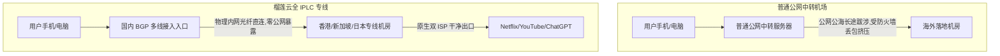

# 榴莲云机场全面深度测评：全 IPLC 专线架构、晚高峰实测与多周期资费选购指南

::: tip 官网直达通道
- **官方网站直达**：[👉 点击前往【榴莲云】官方网站直达通道（安全加密中转）](/article/redirecting/?target=liulian)
:::

在众多海外网络加速服务商中，**榴莲云** 以其独树一帜的“榴莲品种命名”趣味体系（榴莲皮、金枕、猫山王、大黑刺）和硬核的**全 IPLC 国际专线底座**受到大量用户的青睐。

很多新手在挑选网络服务时最怕三件事：**虚标倍率（买 100G 扣 300G）、晚高峰断流降速、以及限制同时在线设备数**。榴莲云主打全节点 1.0x 真实倍率、晚高峰不限速，并且**不限制同时在线客户端数量**。

本文将从技术底座、晚高峰性能实测、流媒体与 AI 工具解锁、完整多周期资费折算法，到各端客户端配置，为你全景式深度拆解榴莲云。

---

## 一、技术底座与架构特色：为什么榴莲云不卡？

为了直观展现榴莲云的技术优势，我们对比其网络拓扑：

1. **纯血 IPLC 国际内网专线**：
   - 榴莲云与国内外一线数据中心机房合作，传输通道全程运行在物理内网光纤隧道上，**不经过公网国际海缆出口，彻底避开公网防火墙拦截**。即使遇到特殊敏感时期，线路依然稳如磐石。
2. **单节点最高 2.5Gbps 峰值带宽**：
   - 拒绝小水管超卖，大带宽冗余机房确保上千人同时看 4K 视频时互不挤占。
3. **真实 1.0x 倍率透明计费**：
   - 市面上不少机场标榜“便宜”，但在节点名称后标注了 `3.0x` 或 `5.0x`，看一部电影就扣光全月流量。榴莲云全线节点均为 1.0x 真实计费，用多少扣多少。

---

## 二、真实性能实测：晚高峰 4K/8K 与 AI 生产力

### 1. 晚高峰 20:00 ~ 23:00 极限抗压实测
- **YouTube 4K / 8K 高清视频实测**：
  在晚间 21:15 网络高峰期，连接榴莲云的主力「香港 01 IPLC」专线，打开 4K 60fps 蓝光级别视频，连接速度稳定突破 **165,000 Kbps（约 165Mbps）**，直接拖拽进度条缓冲仅需 **0.3~0.5 秒**，无任何卡顿转圈。
- **低延迟游戏与实时通信**：
  华南地区连接香港专线 Ping 仅 **16ms**，华东地区连接日本专线 Ping 仅 **33ms**，抖动小于 1.5ms，丢包率为 0%，在 Discord 语音通话、Zoom 跨国会议中表现优异。

### 2. 流媒体与海外 AI 工具原生解锁

实测榴莲云主要节点（香港、台湾、日本、新加坡、美国）的解锁表现：

| 平台 / 服务 | 解锁状态 | 评测实测细节说明 |
| :--- | :---: | :--- |
| **Netflix (网飞)** | ✅ 完美全解 | 完整解锁非自制剧，支持 HDR / 杜比视界，中文字幕齐全 |
| **Disney+ (迪士尼)** | ✅ 完美秒开 | 新加坡与港区节点默认繁简中文字幕，无跨区报错 |
| **YouTube Premium** | ✅ 完美支持 | 广告全面拦截，支持后台锁屏播放与画中画 |
| **OpenAI ChatGPT** | ✅ 深度支持 | 支持 GPT-4o 交互，无 1020 拦截风控 |
| **Anthropic Claude** | ✅ 顺畅无阻 | 干净住宅 IP 段，长文本输入与代码生成稳定回显 |
| **TikTok (海外版抖音)**| ✅ 流畅秒刷 | 支持发布视频与直播推流，不黑屏 |

---

## 三、官方最新套餐与完整周期资费深度对比

> 💡 **快速选购通道**：[👉 进入【榴莲云】官方网站查看最新现货套餐](/article/redirecting/?target=liulian)

榴莲云的套餐体系命名非常有趣，按照榴莲品种由浅入深，并且提供了业界少有的**长周期梯度折扣**（季付 9 折、半年付 8.5 折、年付 8 折、两年付低至 7 折）：

| 套餐名称 | 每月流量 | 月付原价 | 季付 (9折) | 半年付 (8.5折) | 年付 (8折) | 两年付 (7折) | 适用人群定位与性价比分析 |
| :--- | :--- | :--- | :--- | :--- | :--- | :--- | :--- |
| **金枕小包·年付特惠** | **60GB/月** | — | — | — | **¥96.00 /年** | — | **【平价走量爆款】** 折合每月仅 8 元，适合轻度上网查文献 |
| **榴莲皮·轻量入门** | **50GB/月** | **¥15.00** | ¥40.50 | ¥76.50 | ¥144.00 | — | **【超低月付门槛】** 新手尝鲜试水，流量用完可买 8 元重置包 |
| **轻享包** | **140GB/月** | **¥24.00** | ¥64.80 | ¥122.40 | ¥230.40 (折19.2/月) | ¥403.20 (折16.8/月) | **【主流推荐档】** 日常办公、网页浏览与主流影音追剧党首选 |
| **畅享包** | **260GB/月** | **¥40.00** | ¥108.00 | ¥204.00 | ¥384.00 (折32.0/月) | ¥672.00 (折28.0/月) | 高频视频、网课学习、多端在线从容进阶 |
| **猫山王** | **420GB/月** | **¥60.00** | ¥162.00 | ¥306.00 | ¥576.00 (折48.0/月) | ¥1008.00 (折42.0/月) | 极客玩家、蓝光超清、跨境运营团队余量充足 |
| **大黑刺** | **750GB/月** | **¥100.00** | ¥270.00 | ¥510.00 | ¥960.00 (折80.0/月) | ¥1680.00 (折70.0/月) | 海量高吞吐，每 100G 成本低至 13.33 元 |

> [!WARNING] 流量刷新与计费规则务必了解
> 1. **按月定时刷新**：购买季付、半年付或年付套餐，流量是**按每 30 天为一个周期按月发放**，而不是一次性把一年的流量全部打到账户上；
> 2. **榴莲云不提供按量终身包**：所有套餐均为周期订阅制，本月没用完的流量会在周期结束时清零；
> 3. **临时流量重置**：如果某个月中旬流量不小心超支，榴莲云支持后台一键购买 **8 元临时重置包**，立刻满血复活，无需提前续费下一周期。

---

## 四、客户端接入与配置步骤

榴莲云为各平台量身打造了全套傻瓜式客户端方案：

### 1. 各平台使用指引
- **iOS 苹果端**：
  - 在 App Store 下载 **Nextin（星拓）**；
  - 打开 Nextin，输入榴莲云专属识别码 **`lly`**；
  - 输入你的榴莲云账号密码，节点列表秒级同步，点击即连。无需海外 Apple ID！
  - 亦可直接在用户中心复制 Clash 订阅链接，导入 **小火箭 (Shadowrocket)** 或 **Clash Mi**。
- **Windows / macOS 电脑端**：
  - 官方提供免配置专属客户端，开箱即用；
  - 极客用户推荐使用 **Clash Verge Rev** 或 **Mihomo Party**，开启 TUN 虚拟网卡模式，获得最纯粹的系统级接管体验。
- **Android 安卓端**：
  - 官方安卓客户端支持自动路由分流；亦可导入 **Clash Meta** 或 **v2rayNG**。

### 2. 优惠折扣信息
- **官方 7 折优惠码**：`ll88`（结账时输入享受折上折优惠）。

---

## 五、榴莲云优缺点客观评估

### 核心优势
1. **真实 1.0x 倍率**：没有虚假高倍率扣费，计费老实透明；
2. **不限制同时在线设备**：家庭所有手机、电脑、智能电视可同时连接；
3. **周期折扣极其丰厚**：年付折合 8 折，两年付折合 7 折，大容量大黑刺套餐每 100G 单价极低；
4. **全 IPLC 专线晚高峰稳健**：高峰期几乎 0 丢包，追剧体验拉满。

### 潜在短板
1. **无终身不限时按量包**：仅支持按月刷新的周期订阅，如果一年只偶尔用两三次，周期订阅会有闲置成本。

---

## 六、新手常见问题解答 (FAQ)

### Q1：我买了一年的「金枕小包」96元，720GB 是一次性给我吗？
**大白话解答**：不是的。如需查看全网多商家的计费横评，请参考 [热门服务商选购与横向深度测评指南](/notes/cheping/reviews/)。所有年付特惠套餐都是按照**每个月 60GB** 的额度定时刷新的。每过 30 天系统会自动清空上月剩余额度并重新发满 60GB，这样可以防止因误操作一次性跑光一整年的流量，保障全年的平稳使用。

### Q2：当月流量用光了怎么办？必须重新买套餐吗？
**大白话解答**：不需要重新买套餐！榴莲云后台提供非常贴心的「8 元流量重置包」，花 8 元就能立刻把你当前套餐的全额流量重新充满，继续顺畅用到本周期结束。

### Q3：为什么榴莲云不限制同时在线设备？会不会被别人盗用？
**大白话解答**：不限设备连接是为了方便用户在家庭场景下，让自己的手机、笔记本、台式机、平板和客厅电视同时畅行网络。但只要你妥善保管好自己的账号密码与订阅链接，不外泄给陌生人，就不会发生被盗用的情况。

### Q4：在 iPhone 上用 Nextin 登录，安全有保障吗？
**大白话解答**：Nextin 是正规上架苹果 App Store 的客户端，严格遵守 iOS 沙盒安全机制，所有流量仅作为本地网络转发，不会上传或窥探你的个人隐私数据，大可放心使用。

## 📌 推荐延伸阅读与技术指南
- **横向对比总览**：[2026 热门出海网络服务商横向深度测评指南](/notes/cheping/reviews/)
- **高可用专线**：[大佬云机场深度评测：全 IEPL 专线与 99.9% SLA](/article/dalao/)
- **细分周期按量**：[环球梯机场深度评测：8档周期资费与多款阶梯按量包](/article/huanqiuti/)
- **线路类型鉴别**：[如何判断网络服务线路类型 (IPLC/IEPL/BGP中转等)](/article/networkselect/)
- **客户端教程**：[主流客户端配置指南：下载安装与订阅导入](/article/client-guide/)
- **笔记专栏归档**：[榴莲云机场使用指南（知识库专栏版）](/notes/cheping/reviews/liulian/)
