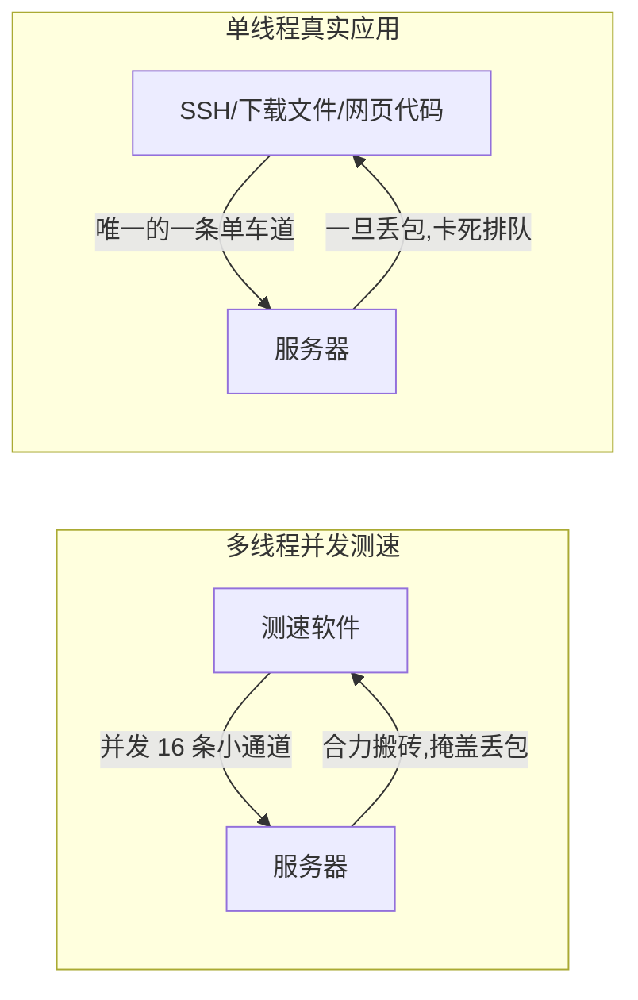
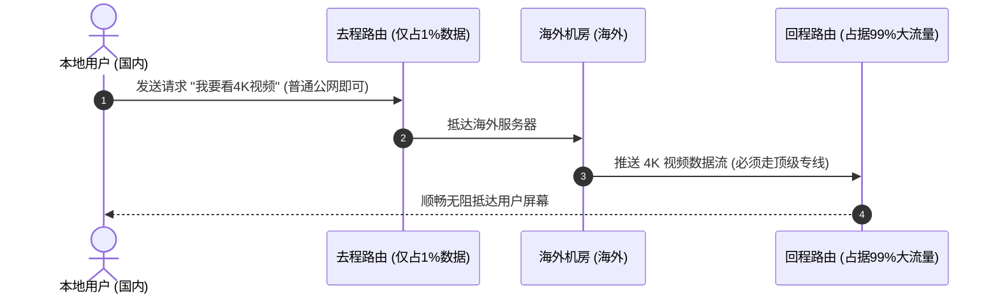

# 出海线路深度测评与解析：BGP 中转与 IPLC/IEPL 专线全解析

你是否遇到过这样的情况：
买了一个宣传号称“千兆大带宽”、“跑分 500Mbps”的机场或海外 VPS，白天测速截图看着非常亮眼；然而一到晚上实际用起来，看个 1080P 视频都在疯狂缓冲，远程桌面连不上，打海外游戏甚至动不动就掉线。

为什么“测速软件上的漂亮数字”和“真实日常使用感受”会差得这么大？

核心原因就在于：**绝大多数普通用户在评测网络时，都被表面数据误导了。**网络不是一条简单的管子，它是由错综复杂的路由节点、骨干网互联协议和运营商调控策略共同组成的动态网络。

本文将摒弃那些生涩晦涩的通信学术论文腔，用最通俗易懂的大白话和形象比喻，带你一步步搞懂出海线路评测的核心逻辑，学会自己看懂线路优劣！

---

## 一、跑分软件为什么会“骗人”？（多线程 vs 单线程）

很多新手测速时，一看到 Speedtest 测出了 300Mbps 就觉得这线路“太快了”。其实这里面藏着一个巨大的盲区：**多线程并发 vs 单线程吞吐**。

### 1. 多线程测速（大力出奇迹的障眼法）
- **大白话比喻**：就像找了 16 辆小三轮车同时帮你运砖头。路上虽然很多坑洼（丢包率高），有一辆三轮车翻车了，其他 15 辆还在继续跑，最后计算总重量时，数字依然看着非常大。
- **缺点**：普通测速软件默认开启了数十个并发连接，它掩盖了严重的网络丢包和抖动。

### 2. 单线程测速（照妖镜）
- **大白话比喻**：相当于你独自开一辆大货车拉货物。路上只要有一个坑（丢包），货车就必须原地刹车等待重传，整条通道立马慢下来。
- **真实场景**：我们在现实中使用的大部分应用（比如 SSH 远程登录连接终端、Git 下载开源代码仓库、网页 HTML/JS 脚本加载），底层往往都是**单线程传输**！
- **如何进行单线程测试**：
  在 Speedtest 网页端中，将“Connections（连接方式）”从“Multi（多连接）”切换为“Single（单连接）”，此时跑出来的速度才是最真实的线路抗丢包底色。

---

## 二、为什么“回程路由”决定 90% 的上网体验？

在普通城市里打电话或者送外卖，你去哪条街，回程通常原路返回。但在跨国互联网中，**去程和回程往往走的根本不是同一条路**！

- **去程路由**：你的手机或电脑，向美国服务器发出指令（“请把这个网页发给我”）。这个数据包极小，可能只有几百字节，相当于你寄出去一封轻飘飘的明信片。
- **回程路由**：美国的服务器把几十兆的网页图片、4K 视频数据流源源不断发回你的屏幕。这相当于对方给你发来了一整辆满载货物的重型卡车！

> **核心结论**：
> 哪怕去程走的是最慢最烂的普通公网，只要**回程路由走的是顶级专线（如电信 CN2 GIA、联通 AS9929、移动 CMIN2 或物理 IPLC 专线）**，你的网络体验依然会极其顺滑！反之，如果去程看着很美，回程走普通 163 骨干网，晚高峰照样会卡得动弹不得。

---

## 三、MTR 探针追踪：看懂每一跳是直达还是绕路

`ping` 命令只能告诉你最终目的地通不通，但如果中途卡了，你根本不知道是卡在哪个机房。而 `MTR`（My Traceroute）则像一个具有透视眼的全程跟踪仪。

### 1. 怎么读懂 MTR 的结果？
在 MTR 报告中，会列出每一跳（Hop 1、Hop 2...）的路由器 IP、延迟和丢包率。
- **假丢包（路由保护）**：如果你看到第 5 跳丢包率是 100%，但第 6、7、8 跳以及终点的丢包率全都是 0%，**这不用担心**！这只是因为第 5 跳机房的路由器开启了防攻击保护，故意不搭理 ICMP 探针，但你的实际网络数据是正常通过的。
- **真拥堵（骨干网堵车）**：如果你看到从第 8 跳（比如某运营商国际出口交换机）开始，丢包率瞬间飙升到 25%，并且后面的每一跳一直到终点丢包率都维持在 25% 左右，**这就是真正的骨干网断崖式拥堵**。

### 2. 警惕“环游世界”的绕路路由
正常从上海访问日本东京，光纤直线穿过东海海底光缆，延迟应该在 30ms 左右。
但如果某个廉价小机的网络配置混乱，数据可能先从上海飞到美国西海岸洛杉矶，再从洛杉矶跨越太平洋飞回日本东京！这种线路的延迟直接飙升到 250ms 以上，俗称“绕美线路”，日常体验极差。

---

## 四、三网出海线路实战选购准则

不同地区的运营商，在不同海外区域有各自的强势线路：

| 目标地区 | 中国电信推荐 | 中国联通推荐 | 中国移动推荐 |
| :--- | :--- | :--- | :--- |
| **中国香港** | CN2 GIA 专线 / IPLC | AS9929 / IPLC | CMI 直连 / CMIN2 / IPLC |
| **日本东京** | CN2 GIA / BBTEC 软银 | 软银 (SoftBank) / IIJ | CMI 经香港转 / CMIN2 |
| **美国西海岸** | CN2 GIA (AS4809) | AS9929 / AS4837 | CMIN2 / 优质 BGP 中转 |
| **欧洲地区** | CN2 GIA 德国法兰克福 | 联通 AS9929 德/英节点 | 联通/电信混合 BGP 中转 |

---

## 五、小白五分钟评测一套节点的自检清单

当你拿到一个新的节点或机场时，不用求助别人，按以下清单跑一遍就能心中有数：

1. **查 IP 属性**：打开 `ipinfo.io`，看所属运营商是不是大厂，看是否支持原生解锁。
2. **跑单线程带宽**：在 `Speedtest` 切换为单连接测速，看是否能稳定在 30Mbps 以上。
3. **测高峰期丢包**：在晚上 9:00 晚高峰，用 `ping.pe` 观察中国移动、电信、联通三网的真实丢包率。如果丢包率小于 3%，说明绝对是优质线路。
4. **测 4K 实际吞吐**：打开 YouTube 找一个 4K 60FPS 视频，右键打开“详细统计信息（Stats for nerds）”，看“Connection Speed（连接速度）”是否能稳定在 50000 Kbps（50Mbps）以上。

---

## 六、常见高频问答 (FAQ)

### Q1：为什么我的节点 Ping 延迟只有 40ms，打游戏却还是疯狂闪烁红色“丢包”警告？
**大白话解答**：延迟低只代表距离近，不代表路面平整。就像你家隔壁虽然只有两公里，但如果中间路上全是大坑、正在施工，你开车过去依然会不断颠簸。很多廉价机房虽然地理上离大陆很近（比如香港公网小机），但晚高峰国际出口极度拥挤，丢包率可能高达 15% 以上。网络游戏中只要丢失一个同步指令包，人物就会瞬间出现“瞬移、卡位、拉扯”。解决游戏卡顿必须挑选**零丢包**的 IPLC 游戏专线，详细实测案例可阅读 [神行加速全面深度测评](/article/shenxing/) 。

### Q2：商家宣称的“BGP 三网自动寻优”到底是怎么工作的？
**大白话解答**：BGP 就像一个全自动导航系统。如果你是北方联通用户，BGP 入口机房会自动分配联通最优路线接待你；如果你是南方电信用户，它会自动切入电信低延迟网关。它避免了“南电信连北联通”导致的跨运营商跨网减速，大幅提升了全国各地用户接入的平均速度。

### Q3：为什么测试 YouTube 视频时，缓冲速度忽高忽低不稳定？
**大白话解答**：YouTube 采用动态自适应流媒体协议（DASH）。当它检测到你的网络有瞬间波动或微小丢包时，会立刻主动降速以防止播放彻底中断；当网络恢复平稳时，它又会尝试提速缓冲。如果你的速度数字忽上忽下剧烈跳动，说明你的线路“抖动（Jitter）”较大，或者是服务端正在受到邻居大流量抢占带宽的干扰。

### Q4：为什么有些节点白天的下载速度可以跑满千兆，到了晚上 8 点后连 10 兆都跑不到？
**大白话解答**：这就是典型的“超售（Oversell）+ 晚高峰骨干网 QoS 限速”。白天大部分人在上班，国际出海带宽非常充裕；而一到晚上，千家万户都在刷海外流媒体、下大文件，运营商有限的总出海带宽瞬间饱和。如果不是购买了独享带宽、未超售精品网（如 GIA/9929/IPLC）的节点，普通平民流量必然会被运营商列入限速排队名单。

## 📌 推荐延伸阅读与技术指南
- **远程办公网络实战**：[跨境远程办公与数字游民网络环境搭建心得](/article/digital-nomad/)
- **机场推荐**：[神行加速全面测评：全 IPLC 专线架构与晚高峰实测](/article/shenxing/)
- **线路真伪鉴别**：[如何判断网络服务线路类型 (IPLC/IEPL/BGP中转等)](/article/networkselect/)
- **网络测试工具**：[在线 IP 与网络测试工具合集（真实延迟与原生解锁）](/article/iptest/)
- **行业避坑指南**：[VPS 行业黑话完全指南（去程回程与路由套路）](/article/vpscant/)
- **笔记专栏归档**：[网络线路解析与出海线路评测（知识库专栏版）](/notes/cheping/study/networkanalysis/)
