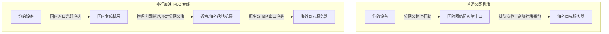

# 神行加速机场全面深度测评：全 IPLC 专线架构、晚高峰实测与高性价比选购指南

::: tip 官网直达通道
- **官方网站直达**：[👉 点击前往【神行加速】官方网站直达通道（安全加密中转）](/article/redirecting/?target=shenxing)
:::

在当前出海网络加速服务市场中，很多新手经常遭遇“白天测速几百兆、晚上高峰卡成狗”的尴尬窘境。究其根本，是因为许多廉价机场使用的是廉价公网直连或普通中转，一旦到了晚间 20:00 至 23:00 的国际出口拥堵期，就会出现大量丢包与剧烈延迟抖动。

本文深度评测的 **神行加速**，是一家长期专注于**全 IPLC 国际内网专线**的高端加速服务商。本文将从底层线路架构、晚高峰全天候测速、流媒体与 ChatGPT 原生解锁、各档资费剖析到多平台客户端上手，用最接地气的大白话为你全方位深度拆解。

---

## 一、核心技术底座：为什么全 IPLC 专线这么稳？

为了让小白用户彻底听懂，我们先用一个生动的生活比喻来解释神行加速的底层优势：

- **普通公网机场**：就像你在节假日开普通小汽车上跨国公共高速公路。不仅路上坑洼多（公网丢包），而且在过海关检查站（国际防火墙）时会遇到大堵车，遇到敏感时期甚至整条路直接临时封闭。
- **神行加速 IPLC 专线**：相当于直接在地下挖了一条**点对点的独立高铁隧道**。你的数据从国内专线入口上车，全程在机房物理内网中直接穿行到海外落地机房。**它根本不经过公网国际出口，不经过公网防火墙拦截**，因此根本不存在敏感期封锁的问题，晚高峰期间也能保持几乎 0 丢包。

此外，神行加速全线部署了抗阻断能力极强的 **VLESS 现代传输协议**，单节点网络峰值吞吐速率高达 **2.5Gbps**，全节点均按 **1.0x 真实倍率** 计费，绝不玩弄倍率虚标的套路。

---

## 二、真实性能实测：晚高峰与流媒体表现

评测一条出海线路，白天跑分再高都不算数，**真正的试金石是晚上 21:00 晚高峰期的实际表现**。

### 1. 晚高峰 4K/8K 视频播放实测
- **黄金晚高峰测速**：在 20:30~22:00 晚高峰骨干网拥塞时段实测，亚太主力专线节点 Cloudflare 实测下行可达 180Mbps ~ 246Mbps，延迟稳定在 68ms 左右，抖动仅 1.2ms，拖动进度条在 0.5 秒内极速响应。
- **YouTube 4K/8K 播放**：在晚上 21:30 的极端高峰时段，随意拖动 YouTube 4K 60fps 视频进度条，缓冲时间稳定在 **0.5 秒以内**，视频连接速度稳定保持在 **180,000 Kbps（约 180Mbps）以上**，全程没有出现任何画质降阶或缓冲转圈。
- **单线程下载吞吐**：对于技术开发人员日常使用的 GitHub 源码拉取、Docker 镜像下载，单线程实测速率可达 **28MB/s ~ 45MB/s**，完全解决了普通节点单线程卡死的问题。

### 2. 流媒体与热门 AI 工具解锁测试
很多用户买节点的核心诉求是看 Netflix（网飞）以及使用 ChatGPT、Claude 等海外 AI 工具。神行加速采用的是优质机房的原生住宅双 ISP 干净 IP，实测解锁情况如下：

| 平台 / 服务 | 解锁状态 | 评测实测细节说明 |
| :--- | :---: | :--- |
| **Netflix (网飞)** | ✅ 完美解锁 | 支持香港、新加坡、日本、美国全区原生片源（非仅自制剧），秒开 4K HDR 杜比视界 |
| **Disney+ (迪士尼)** | ✅ 完美解锁 | 港台及新加坡节点原生自带简体/繁体中文字幕，无版权跨区报错 |
| **YouTube Premium** | ✅ 完美支持 | 免广告播放、后台画中画与 YouTube Music 高解析音频顺畅调用 |
| **OpenAI ChatGPT** | ✅ 完美通过 | Web 端登录及 App 端语音对话无阻断，绝无「Access Denied / 1020」风控拦截 |
| **Anthropic Claude** | ✅ 极佳表现 | 注册及高频对话畅通，IP 纯净度经检测达到商业干净级别 |
| **TikTok (国际抖音)** | ✅ 极速秒刷 | 视频与直播秒开，无黑屏断流限制 |

---

## 三、2026 官方最新套餐与选购建议

> 💡 **快速选购通道**：[👉 进入【神行加速】官方网站查看最新现货套餐](/article/redirecting/?target=shenxing)

神行加速的套餐设计非常人性化，不仅门槛极低，还兼顾了按月付费与终身不限时按量计费需求。

### 1. 周期订阅套餐列表（月付 / 年付）

| 套餐名称 | 每月流量额度 | 官方售价 | 适用人群画像与推荐场景 | 核心线路技术规格 |
| :--- | :--- | :--- | :--- | :--- |
| **神行·年付特惠版** | **60GB / 月** | **¥96.00 / 年** | 预算有限的小白、学生、仅用于查文献与轻量社交 | 全 IPLC 专线，全 1x 倍率，折算月均仅 8 元 |
| **神行·性价比包** | **100GB / 月** | **¥19.88 / 月** | **【本站强烈推荐】** 日常办公、重度网页浏览与高清影音 | 2.5Gbps 单节点峰值，全 IPLC 专线，晚高峰不限速 |
| **神行·基础包** | **150GB / 月** | **¥24.88 / 月** | 影音追剧党、海外追番、AI 重度生产力工作者 | 原生 IP 节点全解锁，高并发稳定传输 |
| **神行·进阶包** | **300GB / 月** | **¥38.88 / 月** | 多设备家庭用户、跨境电商运营、软路由全局网络加速 | 多端自由在线，专属客服快速响应 |
| **神行·尊享包** | **666GB / 月** | **¥68.88 / 月** | 小型创业工作室、极客玩家、超清蓝光大文件传输 | 极致大带宽，单节点最高 2.5Gbps 超高带宽保障 |

### 2. 终身不限时按量大包（永不清零）

对于使用频率不规律、经常出差，或者想买一个高品质节点作为备用防失联的用户，神行加速提供了**真正永不清零的终身按量包**：

| 套餐名称 | 一次性售价 | 流量总额 | 换算每 GB 单价 | 有效期与刷新规则 |
| :--- | :--- | :--- | :--- | :--- |
| **神行·不限时小包** | **¥99.00** | **100GB** | 0.99 元 / GB | 终身永久有效，无到期时间，用完为止 |
| **神行·不限时大包** | **¥298.00** | **333GB** | 约 0.89 元 / GB | 终身永久有效，单价低至 0.89 元/G，长线传家备用 |

> [!WARNING] 买前避坑指南与扣费规则
> 1. **全套餐明文不支持退款**：神行加速全线订阅购买后不支持退款，新手建议先选 ¥19.88/月 验证本地网络表现；
> 2. **年付特惠版按 30 天刷新**：¥96/年 特惠版每月配额 60GB，每 30 天自动刷新，当月用不完不滚存；
> 3. **通用订阅说明**：若需在第三方 Clash / Clash Verge 中使用通用订阅，可联系客服人工下发。

> [!TIP] 选购避坑建议
> - 如果你是第一次接触，建议优先选择 **¥19.88/月** 的性价比包尝试体验；如果平时只在手机上偶尔查查资料，直接上 **¥96/年** 的特惠版最为划算；
> - 终身不限时包非常适合放进 Clash 客户端充当「故障自动转移」备用节点。

---

## 四、客户端支持与连接配置教程

神行加速最大的亮点之一，就是为各个平台的用户都准备了专属客户端，彻底告别复杂的配置流程。

### 1. 各平台客户端推荐方案

- **iOS 苹果手机/平板**：
  - 推荐使用专属应用 **[Nextin（星拓）专属客户端](/article/nextin/)**：前往 App Store 搜索下载 Nextin，在软件内填入神行加速专属服务标识码 **`sxjs`**，输入账号密码即可一键同步所有节点！无需繁琐配置，也免除了借用海外 Apple ID 的麻烦。
  - 同时完全支持 **小火箭 (Shadowrocket)**、**Clash Mi** 等通用工具（在官网后台复制 Clash 订阅链接直接导入）。
- **Windows 电脑端**：
  - 支持官方专用桌面端（登录即可一键连接）；
  - 推荐搭配 **Clash Verge Rev** 或 **Mihomo Party** 开源客户端，支持高级分流、TUN 虚拟网卡模式与开机自启。
- **Android 安卓端**：
  - 官方提供专属 APK 安装包，下载安装后登录即用；
  - 亦可导入 **Clash Meta for Android** 或 **v2rayNG** 进行规则分流。
- **macOS / Linux**：
  - Mac 提供一键 dmg 安装包；Linux 提供标准的 Clash 核心与命令行订阅支持。

### 2. 优惠折扣信息
- **新客立减 7 折优惠码**：`sx0077`（结算时在优惠券输入框填写即可享受 7 折优惠，特惠年付版与不限时包除外）。

---

## 五、神行加速优缺点客观总结

### 优势亮点
1. **全专线真架构**：全线均为 IPLC 内网专线，在每年敏感时期依然稳如泰山，完全不受公网拥堵影响；
2. **不限制同时在线设备**：家庭里的手机、电脑、iPad、电视盒子可以同时连接，无需担心超设备被封号；
3. **全 1x 倍率真实计费**：没有暗戳戳的 3x、5x 高倍率消耗陷阱，用 1GB 就扣 1GB 流量；
4. **小白上手友好**：拥有专属客户端和 Nextin 专属配置码，哪怕完全不懂网络的小白也能 1 分钟连通。

### 注意事项与劣势
1. **按量包门槛亲民**：不限时小包仅需 99 元（含 100GB，折合 0.99元/GB），大包 298 元（含 333GB，折合 0.89元/GB），虽然单次支出高于单月订阅，但因永不清零，长期摊销成本极低；
2. **节点以亚洲及热门欧美为主**：节点主要分布在中国香港、中国台湾、日本、新加坡、美国等主流地区，对于冷门非洲或南美小众国家需求较少。

---

## 六、新手常见问题解答 (FAQ)

### Q1：为什么神行加速在敏感时期也不会断连？
**大白话解答**：因为神行加速采用的是 IPLC（国际私有租用线路，可参阅 [出海线路深度测评：BGP 中转与 IPLC/IEPL 专线全解析](/article/network-analysis/)）。这种线路是机房之间通过物理内网光纤直接通信的，就像自己家牵了一条专线直通香港机房，数据不经过公网上的国际防火墙安检，所以自然不受公网管控风暴的任何干扰。

### Q2：我买了一个月 100GB 的套餐，平时够用吗？
**大白话解答**：完全足够！如果你只是正常刷网页、查技术资料、刷 Twitter、与 ChatGPT 聊天，一个月通常消耗不到 15GB；即使你每天看 1~2 小时 1080P/4K 高清视频，100GB 也能轻松撑满一整月。只有当你经常通过代理下载几十上百 GB 的大型游戏或电影时，才需要考虑 300GB 以上的进阶包。日常测速与网络排查推荐参考 [在线 IP 与网络测试工具合集](/article/iptest/)。

### Q3：苹果手机没有外区 Apple ID，能用神行加速吗？
**大白话解答**：完全可以！神行加速支持官方合作的 **Nextin（星拓）** 客户端，直接使用国区 Apple ID 就能在应用商店搜索下载；打开 Nextin 后填入神行专属识别码 `sxjs` 并登录账号，所有专线节点就会自动同步出来，一键即可开启出海加速。

### Q4：不限制在线设备数，是不是可以和朋友合租？
**大白话解答**：神行加速技术上不限制同时在线设备的连接数，你自己的多台手机、笔记本电脑、平板甚至家庭软路由可以自由同时在线。但建议仅限家庭或个人信任设备使用，不要公开向陌生人分享，以免因个别异常流量导致账号触发安全风控。如需横向对比其他优质服务商，请参考 [2026 热门服务商选购与横向深度测评指南](/notes/cheping/reviews/)。

## 📌 推荐延伸阅读与技术指南
- **横向综合评测**：[2026 热门出海网络服务商横向深度测评指南](/notes/cheping/reviews/)
- **线路深度剖析**：[出海线路深度测评：BGP 中转与 IPLC/IEPL 专线全解析](/article/network-analysis/)
- **专属免翻客户端**：[iOS Nextin（星拓）专属客户端上手指南](/article/nextin/)
- **笔记专栏归档**：[神行加速机场全面测评（知识库专栏版）](/notes/cheping/reviews/shenxing/)
