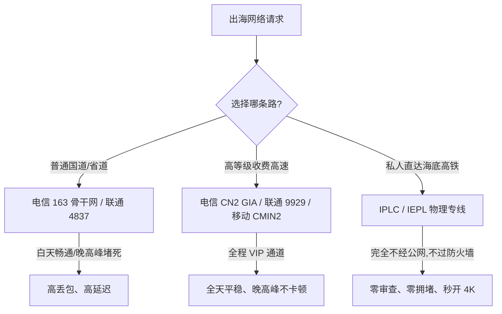

# VPS行业黑话完全指南：小白也能秒懂的买鸡与线路宝典

当你刚踏入网络技术、VPS 服务器或机场交流群时，经常会看到老玩家们在热火朝天地聊着各种“天书”暗语：
- “这个商家又在超售了，晚高峰 163 骨干网 QoS 严重丢包！”
- “建议直接上 CN2 GIA 或者 AS9929，预算充足一定要买 IPLC 专线。”
- “这家节点是原生双 ISP 住宅 IP 吗？能不能完美解锁 TikTok 和奈飞？”

如果你看得一头雾水，千万不要被这些专业术语唬住。实际上，这些看似高深莫测的名词，用我们日常生活中的**“交通出行”**和**“买房租车”**就能完全解释清楚。

本文将用最生动通俗的大白话，把整个 VPS 与网络出海领域的常见黑话一次性讲透，让你彻底摆脱“买鸡小白”的身份！

---

## 一、服务器硬件与主机黑话（买鸡篇）

在 VPS 圈子里，大家亲切地把服务器称为**“鸡”**。

| 行业黑话 | 真实含义 | 大白话形象比喻 |
| :--- | :--- | :--- |
| **母鸡 (Host Server)** | 拥有极强计算性能的整台物理机 | 相当于一栋整整几十层的原装毛坯大楼 |
| **小鸡 (VPS)** | 虚拟出来的单台小虚拟机 | 大楼被房东用隔板打成几十间甚至几百间“单身公寓” |
| **传家宝** | 极度超值且再也买不到的绝版配置 | 比如十几年前买到的核心地段超低租金房，永不涨价 |
| **灵车** | 价格便宜得不可思议但随时跑路的主机商 | 几十块钱包年甚至终身的机房，老板可能下周就卷钱关门跑路 |
| **石头盘** | 磁盘读写速度极其慢的硬盘 | 读写数据像在硬石头上刻字一样艰难卡顿 |
| **超售 (Oversell)** | 商家卖出的总资源远远大于物理机总容量 | 房东只有 100 张床位，但赌大家不会同时来睡，偷偷卖了 500 张票 |

### 为什么大家讨厌“OpenVZ 架构”而偏爱“KVM 架构”？
- **OpenVZ**：类似于“合租大通铺”，所有小鸡共享同一个底层系统核心。房东（商家）极容易在内存和 CPU 上疯狂超售，只要邻居在疯狂看片或挖矿，你的机器就会跟着卡死。
- **KVM**：类似于“独立单间公寓”，每一台小鸡都有独立的虚拟硬件和独立的系统内核，谁也占不了谁的便宜，稳定性高得多。

---

## 二、国内三大运营商骨干网络黑话（修路篇）

数据在互联网上传输，就像汽车在公路上行驶。不同运营商修的路，宽窄和质量截然不同：

### 1. 中国电信
- **163 普通骨干网（AS4134）**：
  - **大白话比喻**：国内最老的免费国道。车道虽然很多，但全国上亿普通老百姓都挤在上面。平时白天跑跑还行，一到晚上 8~11 点晚高峰，出海大门口堵得水泄不通，丢包率瞬间飙到 30% 以上。
- **CN2 GT（Global Transit）**：
  - **大白话比喻**：半程高速。在国内走普通省道，到了出海海关稍微照顾你一下，但依然要跟大部队挤同一个关口，性价比不高。
- **CN2 GIA（AS4809，极力推荐）**：
  - **大白话比喻**：全封闭的 VIP 高速收费公路。全程双向独立车道，不管国内还是国外都走 VIP 专道。就算春运晚高峰，普通人堵在路上哭，CN2 GIA 上依然能以 120 迈的速度飞驰。价格较贵，但极度稳定。

### 2. 中国联通
- **AS4837（联通 169 普通网）**：
  - **大白话比喻**：路面宽敞的省级高架桥。联通的海外带宽总容量相对人口比例非常宽裕，性价比极高，便宜好用。
- **AS9929（联通 A 网 / CUII）**：
  - **大白话比喻**：联通给国家大型政企、银行客户专门留的特勤快车道。车流极少，晚高峰完全不卡，质量直逼电信顶级 CN2 GIA。

### 3. 中国移动
- **CMI（AS9808）**：移动自己的国际出口主干网，连接香港非常快，但晚高峰对欧美方向容易被限速。
- **CMIN2（AS58453）**：移动近年来重金打造的新一代精品专网，专门用来对标电信 CN2 GIA 和联通 AS9929，晚高峰抗拥堵能力极其强悍。

---

## 三、专线与跨境传输黑话（专线篇）

在挑选高端节点时，经常看到 IPLC、IEPL 和 BGP，它们到底厉害在哪里？

### 1. IPLC（国际私有租用线路）
- **核心本质**：真正的**物理点对点内部光纤专线**。
- **大白话比喻**：普通公网是坐飞机或走公路线出境，必须排队过海关检查（防火墙审查）；而 IPLC 就像是中港两地之间私下挖了一条直通海底隧道，车子从深圳开进隧道，直接从香港尖沙咀钻出来。
- **致命优势**：**根本不经过公网国际海关，因此完全不存在被防火墙检测或阻断的可能**！哪怕特殊敏感时期公网大面积封锁，IPLC 依然风雨无阻，延迟稳如一条直线。

### 2. IEPL（国际以太网专线）
- **核心区别**：和 IPLC 的体验几乎完全一样，只是在数据链路层的封装协议不同。在日常使用、抗封锁能力和晚高峰速度上，用户完全感受不到两者的区别。

### 3. BGP 中转（BGP 隧道机房）
- **核心本质**：服务商在内地的优质机房（如上海、深圳、广州）架设具有 BGP 三网自动寻优能力的入口服务器。
- **大白话比喻**：你在四川电信，不用直接万里迢迢连接洛杉矶，而是先就近连到上海机房（延迟只有十几毫秒）；上海机房再通过专用高速中转通道将数据打包发送到美国。既能降低延迟，又能避免你本地电信直连海外的丢包。

---

## 四、IP 身份与流媒体黑话（属性篇）

### 1. 原生 IP vs 广播 IP
- **原生 IP**：机房从当地互联网注册机构（如 APNIC、ARIN）申请到的、注册地与机房物理地址 100% 严格一致的 IP。像当地合法土生土长的本地户口，海外流媒体平台最认可。
- **广播 IP**：IP 本来的注册地可能在非洲或东欧，但机房通过路由广播协议把这个 IP 挪到美国或新加坡去使用。流媒体平台经常能识别出这种“借读户口”而限制播放。

### 2. 原生双 ISP 住宅 IP（最高等级）
- **什么是双 ISP**：IP 的入站运营商（IP Type）和出站运营商都被国际风控数据库标记为商业电信公司（如 AT&T、Verizon、Comcast 等家用民用宽带公司），而不是数据中心机房（Data Center）。
- **为什么值钱**：在 Netflix、TikTok 跨境电商、PayPal 支付、ChatGPT 看来，访问请求来自一个“普通美国家庭客厅里的电脑”，纯净度极高，几乎零风控封号风险。

---

## 五、网络控制黑话（QoS 篇）

- **QoS（服务质量策略）**：
  - **大白话解释**：电信运营商的“看人下菜碟”机制。当晚高峰带宽不够用时，运营商的路由器会优先保证贵宾客户（企业专线、高价值客户）的数据优先通过，而把普通平民老百姓的数据包直接扔掉（丢包）或者故意拖延（延迟飙升）。这就是为什么普通 VPS 到了晚上 9 点就会卡死。

---

## 六、常见高频问答 (FAQ)

### Q1：常听别人说“买小鸡要挑三网回程优化”，到底什么是回程优化？为什么比去程更重要？
**答**：你在上网时，你发出的请求只有几十个字节（“我要看这个视频”），这叫**去程**；而服务器把几十兆的 4K 视频数据推送到你的屏幕上，这叫**回程**。99% 的网络数据流量都消耗在“回程”上！很多不良商家为了省钱，去程故意花小钱走好线路让你测 Ping 看起来很低，但回程却走最拥堵廉价的普通公网，导致实际看视频极慢。因此，**回程路由才是决定网速质量的绝对核心，关于优质回程线路分析请参阅 [出海线路深度测评：BGP 中转与 IPLC/IEPL 专线全解析](/article/network-analysis/)。**。

### Q2：既然 IPLC 专线这么好，为什么不是所有节点都用专线？
**答**：主要有两个原因：
1. **成本极其昂贵**：跨国内网物理光纤的带宽租金是普通公网带宽的几十倍甚至上百倍。正规 1Gbps 的 IPLC 专线每月租金动辄几万甚至十几万元。
2. **带宽容量有限**：正因为昂贵，专线通常只分配给高端付费套餐。如果一家月付几块钱的超便宜机场宣称自己是“千兆 IPLC 专线不限速”，百分之百是假专线（实际上是普通公网伪装的）。

### Q3：为什么有时候买的香港 VPS 延迟只有 10ms，但访问有些海外网站反而打不开？
**答**：香港虽然离大陆物理距离最近、Ping 延迟最低，但香港很多低价 VPS 的出口路由并未经过特殊优化，甚至可能绕道美国才能访问欧洲或某些网站。此外，许多大型国际服务商对机房 IP 审查极其严苛，很多香港机房 IP 早就被各大流媒体列入黑名单，因此低延迟并不等于能畅通无阻访问所有服务。

### Q4：机场里常说的“流量倍率”是什么套路？
**答**：流量倍率是节点消耗流量的乘数。如果你用了 1GB 流量：
- 在 **1x 倍率** 节点上，扣除 1GB 套餐流量；
- 在 **0.2x 倍率** 节点上，只扣除 200MB（适合挂机、大文件下载）；
- 在 **3x 或 5x 倍率** 高端专线节点上，会直接扣除 3GB 或 5GB 流量。新手在节点列表中一定要看清节点名称后方标注的倍率，避免误选高倍率导致套餐几天就被扣光。

## 📌 推荐延伸阅读与技术指南
- **线路深度分析**：[出海线路深度测评：BGP 中转与 IPLC/IEPL 专线全解析](/article/network-analysis/)
- **线路类型鉴别**：[如何判断网络服务线路类型 (IPLC/IEPL/BGP中转等)](/article/networkselect/)
- **节点搭建基础**：[网络通信的基本过程与节点搭建起步](/article/node1/)
- **机场推荐**：[神行加速全面测评：全 IPLC 专线架构与晚高峰实测](/article/shenxing/)
- **笔记专栏归档**：[VPS 行业黑话完全指南（知识库专栏版）](/notes/cheping/study/vpscant/)
