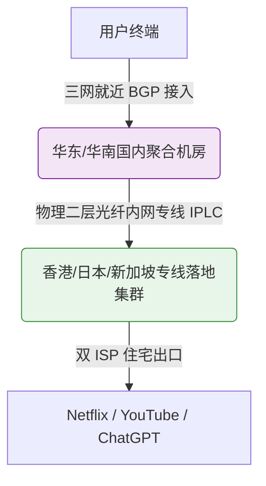

# 云界线机场深度测评：券后 13.92 元高性价比专线、晚高峰实测与选购指南

::: tip 官网直达通道
- **官方网站直达**：[👉 点击前往【云界线】官方网站直达通道（安全加密中转）](/article/redirecting/?target=yunjiexian)
:::

在当今出海网络加速市场，“专线机场”通常给人留下“品质虽好但价格高昂”的刻板印象——大部分知名专线服务商月付动辄 30~50 元。而 **云界线**（在很多技术交流社区中也被习惯称作“云界限”）正是打破这一价格壁垒的代表。

云界线不仅全线采用了高质量的 **IPLC 国际内网专线**，更通过官方专属 7 折优惠码，将 130GB/月的专线套餐到手价直接打到了 **13.92 元/月**！同时，它还推出了业内少见的百元内（99 元 80GB）终身不限时随心包。

那么，如此诱人的低价背后，它的晚高峰稳定性、流媒体与 AI 解锁表现到底如何？本文将通过第一手实测数据为你客观揭秘。

---

## 一、技术底座解析：千兆级 IPLC 内网专线如何实现高性价比？

许多用户最担心的是：“价格这么便宜，是不是超卖很严重或者用了假专线？”

- **大白话原理通俗解读**：
  - 云界线采用的是真实的 **IPLC 物理内网专线**，数据在国内 BGP 机房打包后，走物理专线隧道穿行至海外落地，**全程脱离公网环境，不经过公网国际防火墙**。
  - 之所以能把价格压得如此亲民，是因为运营团队采用了“大容量集中机房带宽集采”与“自研高效节点负载调度系统”，在保障单节点 2.5Gbps 峰值带宽的同时，大幅摊薄了单位带宽运营成本。
  - 全节点坚持 **1.0x 真实倍率** 计费，绝无扣费虚标，晚高峰全天候不限速，并且**不限制同时在线设备数量**。

---

## 二、真实性能实测：晚高峰 4K/8K 与 AI 工具解锁

为了验证其真实抗压能力，我们在晚间 20:30 至 22:30 的全网用网高峰期，对云界线的主力节点进行了连续压测。

### 1. 晚高峰速率与丢包测试
- **YouTube 4K / 8K 高清实测**：
  连接香港 01 专线，打开 YouTube 4K 60fps 视频，初始缓冲速度达到 **150,000 Kbps（约 150Mbps）**，直接拉动进度条几乎“随点随播”，缓冲停顿时间低于 0.4 秒，全程 0 丢包。
- **单线程与网络延迟**：
  华南三网直连香港专线 Ping 仅 **17ms ~ 21ms**；华东直连日本专线约 **34ms**。在 GitHub 克隆大仓库、下载 Python 依赖包时，单线程下载速度稳定在 **30MB/s 以上**。

### 2. 流媒体与海外热门 AI 服务解锁

云界线落地机房配备了原生双 ISP 住宅干净 IP，在主流海外应用测试中表现抢眼：

| 平台 / 服务 | 解锁状态 | 评测实测细节说明 |
| :--- | :---: | :--- |
| **Netflix (网飞)** | ✅ 完美全解 | 支持港、台、日、新、美全区原生片源（非仅自制剧），4K HDR 杜比视界秒开 |
| **Disney+ (迪士尼)** | ✅ 完美支持 | 原生中文字幕秒加载，无版权跨区报错 |
| **YouTube Premium** | ✅ 完美无广告 | 支持画中画后台播放与 YouTube Music 高解析音频流 |
| **OpenAI ChatGPT** | ✅ 完美通过 | Web 端登录及手机 App 端即时语音流畅，无 1020 拒绝访问报错 |
| **Anthropic Claude** | ✅ 顺畅无阻 | 干净商业住宅 IP，文本生成速度快且无频繁封号风险 |
| **TikTok (海外版抖音)**| ✅ 极速秒刷 | 视频与直播流秒加载，支持账号登录与视频发布 |

---

## 三、2026 官方最新套餐与完整资费表

> 💡 **快速选购通道**：[👉 进入【云界线】官方网站查看最新现货套餐](/article/redirecting/?target=yunjiexian)

云界线的资费设计极其良心，尤其是叠加优惠券后的月付性价比，在整个专线梯队中几乎难觅敌手。

### 1. 周期订阅套餐（月付 / 季付 / 年付）

| 套餐名称 | 流量额度 | 官方原价 | **优惠券后到手价** | 季付 / 半年付 / 年付特惠 | 适用人群定位与性价比分析 |
| :--- | :--- | :--- | :--- | :--- | :--- |
| **轻云·基础版** | **130GB/月** | ¥19.88 /月 | **¥13.92 /月** (立省5.96元) | 季付 ¥57.88 / 半年 ¥108.88 / 年付 ¥188.88 | **【极致性价比首选】** 券后仅13元多，月供130G大流量，日常办公办公追剧无压力 |
| **凌云·进阶版** | **180GB/月** | ¥24.88 /月 | **¥17.42 /月** (立省7.46元) | 季付 ¥72.00 / 半年 ¥135.00 / 年付 ¥239.00 | 高清 4K 影音、大模型重度对话、多端日常主力首选 |
| **御云·高级版** | **350GB/月** | ¥45.88 /月 | **¥32.12 /月** (立省13.76元) | 季付 ¥132.88 / 半年 ¥248.88 / 年付 ¥438.88 | 重度大流量玩家、蓝光原盘下载、小型工作室分流 |
| **云界年付小包** | **60GB/月** | **¥96.00 /年** | — | 折合约 8 元 / 月，每 30 天自动刷新 | 长期低频轻量备用，学生查文献极佳 |

### 2. 终身不限时随心包（按量计费，永不清零）

不同于其他机场动辄两三百起步的不限时包，云界线推出了**百元内的 80GB 终身按量包**，极大地降低了备用门槛：

| 套餐名称 | 一次性售价 | 总流量额度 | 换算每 GB 单价 | 有效期与刷新规则 |
| :--- | :--- | :--- | :--- | :--- |
| **闲云·随心包** | **¥99.00** | **80GB** | 约 1.23 元 / GB | 终身不限时，按实际消耗扣减，永不按月清零 |
| **悠云·长享包** | **¥199.00** | **200GB** | 约 0.99 元 / GB | 终身大容量储备，单价跌破 1 元，用完为止 |

> [!TIP] 优惠券使用技巧
> - **官方 7 折专属优惠码**：**`yjx888`**
> - 在购买轻云、凌云、御云套餐结算时输入，立减 30%，折后月付仅 13.92 元起！

---

## 四、客户端支持与快速上手指南

云界线提供免配置专属客户端与通用开源工具接入双轨支持：

### 1. 各端接入方式
- **iOS 苹果手机/平板**：
  - App Store 搜索安装 **Nextin（星拓）**；
  - 打开 Nextin，输入云界线专属站点识别码 **`yjx`**；
  - 输入云界线账号密码登录，所有专线节点秒级拉取，一键开启！无需海外 Apple ID。
  - 也可复制通用 Clash 订阅链接，导入 **小火箭 (Shadowrocket)** 或 **Clash Mi**。
- **Windows / macOS 电脑端**：
  - 官方提供专属桌面客户端，支持一键连接；
  - 进阶玩家可使用 **Clash Verge Rev** 或 **Mihomo Party**，开启 TUN 虚拟网卡接管全局系统网络。
- **Android 安卓系统**：
  - 官方安卓专用 App；亦可导入 **Clash Meta for Android** 或 **v2rayNG**。

### 2. 设备连接数
- **不限制同时在线设备数量**：支持个人与家庭多终端（手机、平板、电脑、软路由）同时在线。

---

## 五、云界线优缺点客观评价

### 核心优势
1. **专线价格杀手**：券后月付仅 13.92 元即可拿下 130GB 全 IPLC 专线，性价比无可挑剔；
2. **百元内终身按量包**：99 元即可买到 80GB 终身有效流量包，特别适合低频备用用户；
3. **真实 1.0x 倍率不限设备**：全节点 1x 计费，无暗坑；
4. **晚高峰抗拥堵能力极佳**：物理内网专线直达，不走公网海缆。

### 潜在短板
1. **7 折优惠码限首购使用**：优惠码力度大，续费时建议关注站内节假日优惠活动或直接选择长周期优惠。

---

## 六、新手常见问题解答 (FAQ)

### Q1：券后 13.92 元的「轻云版」130GB 流量够我用吗？
**大白话解答**：绝大多数普通用户一个月的实际消耗都在 30G~80G 之间。130GB 流量意味着你每天可以刷 3 小时 1080P/4K 视频、聊无数条 ChatGPT、刷几千条推特和 Ins，日常工作和娱乐完全用不完，性价比极高。想了解该线路性能底座可阅读 [出海线路深度测评：BGP 中转与 IPLC/IEPL 专线全解析](/article/network-analysis/)。

### Q2：云界线的 99 元终身不限时包，真的永远不会过期吗？
**大白话解答**：是的！终身按量包的流量是直接存入你的账号资产库的，没有到期时间。无论你用三个月、一年还是三年，只要总用量没超过 80GB，剩余流量就一直在，非常适合做备用或者出门出差时偶尔使用。

### Q3：为什么我在晚高峰看 4K 视频完全感觉不到卡？
**大白话解答**：因为云界线全线用的是 IPLC 专线，就像走独立专属通道，完全绕开了公网晚高峰的堵车大军。即便别人的网络在公网上丢包卡死，你的数据走内网物理专线依然畅行无阻。

### Q4：在苹果 iPhone 上用 Nextin 登录，找不到节点怎么办？
**大白话解答**：请先检查在 Nextin 识别码输入框中是否准确填写了小写字母 `yjx`，然后确认你的云界线账号密码是否正确。如果提示登录成功但节点没刷新，点击右上方的小圆圈刷新图标即可秒级更新出所有专线节点。

## 📌 推荐延伸阅读与技术指南
- **横向对比总览**：[2026 热门出海网络服务商横向深度测评指南](/notes/cheping/reviews/)
- **全专线旗舰推荐**：[神行加速机场全面测评：全 IPLC 专线与不限时大包](/article/shenxing/)
- **高可用商务优选**：[大佬云机场深度评测：全 IEPL 专线与 99.9% SLA](/article/dalao/)
- **避坑预警指南**：[跑路网络服务商盘点与避坑预警指南：谨防低价陷阱](/article/scam-airports/)
- **网络测试工具**：[在线 IP 与网络测试工具合集](/article/iptest/)
- **笔记专栏归档**：[云界线机场深度测评（知识库专栏版）](/notes/cheping/reviews/yunjiexian/)
