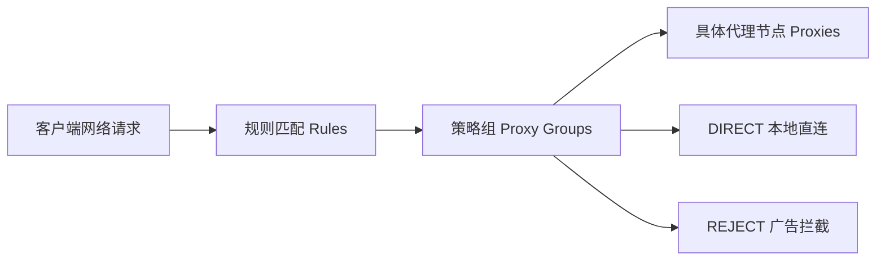

# Clash 规则分流与进阶策略组配置详解：从入门到精通实战指南

Clash 系列内核（包括开源内核、Premium 内核以及最新的 Mihomo / Clash.Meta）之所以广受全球极客与技术爱好者推崇，其最核心的灵魂就在于其高度灵活且精准的**规则分流机制（Rule-based Routing）**。

很多刚刚接触出海网络的新手，习惯了“全局代理”模式，结果访问国内微信、百度、B站时要么卡顿要么提示版权限制，遇到境外网站又得手动来回切节点。
通过精心配置的分流策略，你可以让国内流量毫秒直连免翻、海外常规网页走通用代理、Netflix/Disney+ 跨区流媒体走专属原生解锁节点、ChatGPT/Claude/OpenAI 走低风控住宅节点，从而彻底实现**全自动、无感知出海**。

本文将用最生动通俗的大白话和架构图，带你从底层搞懂策略组与规则编写，轻松玩转自定义分流！

---

## 一、Clash 分流架构三大核心概念（大白话比喻）

在深入规则编写前，需要先厘清三个最基础的概念实体：



1. **Proxies（代理节点）**：
   - **比喻**：就像你车库里的具体车辆（比如一辆跑车、一辆越野车、一辆载重卡车）。它是从服务商订阅拉取到的具体节点，如香港 IPLC、新加坡 BGP、美国双 ISP 等。
2. **Proxy Groups（策略组）**：
   - **比喻**：相当于不同的“调度部门”。你可以让调度部门按照规则派车：比如“出门买菜组”派电动车，“长途出游组”派越野车。常见策略类型包括：
     - `select`：手动挑选节点；
     - `url-test`：自动测速，挑选延迟最低的节点；
     - `fallback`：主备容灾，主节点坏了自动切备用；
     - `load-balance`：负载均衡，把流量均匀分摊到多个节点。
3. **Rules（路由规则）**：
   - **比喻**：就像十字路口的交警与路标牌。网络数据请求从上往下逐条匹配，**只要命中第一条匹配的规则，立刻按照指示转弯，并终止后续匹配！**

---

## 二、常见规则匹配类型与语法对照表

Clash 支持丰富的规则匹配关键字，常见类型对照如下：

| 匹配类型 | 语法示例 | 说明与适用场景 |
| :--- | :--- | :--- |
| **DOMAIN-SUFFIX** | `DOMAIN-SUFFIX,google.com,节点选择` | 匹配域名后缀（含一级、二级所有子域名，如 mail.google.com） |
| **DOMAIN-KEYWORD**| `DOMAIN-KEYWORD,github,节点选择` | 匹配域名中包含该关键词的任意网址 |
| **DOMAIN** | `DOMAIN,www.instagram.com,节点选择` | 严格精准匹配单个完整域名 |
| **IP-CIDR** | `IP-CIDR,192.168.0.0/16,DIRECT` | 匹配指定 IPv4 私有网段，常用于局域网设备直连 |
| **GEOIP** | `GEOIP,CN,DIRECT` | 基于 IP 物理归属地数据库匹配（如中国大陆 IP 走直连） |
| **PROCESS-NAME** | `PROCESS-NAME,Telegram.exe,电报专线` | 依据发起请求的本地进程名分流（需 TUN 模式支持） |
| **MATCH** | `MATCH,漏网之鱼` | 兜底全匹配规则，**必须且只能放在规则列表的最末尾** |

---

## 三、进阶现代化方案：使用 Rule-Providers 动态规则集

早期配置文件往往包含成千上万行静态规则，既臃肿又难以及时更新（比如某海外网站换了新域名，旧规则就失效了）。现代 Clash（尤其 Mihomo 内核）推荐采用外部 **Rule-Providers（规则集提供者）**，由开源社区维护自动每日同步：

```yaml
# 1. 声明外部远程规则集
rule-providers:
  reject:
    type: http
    behavior: domain
    url: "https://testingcf.jsdelivr.net/gh/Loyalsoldier/clash-rules@release/reject.txt"
    path: ./ruleset/reject.yaml
    interval: 86400

  direct:
    type: http
    behavior: domain
    url: "https://testingcf.jsdelivr.net/gh/Loyalsoldier/clash-rules@release/direct.txt"
    path: ./ruleset/direct.yaml
    interval: 86400

  proxy:
    type: http
    behavior: domain
    url: "https://testingcf.jsdelivr.net/gh/Loyalsoldier/clash-rules@release/proxy.txt"
    path: ./ruleset/proxy.yaml
    interval: 86400

# 2. 在 rules 规则区按优先级引用
rules:
  - RULE-SET,reject,REJECT        # 第一步：拦截流氓广告域名
  - RULE-SET,direct,DIRECT        # 第二步：放行国内常用服务直连
  - RULE-SET,proxy,节点选择       # 第三步：常见海外受限网站走代理
  - GEOIP,CN,DIRECT               # 第四步：中国大陆 IP 直连兜底
  - MATCH,漏网之鱼                 # 第五步：所有未命中规则走漏网之鱼兜底
```

---

## 四、策略组黄金搭配实战模板

一套高品质的策略组应该让用户在日常使用中“完全不需要手动切节点”：

1. **节点选择（主控策略组）**：`type: select`，汇集所有可用节点供手动应急切换。
2. **自动优选（Auto-Select）**：`type: url-test`，针对常规海外网页，系统每隔 10 分钟自动 Ping 测速一次，始终自动把网络切换至延迟最低的可用节点。
3. **流媒体专线（Media Streaming）**：专门绑定支持 Netflix / Disney+ 原生双 ISP 解锁的香港、日本、新加坡优质专线节点，不走普通节点。
4. **AI 工具专线（OpenAI / Claude）**：绑定 IP 纯净度高、未被 Cloudflare / OpenAI 列入机房黑名单的专用出口，确保登录 ChatGPT 绝不弹验证码。
5. **漏网之鱼（Final）**：兜底策略，通常设置为走代理策略组或 `DIRECT`。

---

## 五、新手避坑常见排障要点

- **规则顺序颠倒大忌**：
  规则匹配严格遵循“从上往下先到先得”的原则。如果你把宽泛的 `GEOIP,CN,DIRECT` 或者 `MATCH,DIRECT` 放在最顶部，后面的所有微细规则都将彻底失效！
- **DNS 污染导致直连假死**：
  国内运营商 DNS 会恶意污染海外域名（返回假 IP）。请务必在客户端开启 Fake-IP 模式或内置 DoH / DoT 解析，让域名直接在代理服务端进行真实解析。
- **局域网设备无法访问**：
  若开启 TUN 虚拟网卡后无法打开局域网路由器管理页（`192.168.1.1`）或局域网打印机，务必确保规则顶部保留了 `IP-CIDR,192.168.0.0/16,DIRECT` 等私有网段放行规则。

---

## 六、常见高频问答 (FAQ)

### Q1：为什么我明明加了某个域名的 PROXY 规则，打开网站还是打不开？
**大白话解答**：现代大型网站（比如 YouTube、Twitter）往往不只用一个主域名，还会调用很多 CDN 静态资源域名和 API 接口域名（比如 `ytimg.com`、`googlevideo.com`、`twimg.com`）。如果你的规则只写了 `DOMAIN,youtube.com`，视频流的 CDN 域名依然被判定为走直连，就会导致网页排版错乱或视频卡在黑屏转圈。解决办法是使用更智能的完整规则集（Rule-Providers）或者直接使用顶级规则 `DOMAIN-SUFFIX,googlevideo.com,PROXY`。

### Q2：`url-test` 自动测速策略组会不会很消耗我的流量？
**大白话解答**：完全不会！`url-test` 每次测速只是向指定的轻量目标网页（如 `http://www.gstatic.com/generate_204`）发送一个几百字节的 HTTP HEAD 探针请求，消耗的流量只有几 KB，即使每天测上千次，一个月耗费的流量也不到 10MB。

### Q3：开启 Fake-IP 模式和 Redir-Host 模式有什么区别？
**大白话解答**：
- **Redir-Host（传统模式）**：每次你在电脑上输入网址，电脑必须先向 DNS 服务器问出真实 IP 地址，然后 Clash 才能判断走直连还是走代理。这会导致解析延迟高，甚至国内 DNS 直接给你返回被污染的死 IP。
- **Fake-IP（推荐现代模式）**：电脑输入网址后，Clash 瞬间假装返回一个虚构的本地地址（如 `198.18.0.2`），把网络请求先骗进 Clash 内部，真正的域名解析放到海外代理服务器上去完成。这样网页秒开，且彻底免疫国内 DNS 污染！

### Q4：在客户端里编辑配置文件，保存后提示 YAML 语法错误怎么办？
**大白话解答**：YAML 格式对“缩进空格”有着严格到极致的语法要求：**必须用空格缩进，绝对不能用 Tab 制表符；冒号后面必须带一个空格！**如果报错，检查你刚才修改的那几行，把 Tab 键换成两格空格，并在冒号后补上空格即可。

## 📌 推荐延伸阅读与技术指南
- **进阶分流与策略组**：[Clash 分流规则与配置进阶：Proxy Groups、Rule Provider 与自定义分流](/article/clash-config/)
- **客户端实战**：[Clash Verge Rev 核心配置与订阅导入快速上手](/article/clash-verge/)
- **高颜值新客户端**：[Mihomo Party 现代化客户端实战配置](/article/mihomo-party/)
- **排障全指南**：[Clash 常见报错与排障大全：TUN网卡与端口冲突](/article/clash-faq/)
- **核心演进**：[Clash 核心概念与内核生态演进：从 Clash 到 Mihomo](/article/clash-intro/)
- **笔记专栏归档**：[Clash 分流规则与配置进阶（知识库专栏版）](/notes/clash/config/)
