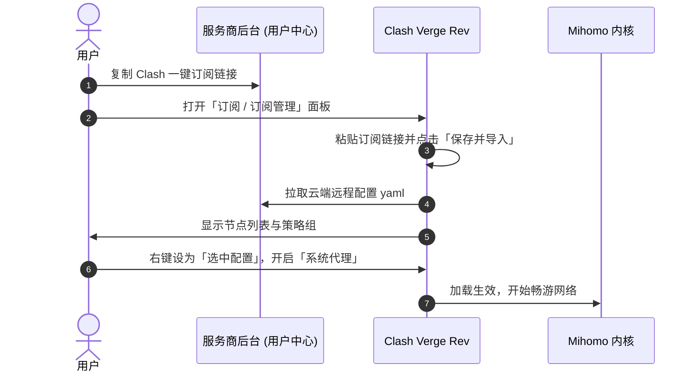

# Clash Verge Rev 全平台保姆级安装、订阅导入与配置优化完全指南

**Clash Verge Rev** 是目前 Windows、macOS 和 Linux 平台上用户量最大、更新最积极的开源桌面客户端。它基于现代 Tauri 框架打造，内存占用仅 30MB~50MB，原生内置最新的 Mihomo (Clash.Meta) 强悍内核，界面现代美观且深度支持 TUN 全局虚拟网卡模式，全面替代了早已停更的老版 Clash for Windows。

无论你是刚接触出海网络的新手，还是需要加速游戏、Git 与 Docker 终端的开发者，本文都将用最通俗易懂的大白话为你手把手讲清下载安装、一键订阅导入、TUN 模式配置与常见避坑技巧。

---

## 一、软件去哪里下载与安装

### 正规下载渠道推荐：

1. **官方开源 Releases 页面（最安全可靠）**：
   - 官方主仓库：[https://github.com/clash-verge-rev/clash-verge-rev/releases](https://github.com/clash-verge-rev/clash-verge-rev/releases)
   - 国内镜像加速打开：[https://ghfast.top/https://github.com/clash-verge-rev/clash-verge-rev/releases](https://ghfast.top/https://github.com/clash-verge-rev/clash-verge-rev/releases)
2. **你的机场/服务商后台（免翻墙直连下载）**：
   - 登录你的网络服务商网站用户中心，点击左侧【客户端下载】->【Windows/Mac】，通常提供国内千兆不限速直链，点击即可秒速下完。

### 各平台安装包选型速查：
- **Windows 平台**：下载 `Clash.Verge_x.x.x_x64_zh-CN.msi`（64位电脑推荐双击安装）或 便携绿色版 `portable.zip`；
- **macOS 平台**：
  - Apple Silicon 芯片（M1/M2/M3/M4 系列）：下载 `_aarch64.dmg`；
  - Intel 芯片老款 Mac：下载 `_x64.dmg`；
- **Linux 平台**：提供 `.AppImage`、`.deb`、`.rpm` 以及 Arch Linux AUR 安装包。

::: warning macOS 首次打开提示损坏解决
macOS 用户首次打开若提示「应用已损坏」或「无法打开未知开发者」，打开终端运行以下命令即可：
```bash
sudo xattr -r -d com.apple.quarantine "/Applications/Clash Verge.app"
```
:::

---

## 二、订阅链接导入与节点激活流程

很多新手不知道订阅链接导入后为什么不能立即上网，我们用一张时序图理清全流程：



### 详细实操四步法：
1. **获取订阅链接**：在你的网络服务商用户中心，找到 **「一键导入 Clash 订阅」** 或复制 **Clash / Mihomo 专用订阅 URL**。
2. **导入客户端**：
   - 打开 Clash Verge Rev，在左侧导航点击 **「订阅」**（Profiles）；
   - 在顶部输入框粘贴刚才复制的订阅 URL，可自定义备注名称（如 `主力订阅`）；
   - 点击右侧 **「保存并导入」**（Save & Import），等待进度条加载完毕。
3. **选择并启用配置**：
   - 在订阅列表中，找到刚才导入成功的卡片，**鼠标右键点击并选择「选择」**（此时卡片左侧会出现明显的激活高亮标识）；
   - 回到左侧导航点击 **「代理」**（Proxies），在顶部的规则组中点击任意可用节点（可点击右下角的小闪电图标批量测速，选择延迟绿色且数值较低的节点）；
   - 在左下角或设置页开启 **「系统代理」** 开关，即可开始正常上网！

---

## 三、开启 TUN 虚拟网卡模式（游戏与终端加速必备）

默认的「系统代理」只能接管遵循 Windows/macOS 系统代理规范的浏览器和常规应用。若要加速游戏（Steam/Epic/外服对战）、命令行（Git/SSH/Terminal）或某些不走系统代理的软件，需开启 **TUN 虚拟网卡模式**。

### 开启步骤：
1. 点击左侧导航 **「设置」**（Settings）；
2. 找到 **「服务模式」**（Service Mode），点击右侧的 **「安装」**（Install）。Windows 会弹出 UAC 提权申请，点击「是」允许；安装成功后该项会显示为绿色活跃状态；
3. 接着在设置页面将 **「TUN 模式」** 开关打开；
4. 此时你的系统网络连接中会自动生成一张名为 `Mihomo` 的虚拟网卡，整台机器的所有出网流量就会被深度接管。

---

## 四、实用进阶优化设置

- **开机自启动与静默启动**：在「设置」中勾选「开机自启」和「启动时静默最小化到托盘」，开机自动在任务栏后台运行，不弹大窗口打扰。
- **自动更新订阅周期**：在已导入的订阅卡片上右击选择「编辑」，将更新间隔设置为 `24小时` 或 `12小时`，确保及时同步服务商的最新节点 IP 与流媒体分流策略。
- **分流模式选择**：
  - **规则模式 (Rule)**：推荐日常使用！国内网站走直连，海外受阻网站走代理，两不耽误；
  - **全局模式 (Global)**：所有流量一律走代理，排查网络故障或需要固定海外环境时使用；
  - **直连模式 (Direct)**：完全不走代理。

---

## 五、常见高频问答 (FAQ)

### Q1：为什么安装“服务模式”时一直提示安装失败或报错？
**大白话解答**：通常是因为杀毒软件（如 360 安全卫士、火绒、Windows Defender）拦截了软件安装系统驱动服务。
请在安装服务模式前，先将杀毒软件临时退出，或者在弹出的“用户账户控制（UAC）”窗口中选择“是（允许管理员权限）”。如果依然失败，退出软件后，右键点击软件图标选择“以管理员身份运行”，再点击安装服务模式即可顺利通过。

### Q2：软件左下角或者设置里的“系统代理”打不开，一点开就秒弹回关闭状态？
**大白话解答**：这通常是因为本地有其他代理软件（如已开启的老版 v2rayN、百度网盘加速插件或公司 VPN）占用了本地的 `7890` 端口。
解决办法：在 Clash Verge Rev 的【设置】中，找到“混合端口（Mixed Port）”，将默认的 `7890` 修改为一个不常用的新端口（比如 `7897` 或 `10808`），然后重新打开系统代理开关即可恢复正常。

### Q3：开启 TUN 模式后，电脑为什么突然连不上局域网打印机或家庭 NAS 了？
**大白话解答**：TUN 模式接管了电脑的所有流量。如果在设置中没有开启局域网直连绕过，发往局域网内部 IP 的数据就会被误送进代理。
解决办法：在【设置】->【TUN 模式设置】中，确保勾选了 **「严格路由（Strict Route）」** 并开启 **「绕过私有 IP（Bypass Private Route）」**，这样发往局域网（`192.168.x.x`、`10.x.x.x`）的打印机和 NAS 流量就会自动走本地直连。

### Q4：从老版 Clash for Windows 迁移过来，以前自定义的配置规则还能用吗？
**大白话解答**：完全无缝兼容！Clash Verge Rev 完美支持原版 Clash 的所有 YAML 规则语法，并且由于内置了新版 Mihomo 内核，还额外支持了更先进的规则提供者（Rule Providers）与新型协议。直接把原先的订阅链接导入进来即可开箱即用。

## 📌 推荐延伸阅读与技术指南
- **高颜值新选择**：[Mihomo Party 现代化客户端实战与高级配置](/article/mihomo-party/)
- **规则分流详解**：[Clash 规则分流与进阶策略组配置详解](/article/clash-rules-guide/)
- **排障完全手册**：[Clash 常见报错与排障大全：TUN故障与端口解决](/article/clash-faq/)
- **全平台总览**：[主流客户端配置指南：下载安装与订阅导入](/article/client-guide/)
- **笔记专栏归档**：[Clash Verge Rev 全平台配置优化（知识库专栏版）](/notes/clash/verge/)
