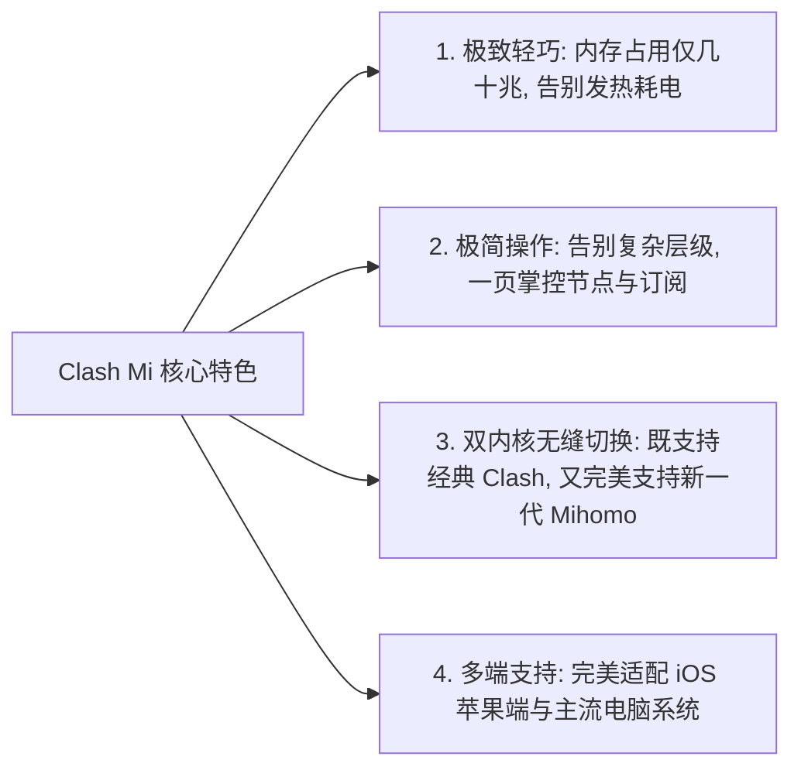
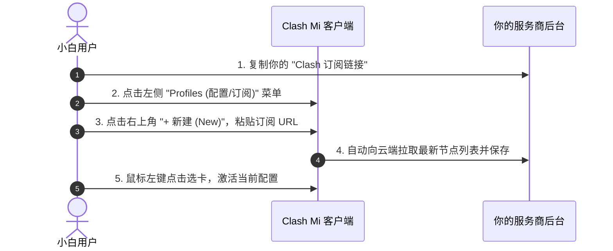

# Clash Mi (iOS / 多平台) 极简教程：轻量现代客户端新手指南

在老牌的 Clash for Windows（CFW）项目停更归档之后，整个开源社区涌现出了一批优秀的新生代客户端。其中，**Clash Mi（支持 iOS 与多桌面平台，及其备受喜爱的孪生开源兄弟 Clash Nyanpasu）** 凭借其极致轻量、内存占用极低、界面清爽可爱的特色，迅速赢得了大量技术玩家和普通小白的青睐。

如果你觉得市面上某些客户端体积太庞大、吃内存太多，或者经常搞不清楚复杂的扩展配置，那么 **Clash Mi（iOS / 多平台）** 绝对是你日常最安心、最省心的轻量出海利器！

本文将用完全通俗的大白话，不带任何玄学技术术语，手把手带你完成从安装、订阅导入到开启极速代理的完整上手流程！

---

## 一、Clash Mi 到底好在哪里？（轻量三宝大白话）

1. **告别“内存刺客”**：老款客户端动辄占用好几百兆内存，而 Clash Mi 基于现代化精简底层架构打造，日常在后台静默运行时代扣内存通常只有 **几十兆**，老旧笔记本、低配电脑以及手机运行起来毫无卡顿！
2. **极简操作逻辑**：没有令人眼花缭乱的层层折叠菜单，左侧是清晰明了的导航栏，右侧是直观的大卡片，纯小白一分钟就能搞懂该点哪里；
3. **新协议无死角支持**：底层搭载了强大的 Mihomo (Clash.Meta) 内核，无论是传统的 Shadowsocks、Trojan，还是最新的 VLESS Reality、Hysteria 2 协议，都能完美兼容、丝滑解码。

---

## 二、从零到一：去哪里下载与三分钟上手指南

很多新手最常卡在第一步：“教程让我去下载，但我现在还没翻墙，到底去哪里能下载到正版软件？”

### 第一步：获取安装包（两大正规下载渠道）

根据你的网络情况，推荐以下两种最可靠的下载方式：

#### 渠道一：在你的机场/服务商后台直接下载（最推荐小白，免翻墙不限速）
如果你已经订购了网络服务提供商的订阅套餐：
1. 登录服务商网站的用户中心；
2. 在左侧菜单点击 **【客户端下载】** 或在首页快捷入口找到 **【下载与教程】**；
3. 找到 **Clash Mi / 喵帕斯** 或 **iOS 客户端**：
   - **iOS 用户**：后台会直接提供一个专属的 **TestFlight 邀请链接**，点击即可直接跳转苹果商店安装，全程无需海外 ID；
   - **电脑用户**：服务商一般都提供国内 CDN 不限速直链，点击即可秒速下载 `.exe` 或 `.dmg` 安装包，完全不需要提前翻墙！

#### 渠道二：官方开源项目发布地址（GitHub 原版）
如果你喜欢直接获取全球开发者最新维护的原汁原味版本：
- **官方开源项目 Release 下载库**：
  [https://github.com/keiko233/clash-nyanpasu/releases](https://github.com/keiko233/clash-nyanpasu/releases)
- **国内打不开 GitHub 时的镜像加速下载**：
  在 GitHub 链接前加上 `https://ghfast.top/`，例如：`https://ghfast.top/https://github.com/keiko233/clash-nyanpasu/releases` 即可国内高速打开。

#### 各平台安装包选型速查表：
- **iOS 苹果手机/平板**：
  - 方式 A：在服务商后台点击 **TestFlight 邀请安装链接**（最简单）；
  - 方式 B：下载官方发布的 `.ipa` 安装包，在电脑上使用爱思助手进行个人免费证书签名安装；
- **Windows 电脑**：
  - 优先选择带有 `_x64-setup.exe` 或 `.msi` 结尾的文件（64位常规系统双击直接安装）；
  - 如果不想安装，可下载 `portable.zip` 便携免安装版，解压即用；
- **Mac 苹果电脑**：
  - M1 / M2 / M3 / M4 系列芯片：下载带有 `_aarch64.dmg` 的文件；
  - Intel 芯片老款 Mac：下载带有 `_x64.dmg` 的文件；
- **Linux 电脑**：
  - Ubuntu / Debian 用户下载 `.deb` 包；其他发行版下载通用的 `.AppImage` 单文件运行。

安装完成后启动软件，你会看到一个极具现代感、简洁清爽的主界面。

### 第二步：导入服务商订阅链接
这是最核心的一步：把你在服务商那里购买的节点清单装进软件里。

1. 点击左侧菜单栏中的 **「Profiles（配置管理）」**；
2. 点击右上角的 **「+ New（新建）」** 按钮；
3. 在弹出的对话框中，类型选择 **「Remote（远程订阅）」**；
4. **Name（名称）**：随便起一个好记的名字（比如“我的主力专线”）；
5. **URL（订阅地址）**：把你从服务商后台复制的 Clash 订阅链接粘贴进去；
6. 点击底部的 **「Save（保存）」** 按钮，软件会自动从云端下载节点；
7. 下载完毕后，看到列表中多出了该配置卡片，**鼠标左键点击它一下，让它前面的圆圈亮起勾选标记**，这就代表配置已经成功激活啦！

### 第三步：测速并挑选低延迟节点
1. 点击左侧菜单栏的 **「Proxies（代理节点）」**；
2. 页面中会整齐列出所有的节点策略组（如“PROXY”、“自动选择”、“故障转移”等）；
3. 找到右上角的小闪电图标，点击它进行 **一键批量测速**；
4. 节点列表会刷新出一排排彩色毫秒数字。选一个你喜欢的绿色低延迟节点（例如香港专线或日本高速），用鼠标单击选中即可。

### 第四步：点亮开关，开始上网！
回到软件左下角或主页，找到 **「System Proxy（系统代理）」** 开关，将它向右拨动点亮。
此时打开浏览器，访问 `www.google.com` 或 `www.youtube.com`，畅爽的无界网络体验即刻开启！

---

## 三、网络工作模式怎么选？（大白话对比）

很多新手在设置里看到“Rule”、“Global”、“Direct”不知道该怎么选：

- **Rule（规则模式，强烈推荐默认使用）**：
  - **大白话**：**智能红娘模式**。你访问国内网站（百度、淘宝、哔哩哔哩、微信）时自动走本地直连，不耗费节点流量，速度拉满；当你访问国外网站（YouTube、GitHub、Google）时，才自动通过代理节点出海。省流量、省心、速度最快！
- **Global（全局模式）**：
  - **大白话**：**全部出国模式**。电脑里的所有应用、哪怕打开百度都会强行绕道去香港或美国转一圈再回来。平时切记不要开，只有在特定海外游戏或特定国外网页打不开时偶尔应急使用。
- **Direct（直连模式）**：
  - **大白话**：**彻底停机直连**。相当于关闭代理功能，所有流量全都不走代理。

---

## 四、常见高频问答 (FAQ)

### Q1：为什么导入订阅链接后一直转圈，最后提示“Fetch profile failed”下载失败？
**答**：通常有两大原因：
1. **订阅链接本身被国内网络阻断了**：很多机场的订阅域名在国内公网访问受到干扰。可以先找一个临时的可用节点连上，或者开启软件的“使用当前系统代理更新订阅”选项，再点更新；
2. **复制时前后多加了看不见的空格或特殊符号**：把订阅链接粘贴到记事本里检查一下，确保前后干净，然后再贴入软件重试。

### Q2：电脑右下角明明看到客户端在运行，但为什么就是打不开任何海外网页？
**答**：请按照以下黄金顺序检查三点：
1. **检查节点有没有选中**：进入“Proxies（代理）”界面，确认“Proxy”或“节点选择”策略组里确实高亮选中了一个可用的绿色节点，而不是停留在超时的红色节点上；
2. **检查系统代理是否真正开启**：进入 Windows“设置 -> 网络和 Internet -> 代理”，看“使用代理服务器”开关是否已经自动打到“开”，并且端口是否对应（通常为 `7890` 或 `7897`）；
3. **检查系统时间**：电脑系统时间如果快了或慢了超过 60 秒，TLS 加密握手会直接失效，在系统设置里点击“立即同步时钟”即可秒恢复。

### Q3：用完电脑准备关机前，需要手动关掉 Clash Mi 吗？
**答**：**强烈建议养成“先关系统代理，再关软件退出”的好习惯！**
如果你直接暴力关机或任务管理器强杀进程，Windows 系统的注册表代理设置可能会残留在系统里。导致你下次开机没有启动 Clash 时，电脑连国内普通网页都打不开（提示“代理服务器拒绝连接”）。如果不幸遇到了这种情况，只需重新打开 Clash Mi，把系统代理开关打开再正常关闭一次，即可立刻修复网络。

### Q4：Clash Mi 支持开机自动启动并在后台静默运行吗？
**答**：完全支持！在软件左侧的 **「Settings（设置）」** 中：
- 勾选 **「Auto Launch（开机自启）」**；
- 勾选 **「Silent Start（静默启动/最小化到托盘）」**；
这样每次打开电脑，软件就会默默在右下角任务栏启动并自动守护网络，无需每次开机手动运行。

## 📌 推荐延伸阅读与技术指南
- **全平台总览**：[主流客户端配置指南：下载安装与订阅导入](/article/client-guide/)
- **iOS经典工具**：[小火箭 (Shadowrocket) 苹果 iOS 完整新手教程](/article/shadowrocket/)
- **iOS免翻利器**：[iOS Nextin（星拓）专属客户端上手指南](/article/nextin/)
- **进阶分流规则**：[Clash 规则分流与进阶策略组配置详解](/article/clash-rules-guide/)
- **笔记专栏归档**：[Clash Mi 极简教程（知识库专栏版）](/notes/clash/clashmi/)
