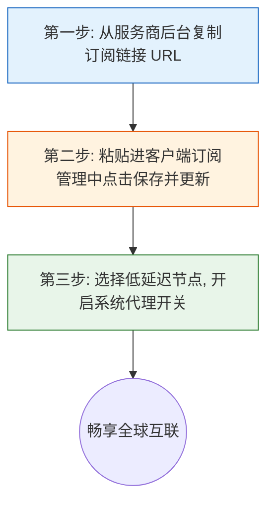

# 全平台主流客户端横向评测与保姆级选型配置全指南

初次接触出海网络的新手，最容易被五花八门的客户端名字搞得晕头转向：Clash Verge Rev、Mihomo Party、Clash Mi、小火箭 (Shadowrocket)、Nextin、v2rayNG、Clash Meta……究竟哪一款最适合自己的手机和电脑？它们之间有什么区别？

本文将用最通俗易懂的大白话，为你梳理 Windows、macOS、iOS、Android 以及 Linux 五大平台的客户端选型决策树，并提供下载渠道、订阅导入核心三步法以及网络故障自检指南。

---

## 一、五大平台主流客户端横向对比与推荐矩阵

为了帮助你 1 分钟锁定最适合自己的工具，我们整理了下表：

| 平台 | 首选推荐工具 | 备选推荐 | 核心特点与上手难度 | 适用人群画像 |
| :--- | :--- | :--- | :--- | :--- |
| **Windows 电脑** | **Clash Verge Rev** | **Mihomo Party** | 内置新版内核，支持 TUN 游戏模式与开机自启（难度：★☆☆） | 90% 电脑用户首选，日常办公与打游戏通吃 |
| **macOS 苹果电脑** | **Clash Verge Rev** (dmg) | **Mihomo Party** | 原生兼容 M1/M2/M3/M4 与 Intel 芯片，内存占用极低（难度：★☆☆） | Mac 办公开发、设计剪辑与跨国协作 |
| **iOS (iPhone/iPad)** | **Nextin（星拓）** | **小火箭 (Shadowrocket)** / **Clash Mi** | **Nextin 无需外区 ID**，输入服务商代码直接连；小火箭需海外 ID 但功能最全（难度：★☆☆） | 苹果全系手机平板用户，免换区救星 |
| **Android 安卓手机** | **Clash Meta for Android** | **v2rayNG** | 开源免费，支持分应用代理、自适应规则分流与电量优化（难度：★★☆） | 安卓主流品牌手机与国产深度定制系统 |
| **Linux 系统** | **Clash Verge Rev** (GUI) | **Mihomo 命令行核心** | 支持 AppImage 双击即用，命令行支持 systemd 后台常驻与环境变量注入（难度：★★★） | 程序员、Ubuntu/Debian 开发者、云端服务器运维 |

---

## 二、万卷不离其宗：所有客户端通用的「三步上手核心逻辑」

不管你用的是哪一家服务商的机场，也不管你使用的是上述哪一款客户端，配置的本质永远只有三步：

1. **第一步：拿到“车票”（订阅链接）**
   - 登录你的网络服务商用户中心，找到「一键导入」或者「复制 Clash 订阅链接」按钮，点击复制存入剪贴板。
2. **第二步：把“车票”存入“钱包”（客户端订阅管理）**
   - 打开客户端中的「订阅（Profiles / Subscriptions）」界面，把链接粘贴进去，起个名字，点击「保存 / 下载 / 导入」。客户端会自动把云端的几十个节点配置拉取到本地。
3. **第三步：刷票进站（选节点并打开总开关）**
   - 点击节点测速小图标，挑选一个绿色低延迟节点（如香港、台湾、新加坡、日本）；
   - 打开客户端主界面上的 **「系统代理（System Proxy）」** 开关，即可顺利出海！

---

## 三、三大代理运行模式怎么选？（大白话深度解密）

客户端主界面通常有三种模式可供勾选，小白用户切记按需选择：

### 1. 规则模式（Rule）—— 【日常默认推荐】
- **大白话比喻**：相当于带自动识别功能的“智能导航”。
- **工作机制**：当你打开百度、淘宝、微信、B站等国内网站时，直接走国内运营商宽带直连，速度最快且不扣节点流量；当你打开 Google、YouTube、GitHub、ChatGPT 时，自动悄悄切入海外专线。两者兼得，互不干扰！

### 2. 全局模式（Global）—— 【仅排查故障或特定场景使用】
- **大白话比喻**：相当于不管你去哪条街，一律必须坐跨国飞机。
- **工作机制**：整台设备的所有网络请求，哪怕访问百度也强行送去海外节点绕一圈。
- **缺点**：会导致国内网站访问变慢、网易云音乐提示“版权不在中国大陆无法播放”，还会白白浪费你的代理流量。

### 3. 直连模式（Direct）—— 【完全不走代理】
- **工作机制**：相当于完全关闭代理功能，所有网络直接裸连。

---

## 四、客户端连不上？新手排障黄金四步法

如果打开代理开关后依然打不开网页，请按以下顺序快速自检：

1. **检查本地系统时间是否同步（80% 的新手卡在这一步！）**
   - TLS 加密协议对时间极其敏感。如果你的电脑或手机时间比标准网络时间快了或慢了超过 60 秒，专线握手就会立刻被安全机制强行拒绝。
   - **解决办法**：进入 Windows / 手机系统设置，将「自动同步网络时间」开关关闭后再重新打开。
2. **检查本地端口是否被占用（7890 端口冲突）**
   - 如果系统代理开关一点就秒弹回关闭，说明本地有残留软件占用了 7890 端口。在设置中把混合端口改成 `7897` 或 `10808` 即可解决。
3. **检查节点是否全红或超时**
   - 如果点击测速全部节点显示“Timeout”或红色，检查你的套餐是否欠费到期，或者订阅链接是否已过期。在订阅页面点击「刷新订阅」拉取最新配置。
4. **清理残留代理设置**
   - 之前如果非正常关机或者强制退出了某个代理软件，Windows 系统的“Internet 选项 -> 代理设置”可能残留了无效代理地址。进入 Windows 设置 -> 网络与 Internet -> 代理，关闭手动代理设置即可。

---

## 五、常见新手问答 (FAQ)

### Q1：为什么苹果手机下载小火箭 (Shadowrocket) 要收费，还有别的免费方法吗？
**大白话解答**：小火箭是海外 App Store 的独立付费应用（约 2.99 美元）。如果你不想借或注册海外 Apple ID、也不想花美金，强烈推荐使用国区 App Store 就能直接免费下载的 **Nextin（星拓）**。在 Nextin 里输入你的机场服务商专属识别码（在服务商用户中心的 Nextin 导入页面直接复制获取），就能完全免去海外 ID 的繁琐流程，一键同步节点使用。

### Q2：电脑上开了 Clash，为什么微信能上网但网页打不开？
**大白话解答**：这是经典的「DNS 污染与系统代理劫持」问题。微信使用的是已经建立的底层 IP 通信，而浏览器打开网页需要向 DNS 服务器查询网址 IP。
解决办法：打开 Clash Verge Rev 的【设置】，将【DNS 设置】中的【内置 DNS（Built-in DNS）】打开，或者直接在设置中开启【TUN 模式】，让虚拟网卡全面接管 DNS 解析，网页即可秒开。

### Q3：安卓手机上用 Clash 会不会非常耗电？
**大白话解答**：现在的 Clash Meta 内核经过了深度优化，常驻后台的 CPU 占用率通常不足 1%，一整天的额外耗电量只有 2%~3%，几乎可以忽略不计。但国产手机系统（如小米澎湃 OS、华为鸿蒙、vivo OriginOS）通常有激进的后台杀进程机制。请务必在手机「电池管理」中将 Clash 设置为“允许后台自启动”和“无限制后台活动”，防止屏幕锁屏后断网。

### Q4：我换了一家新机场，需要把之前的客户端卸载重新装吗？
**大白话解答**：完全不需要！客户端就像一个播放机，各个机场的订阅链接就像不同的音乐光盘。你只需要打开现有客户端的「订阅管理」页面，把新机场的订阅链接添加进去，然后鼠标选中新订阅即可顺畅切换，原先安装的所有驱动和服务完全不需要变动。

## 📌 推荐延伸阅读与技术指南
- **Windows端教程**：[Windows 电脑端科学上网完全指南](/article/windows-client/)
- **Android端教程**：[安卓手机端科学上网完全指南：Clash Meta 极速上手](/article/android-client/)
- **iOS小火箭教程**：[小火箭 (Shadowrocket) 苹果 iOS 完整新手教程](/article/shadowrocket/)
- **iOS免翻客户端**：[iOS Nextin（星拓）专属客户端上手指南](/article/nextin/)
- **现代客户端实战**：[Mihomo Party 现代化客户端实战配置指南](/article/mihomo-party/)
- **常见排障手册**：[Clash 常见报错与排障大全：TUN故障与端口解决](/article/clash-faq/)
