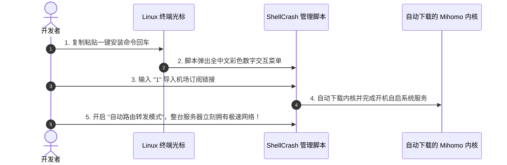

# Linux 系统科学上网完全指南：终端命令行与图形桌面客户端大白话上手

对于很多程序员、科研学者、高校师生以及使用 Ubuntu、Debian、Arch Linux 或 CentOS 的服务器运维人员来说，在 Linux 环境下科学上网经常是一场“噩梦”：
- “在 Windows 上能正常看网页，一进 Linux 终端敲 `git clone` 就无尽转圈，最后报错 `Connection timed out`；”
- “用 `curl`、`wget` 下载开源模型或依赖包时，速度只有几十字节，甚至直接被拒绝连接；”
- “Linux 没有 Windows 那样显眼的开关按钮，到底该怎么给命令行和整机配置代理？”

很多小白在网上一搜教程，满屏都是生硬的底层网络命令（iptables、nftables、tproxy、systemd……），越看越崩溃。

其实，**在 Linux 下配置代理非常简单！** 无论你是有显示器图形界面的桌面版（Ubuntu Desktop / Deepin），还是只有一行小黑框光标的纯命令行服务器（VPS / 虚拟机 / WSL），都有极其傻瓜化的成熟方案。

本文将用完全通俗的大白话，分别教你搞定**纯终端神器 ShellCrash** 与 **桌面图形客户端 Clash Verge**，彻底告别开发卡顿！

---

## 一、方案二选一：你的 Linux 属于哪种环境？

在开始前，先看你的 Linux 属于哪种形态：

```mermaid
flowchart TD
    Linux[你的 Linux 系统属于哪种使用场景?] --> Choice{是否有鼠标桌面?}
    Choice -->|有鼠标有桌面 (Ubuntu Desktop / Mint)| GUI[方案一: 桌面图形版 Clash Verge Rev]
    Choice -->|纯黑框终端 / 远程 VPS / WSL 2 / 无桌面服务器| CLI[方案二: 终端一键脚本神器 ShellCrash]
```

- **方案一：桌面用户（有鼠标有显示器）**
  直接使用 **Clash Verge Rev for Linux**！操作体验与 Windows / Mac 完全一模一样，双击打开软件，粘贴订阅链接，点亮开关就能用。
- **方案二：纯命令行环境（终端服务器 / WSL 2 / 树莓派软路由）**
  强烈推荐开源界封神的 **ShellCrash（原名 ShellClash）**！只需一行命令就能在终端里弹出一个全中文彩色菜单，键盘按 `1`、`2`、`3` 就能搞定全部配置！

---

## 二、方案一：图形桌面端（Ubuntu Desktop 等）3 分钟上手

如果你用的是带有桌面的 Linux 系统，体验最舒服的是下载 **Clash Verge Rev** 的 `.deb` 安装包或通用的 `.AppImage` 免安装单文件。

### 第一步：下载并安装
打开终端，使用 `wget` 下载官方最新版（以 Ubuntu/Debian 为例）：
```bash
# 下载官方 deb 安装包
wget https://github.com/clash-verge-rev/clash-verge-rev/releases/latest/download/clash-verge_x.x.x_amd64.deb

# 使用系统包管理器一键安装
sudo dpkg -i clash-verge_x.x.x_amd64.deb
sudo apt-get install -f -y # 自动修复补齐依赖项
```

### 第二步：导入订阅与启动
1. 在应用程序菜单中找到 **Clash Verge** 图标点击启动；
2. 进入软件左侧的 **「订阅（Profiles）」**，把你的机场 Clash 订阅链接粘贴进去并保存；
3. 单击该订阅卡片使其激活；
4. 进入 **「设置（Settings）」**，打开 **「系统代理（System Proxy）」** 开关；
5. 打开系统自带的火狐浏览器（Firefox）或 Chrome，瞬间实现秒速出海！

---

## 三、方案二：纯终端服务器神器 ShellCrash（无桌面的终极救星）

如果你面对的是只有黑底白字命令行的远程服务器、Docker 宿主机或 WSL 2，那么 **ShellCrash** 就是专门为你量身打造的救世主。



### 第一步：一行代码一键安装
在 Linux 终端中，粘贴以下官方一键安装命令并回车：

```bash
# 运行官方 ShellCrash 一键安装脚本
export url='https://fastly.jsdelivr.net/gh/juewuy/ShellCrash@master' && bash -c "$(curl -kfsSl $url/install.sh)" && source /etc/profile &> /dev/null
```
执行后，屏幕会弹出一个非常友好的全中文菜单，按数字键 `1` 确认安装在默认目录即可。

### 第二步：导入你的节点订阅链接
在终端中输入命令进入管理面板：
```bash
crash
```
屏幕上会出现类似如下的彩色菜单：
```text
-----------------------------------------------
欢迎使用 ShellCrash 管理脚本！
1) 配置订阅/更新节点
2) 启动/重启服务
3) 停止服务
4) 节点选择/测速管理
5) 路由模式与高级设置
0) 退出脚本
-----------------------------------------------
请选择操作 [0-9]:
```
1. 键盘输入数字 **`1`**（配置订阅）回车；
2. 接着选择“导入在线订阅”，长按鼠标右键把你的 **Clash 订阅链接** 粘贴进去回车；
3. 脚本会自动为你下载好完整的节点列表并生成配置文件。

### 第三步：启动服务并开启全局代理
回到主菜单：
1. 键盘输入数字 **`2`**（启动服务）回车；
2. 此时代理内核已经在后台默默守护运行！
3. 如果你想让终端里的所有命令（如 `curl`、`git clone`）立刻走代理，直接在终端里输入：
```bash
# 一键让当前终端命令接入代理
export http_proxy="http://127.0.0.1:7890"
export https_proxy="http://127.0.0.1:7890"
```
此时运行测试命令：
```bash
curl -I https://www.google.com
```
如果终端打印出 `HTTP/2 200`，恭喜你，你的 Linux 终端已经彻底打通国际网络通道！

---

## 四、终端常用出海环境变量快捷配置（永久生效秘籍）

很多开发者觉得每次打开新终端都要手动打 `export http_proxy=...` 太麻烦了。教你一个终身受益的快捷别名小秘籍：

编辑你当前用户的终端配置文件（以 bash 为例）：
```bash
nano ~/.bashrc
```
滑到文件最底部，粘贴以下四行快捷指令：
```bash
# 定义一键开启代理快捷别名
alias setproxy="export http_proxy=http://127.0.0.1:7890; export https_proxy=http://127.0.0.1:7890; echo '🚀 终端代理已开启！'"

# 定义一键关闭代理快捷别名
alias unsetproxy="unset http_proxy; unset https_proxy; echo '🛑 终端代理已关闭！'"
```
保存退出后，执行 `source ~/.bashrc` 刷新环境。
- **以后每次需要让终端加速时**：随手敲一下 **`setproxy`** 回车，终端代理立刻秒开！
- **不需要代理时**：随手敲一下 **`unsetproxy`** 回车，网络立刻恢复纯原装直连！

---

## 五、常见高频问答 (FAQ)

### Q1：为什么在 Linux 终端里给 `sudo apt update` 或者 `git` 配置代理没有生效？
**答**：这是很多初学者都会踩的权限盲区：
- **对于 `sudo apt update`**：当你使用 `sudo` 临时提权为 root 用户时，系统出于安全考虑会默认抹掉普通用户的环境变量。解决办法是在运行命令时加上 `-E` 参数保留环境变量，例如：`sudo -E apt update`；
- **对于 Git 专用代理**：Git 有自己的独立代理配置通道，可以直接运行以下两行命令为 Git 永久绑定本地代理：
  ```bash
  git config --global http.proxy http://127.0.0.1:7890
  git config --global https.proxy http://127.0.0.1:7890
  ```

### Q2：我在 WSL 2（Windows 的子系统 Linux）中怎么让 Linux 共享外面的 Windows 代理？
**答**：WSL 2 在架构上相当于一台独立的虚拟机。如果你的 Windows 宿主机上已经开着 Clash Verge Rev，最简单的方法是：
1. 在 Windows 的 Clash Verge 设置中勾选 **「允许局域网连接（Allow LAN）」**；
2. 在 WSL 2 终端中，查看 Windows 宿主机的内网 IP：
   ```bash
   cat /etc/resolv.conf | grep nameserver | awk '{print $2}'
   ```
3. 将打印出来的 IP 设为代理地址，例如：`export http_proxy="http://172.x.x.x:7890"` 即可秒连 Windows 代理！

### Q3：Docker 容器构建（docker build）时拉取海外镜像超时怎么破？
**答**：Docker 守护进程是一个独立的系统后台服务，普通终端的环境变量对它无效。可以在 `/etc/docker/daemon.json` 中配置国内可用的镜像加速源，或者创建目录 `/etc/systemd/system/docker.service.d/http-proxy.conf`，在里面写入：
```text
[Service]
Environment="HTTP_PROXY=http://127.0.0.1:7890"
Environment="HTTPS_PROXY=http://127.0.0.1:7890"
```
重启 Docker 服务（`systemctl restart docker`）后，Docker 就能直接畅通拉取海外镜像了。

### Q4：ShellCrash 可以设置为随 Linux 开机自动启动吗？
**答**：完全可以！在终端中输入 `crash` 进入管理主菜单，选择“高级设置”，里面有专门的【开机自启】选项，按数字键开启后，系统会自动注册一个 `systemd` 守护服务，无论服务器重启多少次，只要一开机后台就会自动运行并接管网络。

## 📌 推荐延伸阅读与技术指南
- **全平台总览**：[主流客户端配置指南：下载安装与订阅导入](/article/client-guide/)
- **图形客户端**：[Mihomo Party 现代化客户端实战与配置](/article/mihomo-party/)
- **线路深度剖析**：[出海线路深度测评：BGP 中转与 IPLC/IEPL 专线全解析](/article/network-analysis/)
- **节点自建系列**：[网络通信的基本过程与节点搭建起步](/article/node1/)
- **笔记专栏归档**：[Linux 系统科学上网完全指南（知识库专栏版）](/notes/clash/linux/)
