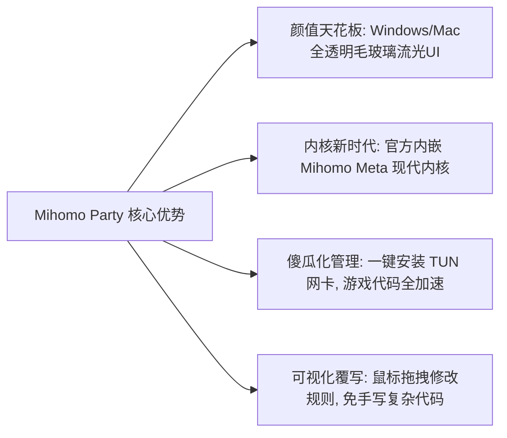

# Mihomo Party 现代化客户端实战：高颜值UI与小白上手教程

在很多人的印象里，代理软件的界面通常都很“程序员风格”：要么密密麻麻全是生涩的代码参数，要么灰头土脸像二十年前的旧软件。

如果你追求极致的现代视觉审美、喜欢 Windows 11 的半透明磨砂亚克力玻璃质感或 macOS 的优雅动画，那么 **Mihomo Party（俗称“派对版客户端”）** 绝对是目前全网颜值最高、体验最丝滑的神仙级客户端！

它深度集成了新一代 **Mihomo（Clash.Meta）** 强劲内核，不仅颜值爆表，更对纯小白用户极其友好，把复杂的路由分流、网卡驱动安装、节点测速做成了一个个漂亮的彩色卡片。

本文将用完全通俗的大白话，教你从下载安装、订阅导入到开启 TUN 模式畅玩游戏与 4K 视频！

---

## 一、为什么越来越多人选择 Mihomo Party？

相比老旧的初代 Clash，Mihomo Party 有着三大颠覆性的用户体验升级：

1. **科技美学天花板**：完美支持系统深色模式（Dark Mode）与流光动效。节点按延迟从低到高排列，连线速度一目了然；
2. **免敲命令的 TUN 模式**：以前装虚拟网卡驱动动不动报错“管理员权限不足”，在 Mihomo Party 里只要点击一次开关，系统自动完成驱动安装和 DNS 防泄漏设置；
3. **强大的协议兼容性**：完美支持最新的 VLESS Reality、Hysteria 2、TUIC、Trojan 以及传统 Shadowsocks，再奇葩的高端节点都能秒开。

---

## 二、从零到一：三分钟极速上手教程

### 第一步：下载与安装软件
前往官方开源发布页下载对应系统平台的安装包：
- **Windows 用户**：下载 `.exe` 安装程序（推荐选择 `x64-setup.exe`），双击一路点击“下一步”安装即可；
- **Mac 苹果用户**：Intel 芯片选择 `x64.dmg`，M1/M2/M3/M4 芯片选择 `arm64.dmg`，下载后将图标拖入“应用程序”文件夹。

### 第二步：导入你的节点订阅链接
1. 打开 Mihomo Party 软件，点击左侧菜单栏的 **「订阅」** 图标（类似纸飞机的按钮）；
2. 点击右上角的 **「+ 添加订阅」** 按钮；
3. 将你的服务商或机场提供的 **Clash / Mihomo 订阅链接** 完整粘贴到输入框中；
4. 点击“保存”按钮，软件会自动从云端拉取所有节点列表。下载完成后，**点击该订阅卡片，让它亮起彩色高光**，表示当前已成功激活该配置！

### 第三步：测速并选择心仪节点
1. 点击左侧的 **「代理」** 标签页，这里会以漂亮的卡片形式列出所有策略组（如“节点选择”、“自动优选”、“国外媒体”等）；
2. 点击右上角的 **「闪电图标（批量测速）」**，软件会在两三秒内测出所有节点的真实延迟：
   - **绿色数字（如 20ms ~ 60ms）**：极速优质节点，适合打游戏、刷短视频；
   - **黄色数字（如 80ms ~ 150ms）**：正常节点，看 4K 高清毫无压力；
   - **红色数字或超时**：说明当前节点网络波动或不可用。
3. 点击选中一个延迟低的香港或日本节点即可。

### 第四步：开启代理开关
在主界面顶部，直接打开 **「系统代理（System Proxy）」** 开关。打开浏览器访问 Google 或 YouTube，即刻畅游全球网络！

---

## 三、网络模式怎么选？（系统代理 vs TUN 模式大白话）

软件右上角提供了两个最核心的开关，很多小白不知道它们到底有什么区别：

| 模式名称 | 作用范围 | 适用人群与场景 | 对电脑的性能消耗 |
| :--- | :--- | :--- | :--- |
| **系统代理 (System Proxy)** | 仅代理浏览器和支持系统代理的普通软件 | 日常轻度刷网页、看 YouTube、查资料 | 极低（几乎不占 CPU） |
| **TUN 增强模式 (虚拟网卡)** | **接管整台电脑 100% 的所有网络流量** | 外服网络游戏联机、Git/代码开发、命令行终端、桌面应用 | 略微占用少许 CPU，但体验最完美 |

> **小白使用指南**：
> - 平时办公、看剧，只开 **「系统代理」** 就足够用了；
> - 如果你在玩 Steam 外服游戏、Epic 游戏商店下载更新慢、或者在终端里运行 `git clone`、`pip install` 提示网络超时，直接无脑点亮 **「TUN 模式」**，电脑里的所有程序就会像连上海外专用路由器一样彻底打通！

---

## 四、常见高频问答 (FAQ)

### Q1：为什么开启了系统代理，但打游戏或者微信电脑版提示网络异常？
**答**：因为很多网络游戏和国内通讯软件走的是底层的 UDP 协议，根本不遵守 Windows 的“系统代理”设置。解决办法极其简单：**在 Mihomo Party 里把“TUN 模式”开关打开**！TUN 模式会在你的电脑内部虚拟一张真实的网卡，把所有游戏的数据包强行接管并安全分流，瞬间搞定游戏加速。

### Q2：为什么我的订阅更新总是报错“Network Error”或更新失败？
**答**：通常有三种原因：
1. **机场订阅链接本身失效或被墙**：可以先关闭代理，在浏览器中直接打开这个订阅链接。如果浏览器提示打不开，说明订阅域名可能被阻断，联系服务商获取最新防封订阅地址；
2. **本地防火墙阻拦**：Windows Defender 误将程序拦截，在弹出的“Windows 安全中心提示”中选择“允许在专用和公用网络上通信”；
3. **时间不准确**：电脑右下角的系统时间误差超过 1 分钟，同步一下 Windows 官方时间服务器即可。

### Q3：用完电脑准备关机前，需要关掉软件吗？
**答**：**强烈建议在退出软件前，先在主界面把“系统代理”开关关闭，或者在软件设置中勾选“退出时自动清理系统代理”！**
如果直接拔电源关机或强行杀掉进程，Windows 系统的注册表代理设置可能会残留在系统里，导致下次开机不启动代理软件时，电脑连国内普通网页（如百度）都打不开！如果遇到这种情况，重新打开软件再正常退出即可恢复。

### Q4：Mihomo Party 和 Clash Verge Rev 有什么区别？我应该用哪一个？
**答**：两者的底层核心都是强大的 Mihomo (Clash.Meta) 内核，核心性能和分流能力完全并驾齐驱！
- 如果你喜欢 **超高颜值、极光半透明流光视觉卡片、现代深色模式**，首选 **Mihomo Party**；
- 如果你喜欢 **经典简约风格、老牌稳定、社区脚本插件丰富**，首选 **Clash Verge Rev**。两者都是顶级一流工具，选自己看着顺眼的即可。

## 📌 推荐延伸阅读与技术指南
- **同代主流替代**：[Clash Verge Rev 核心配置与订阅导入指南](/article/clash-verge/)
- **规则策略精进**：[Clash 规则分流与进阶策略组配置详解](/article/clash-rules-guide/)
- **内核生态演进**：[Clash 核心概念与内核生态演进：从 Clash 到 Mihomo](/article/clash-intro/)
- **Linux端实战**：[Linux 系统科学上网完全指南](/article/linux-client/)
- **笔记专栏归档**：[Mihomo Party 现代化客户端实战（知识库专栏版）](/notes/clash/mihomo/)
