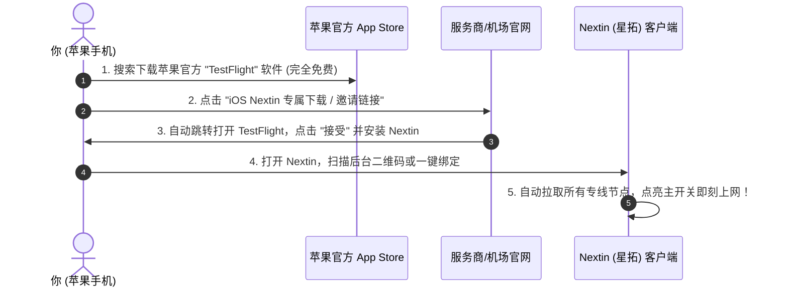

# iOS Nextin（星拓）专属客户端上手指南：免海外ID的一键极速出海利器

对于使用 iPhone 和 iPad 的苹果手机用户来说，想要科学出海，传统方案通常只有一条路：**自己去折腾或者花钱购买一个美区 Apple ID，再去海外商店花 $2.99 美元购买小火箭（Shadowrocket）**。

很多纯小白用户一看到“切换美区账号”、“双重认证”、“美元礼品卡充值”，直接被繁琐的流程劝退了。

正因如此，近年来主流网络服务商纷纷联合推出了专为苹果用户量身定制的专属客户端——**Nextin（中文名：星拓）**！

**为什么 Nextin 会迅速风靡各大机场圈？**
- **完全不需要海外 Apple ID**：直接使用国内普通 Apple 账号，通过苹果官方 TestFlight 就能免费下载安装；
- **真正的“零门槛傻瓜化”**：不用复制冗长的订阅链接，也不用手写任何规则。在服务商后台扫个码，几十条优质专线节点一秒自动同步；
- **智能分流更懂国内用户**：内置国内白名单直连，国内微信、淘宝秒开不耗流量，海外 4K 视频丝滑起飞！

本文将用彻底通俗的大白话，手把手教你如何在几分钟内安装并用好这款苹果端的“省心神器”！

---

## 一、Nextin（星拓）与传统小火箭（Shadowrocket）大比拼

很多新手不知道这两款软件到底有什么区别，看下面这张对比表就全明白了：

```mermaid
flowchart TD
    Choice[苹果手机用户该怎么选?] --> A{你的核心需求}
    A -->|不想折腾美区账号 / 想要一键扫码全自动同步 / 极简操作| Nextin[Nextin 星拓客户端 (推荐新手首选)]
    A -->|拥有美区账号 / 喜欢深度折腾复杂重写脚本 / 混合多家机场| SR[Shadowrocket 小火箭 (老牌极客工具)]
```

| 对比维度 | Nextin（星拓专属客户端） | Shadowrocket（小火箭） |
| :--- | :--- | :--- |
| **下载门槛** | **极低（国内苹果账号直接装，免美区 ID）** | 较高（必须持有海外 Apple ID 才能下载） |
| **软件费用** | **完全免费**（服务商直接提供内测名额） | 需要付费 $2.99 美元（约 22 元人民币） |
| **节点导入** | **一键扫码 / 一键登录全自动同步** | 需手动复制订阅 URL 粘贴拉取 |
| **规则设置** | **出厂已调校最优（国内直连/海外代理）** | 需手动选择配置规则或在线规则集 |
| **适合人群** | **绝大多数普通小白、追剧族、嫌折腾的办公族** | 喜欢折腾脚本、抓包、玩复杂规则的进阶玩家 |

---

## 二、从零到一：四步极速安装与上手（保姆级教学）

安装 Nextin（星拓）非常简单，整个过程只需要四步：



### 第一步：在苹果应用商店下载 TestFlight
1. 打开 iPhone 自带的 **【App Store（应用商店）】**；
2. 在搜索框输入 **`TestFlight`**（这是苹果官方专用的软件测试分发平台，正规安全，免费下载）；
3. 点击“获取”下载并安装到手机桌面上。

### 第二步：获取 Nextin（星拓）测试资格并安装
1. 使用手机自带的 Safari 浏览器，登录你订购的网络服务商用户中心后台；
2. 找到 **「客户端下载」** 或 **「iOS 专属客户端」** 区域，点击 **「Nextin（星拓）下载链接」**（或者用手机扫描电脑屏幕上的 TestFlight 邀请二维码）；
3. 手机会自动跳转到刚才安装的 TestFlight 软件中，屏幕上会显示 Nextin（星拓）的应用图标；
4. 点击 **「接受（Accept）」**，然后点击 **「安装（Install）」**；
5. 几秒钟后，Nextin（星拓）就成功安装在你的手机桌面上了！

### 第三步：一键导入你的专线节点
1. 打开桌面的 **Nextin** 软件；
2. 首次进入软件时，点击页面上的 **「扫码绑定」** 或 **「一键同步」**：
   - **方式一（扫码）**：点击软件内置的扫码功能，对准服务商后台的专属客户端二维码一扫，所有香港、日本、美国专线节点瞬间加载完毕；
   - **方式二（粘贴授权码/订阅）**：复制后台提供的一键绑定 Token 授权码，打开 Nextin 会自动识别粘贴，自动拉取节点。

### 第四步：点亮总开关，开启无界浏览
1. 进入节点列表，点击右上角的 **「测速」** 按钮，列表会清晰显示出各个节点的延迟数字；
2. 选中一个绿色的低延迟节点（如香港 IPLC 专线）；
3. 回到主页，轻触屏幕正中间大大的 **「圆圈连接按钮」**；
4. **首次系统授权**：iOS 系统会弹出安全弹窗：*“Nextin 想要添加 VPN 配置”*，点击 **【允许】**，接着验证一下 Face ID 面容或者输入手机锁屏密码；
5. 屏幕上方状态栏出现 **`[VPN]`** 标志，连接成功！现在去打开 YouTube、Twitter 或 Google，尽情享受极速流畅的出海体验吧！

---

## 三、Nextin 核心日常设置与避坑技巧

为了让你在日常使用中更加省心，建议随手检查以下两项设置：

### 1. 路由模式：务必保持“智能分流”
在 Nextin 的设置或主界面下方，通常有三种模式可选：
- **智能分流（推荐长期使用）**：
  国内的微信、高德地图、淘宝、美团走你手机的原生流量直连，不仅省流量，而且绝对不会影响手机定位；国外的 Google、YouTube、Netflix 自动走海外专线加速。
- **全局代理**：整台手机的所有流量强行出国，平时切勿开启。
- **全局直连**：不走任何代理。

### 2. 节点自动更新设置
在设置中将“自动同步节点列表”开关开启。这样每当你连接网络时，软件会在后台默默帮你同步服务商最新增加的高速节点，随时随地保持最优网络体验。

---

## 四、常见高频问答 (FAQ)

### Q1：为什么点击下载链接时，TestFlight 提示“此 Beta 版测试员已满”怎么办？
**答**：苹果官方对单个 TestFlight 软件的内测名额有上限规定（通常是 1 万人）。由于服务商用户量庞大，有时旧群组的名额会被抢满。
遇到这种情况**千万不要慌**：
主流服务商通常会全天候监控名额，并定期补充全新的测试群组。返回你的服务商后台刷新页面，点击最新的“备用邀请通道 2”或者联系官网在线客服，客服会立即发给你最新的可用安装通道。

### Q2：扫码绑定后，为什么节点列表一片空白没有显示任何节点？
**答**：请按以下三点排查：
1. **检查套餐状态**：登录服务商后台，确认你的套餐没有过期、可用流量没有用光；
2. **首次网络权限被拦截**：部分国行 iPhone 首次打开 App 时，会弹出“是否允许使用无线局域网与蜂窝网络”，如果不小心点了“不允许”，软件就无法联网拉取数据。进入手机【设置 -> Nextin】，将“无线局域网与蜂窝数据”权限打开；
3. **手动刷新**：在 Nextin 节点列表页面用手指从上往下拉一下屏幕（下拉刷新），重新向服务器请求一次即可。

### Q3：用完之后怎么断开连接？会一直消耗手机电量吗？
**答**：不想使用时，只需打开 Nextin，再次轻触主页的大圆圈连接按钮，状态变为“未连接”，VPN 标识消失即可。Nextin 采用了专门针对 iOS 系统优化的低能耗休眠机制，在平时待机或没有网络活动时，CPU 占用率接近于零，全天挂在后台也不会明显影响手机续航。

### Q4：使用 Nextin（星拓）能看 Netflix 奈飞、Disney+ 以及使用 ChatGPT 吗？
**答**：完全支持！能否解锁流媒体和 AI 工具，核心取决于服务商提供的节点线路属性。像优质专线服务商提供的 Nextin 节点，出站均配备了原生 IP 与原生双 ISP 住宅出口，在 Nextin 中选中标有“流媒体解锁”或“美国/新加坡专线”的节点，打开 Netflix 和 ChatGPT 即可直接使用，免除任何报错烦恼。

## 📌 推荐延伸阅读与技术指南
- **出海线路深度测评**：[BGP 中转与 IPLC/IEPL 专线全解析](/article/network-analysis/)
- **经典苹果方案**：[小火箭 (Shadowrocket) 苹果 iOS 完整新手教程](/article/shadowrocket/)
- **全平台总览**：[主流客户端配置完全指南（Windows/macOS/Android/iOS）](/article/client-guide/)
- **电脑端推荐**：[Clash Verge Rev 核心配置与订阅导入指南](/article/clash-verge/)
- **笔记专栏归档**：[iOS Nextin 客户端上手指南（知识库专栏版）](/notes/clash/nextin/)
