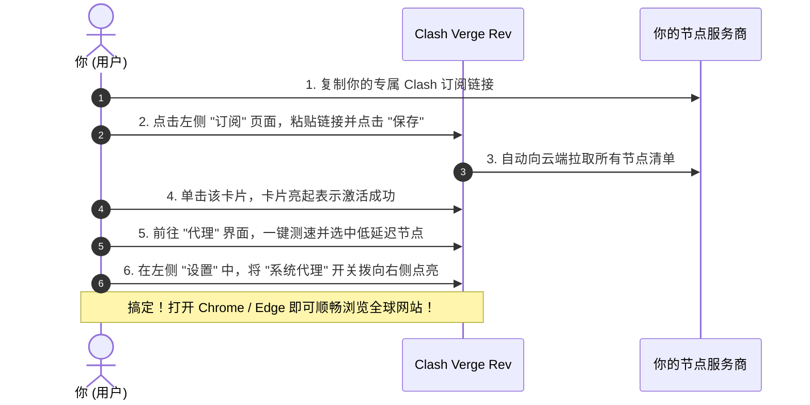

# Windows 电脑端科学上网完全指南：主流客户端选型与极简上手

对于使用 Windows 操作系统（Windows 10 / Windows 11）的广大办公族、学生、游戏玩家和跨国开发者来说，在电脑上配置一套稳定顺畅的网络代理工具是每天工作学习的刚需。

然而，网络上的客户端软件琳琅满目：**Clash for Windows、Clash Verge Rev、v2rayN、Mihomo Party、Sing-box……**
很多小白刚开始接触时，往往会被这些名字搞得晕头转向：
- “为什么大家都在说 Clash for Windows 停更了，我到底该用哪个？”
- “Clash Verge Rev 和 v2rayN 有什么区别，哪个更适合我？”
- “为什么代理软件开了，但游戏和命令行终端还是连不上外网？”

本文将用完全通俗的大白话，不堆砌晦涩代码，手把手带你理清 Windows 客户端的选择脉络，并以目前口碑最好、使用最广泛的客户端为例，带你 3 分钟完成从安装到顺畅上网的全过程！

---

## 一、Windows 客户端三大门派选型天梯榜（大白话怎么挑）

在 2026 年的今天，千万不要再去百度下载早就停更的旧版 Clash for Windows（CFW）了！目前 Windows 平台最主流的优秀客户端主要有以下三位实力选手：

```mermaid
flowchart TD
    Choice[你的 Windows 电脑该选哪款客户端?] --> A{你的核心偏好}
    A -->|首选推荐: 现代美观、稳定全能、规则分流强大| Verge[Clash Verge Rev (全网综合第一主力)]
    A -->|纯极客/经典传统/支持超多古老协议| V2rayN[v2rayN (传统硬核多核心工具)]
    A -->|追求 Windows 11 极致透明毛玻璃流光美学| Party[Mihomo Party (颜值天花板派对版)]
```

| 客户端名称 | 适合人群 | 核心优势 | 小白推荐指数 |
| :--- | :--- | :--- | :--- |
| **Clash Verge Rev（强烈推荐首选）** | 90% 的普通小白与主流用户 | 界面现代化、内置中文、内核更新快、支持 TUN 模式、一键拖拽排序 | ⭐⭐⭐⭐⭐ (五星力荐) |
| **v2rayN** | 喜欢传统 Windows 界面、喜欢同时玩很多杂乱单节点的老玩家 | 支持协议极多（V2Ray/Xray/Sing-box全内核）、绿色免安装、轻巧 | ⭐⭐⭐⭐ (四星好评) |
| **Mihomo Party** | 重度颜值控、喜欢 Win11 毛玻璃半透明特效 | 视觉极美、卡片化布局、一键装驱动免命令行 | ⭐⭐⭐⭐⭐ (五星力荐) |

> **小白无脑结论**：
> 如果你不想纠结，**直接无脑选择安装【Clash Verge Rev】！**它是目前全网社区公认的最成熟、最稳定、维护最活跃的接班王者！

---

## 二、Clash Verge Rev 三分钟极速保姆上手

### 第一步：去哪里下载并安装软件
推荐通过以下两种方式下载安装包（完全免费）：
1. **方式一（免翻墙高速下载，最推荐新手）**：登录你购买的服务商（机场）官网后台，点击左侧【客户端下载】->【Windows 版】，点击一键下载，通常为国内 CDN 直连极速下载；
2. **方式二（官方原版下载）**：访问 Clash Verge Rev 官方 GitHub Releases 仓库：[https://github.com/clash-verge-rev/clash-verge-rev/releases](https://github.com/clash-verge-rev/clash-verge-rev/releases)（国内可使用镜像 [https://ghfast.top/https://github.com/clash-verge-rev/clash-verge-rev/releases](https://ghfast.top/https://github.com/clash-verge-rev/clash-verge-rev/releases) 打开）；

下载好名为 **`Clash.Verge_x.x.x_x64-setup.exe`** 的安装包后，双击运行，一路点击“下一步”完成安装并启动。
*提示：首次启动如果界面显示为英文，点击左侧底部的【Settings】->【Language】，选择【简体中文】即可秒变全中文界面。*

### 第二步：导入你的节点订阅链接
1. 登录你购买的服务商或机场后台，点击 **「复制 Clash 订阅链接」**；
2. 打开 Clash Verge Rev 软件，点击左侧菜单栏的 **「订阅（Profiles）」**；
3. 将你复制的订阅链接完整粘贴到上方的输入框中；
4. 点击右侧的 **「保存（Save）」** 按钮，软件会自动从云端拉取完整的节点列表；
5. 下载完成后，列表中会出现该订阅卡片，**鼠标左键单击该卡片，卡片周围亮起彩色高光，代表该配置已正式激活生效**！



### 第三步：测速并选择最佳节点
1. 点击左侧菜单栏的 **「代理（Proxies）」**；
2. 页面中会整齐展示不同的策略组（例如：`节点选择`、`自动选择`、`国外媒体`等）；
3. 找到右上角的小闪电图标，点击进行 **一键批量测速**；
4. 节点列表会刷新出每个节点的延迟毫秒数，点击选中一个绿色的低延迟节点（如香港专线或日本节点）即可。

### 第四步：点亮总开关
回到软件左侧菜单栏的 **「设置（Settings）」**：
找到最上方的 **「系统代理（System Proxy）」** 开关，将它向右拨动打到“开”。
恭喜你！现在打开电脑上的浏览器，访问 Google、YouTube 或维基百科，你已经成功畅游无界网络了！

---

## 三、Windows 专属进阶神技：TUN 模式（打游戏与终端代码全加速）

很多初学者经常遇到一个让人抓狂的问题：
“为什么我打开浏览器看 YouTube 飞快，但在 Windows 自带的命令提示符（CMD/PowerShell）里下代码 `git clone` 还是超时报错？为什么打外服游戏依然连不上？”

**大白话原因**：因为 Windows 的“系统代理”只对浏览器等标准 HTTP 软件生效，命令行终端、网络游戏和各种底层开发工具是**根本不认系统代理的**！

### 解决绝招：开启 TUN 模式（虚拟网卡）
TUN 模式相当于在你的 Windows 电脑内部虚拟出了一块真实物理网卡，**强行接管电脑里 100% 的所有进出流量**，哪怕是顽固的游戏客户端和命令行，也会被强行送入代理管道！

1. 在 Clash Verge Rev 左侧进入 **「设置」**；
2. 找到 **「服务模式（Service Mode）」**，点击右侧的“安装（Install）”，系统会弹窗提示请求管理员权限，点击“是”，直到状态变为绿色齿轮；
3. 开启上方的 **「Tun 模式（Tun Mode）」** 开关；
4. 此时你的电脑右下角网络图标会显示已连入虚拟网卡，终端里的 `git clone`、`pip install`、Steam 下载和外服游戏联机瞬间原地起飞！

---

## 四、常见高频问答 (FAQ)

### Q1：为什么昨天电脑上网好好的，今天一开机连百度和国内微信都打不开了？
**答**：这是 Windows 用户最常碰到的“代理残留排障经典问题”！
100% 是因为你上次关电脑时，**没有正常退出代理软件就直接拔电源关机或强行杀进程**，导致 Windows 系统注册表里的“本地代理设置”依然卡在开启状态，而代理软件本身没有启动。
- **一秒恢复绝招**：重新打开 Clash Verge Rev，把左侧设置里的“系统代理”开关打开一次，再正常点击关闭；或者进入 Windows 系统【设置 -> 网络和 Internet -> 代理】，把“使用代理服务器”手动拨到“关”即可立刻恢复正常！

### Q2：下载客户端时，Windows Defender 提示“有病毒/阻止运行”怎么办？
**答**：完全不用担心，这是正常的安全误报！因为代理软件的本质是接管并转发系统网络流量，Windows Defender 等杀毒软件默认会对所有没有向微软交昂贵认证保护费的开源网络代理软件提示“可疑网络劫持程序（RiskWare）”。在弹出的 Windows SmartScreen 提示窗口中，点击【更多信息】->【仍要运行】即可安全安装。

### Q3：为什么测速明明显示有绿色数字，但浏览器依然提示“无法访问此网站”？
**答**：请按以下三步排查：
1. **检查节点策略组选择**：进入“代理”页面，确保“节点选择（PROXY）”组里没有被误选在“REJECT（拒绝拦截）”或者已失效的红色节点上；
2. **检查电脑系统时间**：Windows 右下角时间只要跟北京时间相差超过 1 分钟，所有的 TLS 加密握手都会被强制断开。进入 Windows 设置里的“日期和时间”，点击【立即同步】即可；
3. **关闭其他杀毒软件的“网络流量保护”**：部分国内安全卫士的流量拦截防护会阻断本地 7890 代理端口。

### Q4：Clash Verge Rev 支持开机自动启动并在后台托盘静默运行吗？
**答**：完全支持！在左侧【设置】中：
- 勾选 **「开机自启（Auto Launch）」**；
- 勾选 **「静默启动（Silent Start）」**；
这样每次开机，软件就会直接在右下角任务栏小托盘里静静待命，为你提供全天候不间断的网络守护。

## 📌 推荐延伸阅读与技术指南
- **全平台总览**：[主流客户端配置指南：下载安装与订阅导入](/article/client-guide/)
- **新一代Windows端**：[Clash Verge Rev 核心配置与订阅导入指南](/article/clash-verge/)
- **高颜值跨平台**：[Mihomo Party 现代化客户端实战与配置](/article/mihomo-party/)
- **安卓手机协同**：[安卓手机端科学上网完全指南](/article/android-client/)
- **故障排查大全**：[Clash 常见报错与排障大全](/article/clash-faq/)
- **笔记专栏归档**：[Windows 电脑端科学上网指南（知识库专栏版）](/notes/clash/windows/)
