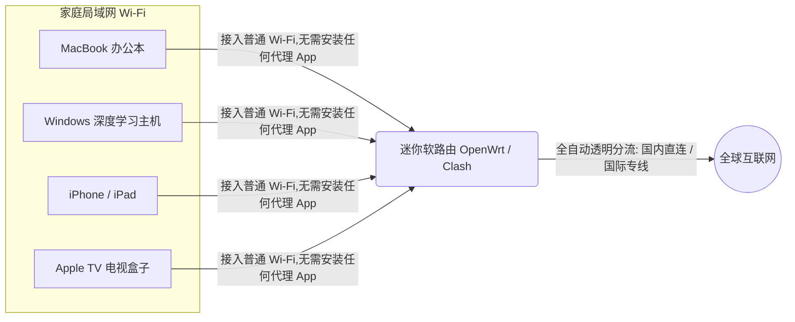

# 跨境远程办公与数字游民网络环境搭建心得：低延迟、零感知与高可用实战

作为长期从事跨境远程协作、开源代码维护、跨国技术咨询与自由职业的技术人，“稳定、无感、低延迟”的出海网络底座不是娱乐消遣的玩具，而是**维系日常饭碗的绝对生产力基石**。

普通人上网看剧，网络就算偶尔卡顿两秒，播放器本地的缓存也能把画面掩盖过去；但在远程办公场景下，无论是敲击 SSH 终端、与海外客户开 Zoom 音视频跨国会议，还是调用 ChatGPT / Claude 编写代码，网络环境的任何一丝抖动与丢包，都会被无限放大成灾难性的办公事故。

在走过数个国家、体验过无数酒店 Wi-Fi 与机场线路后，我总结了这套专门面向数字游民与跨境远程开发者的网络架构心得，从底层逻辑到实操细节，用大白话与你倾囊分享。

---

## 一、为什么远程办公的网络要求远比“看剧刷视频”严苛得多？

很多新手以为“能看 4K YouTube 的节点，办公就一定稳”，这是一个巨大的认知误区：

```mermaid
flowchart TD
    subgraph 视频娱乐场景 (高容错)
    V1[视频数据流] -->|本地播放器提前预加载 30 秒缓存| V2[屏幕正常播放]
    V2 -.->|哪怕中间丢包断连 5 秒,观众完全无感知| V2
    end
    
    subgraph 远程办公场景 (零容错)
    W1[SSH 终端 / 远程桌面 RDP] -->|单线程持续长连接 TCP| W2[敲击键盘字符即时回显]
    W2 -->|一旦遭遇 1% 丢包或线路抖动| W3[光标卡死 / 会议声音变电音 / 连线彻底中断]
    end
```

1. **SSH 远程终端对“丢包率”零容忍**：
   - 远程服务器终端敲命令是纯单线程实时 TCP 交互。普通公网节点一旦遇到 3% 的丢包，你在键盘上敲下的字母就会瞬间粘连、停顿，甚至直接报错 `Broken pipe` 掉线，极其折磨心态。
2. **跨国音视频会议（Zoom / Google Meet）对“网络抖动（Jitter）”极度敏感**：
   - 实时音视频基于 UDP 传输，只要延迟在瞬间从 50ms 蹿升到 200ms（剧烈抖动），对方听到的声音就会变成破碎断续的“机器人电音”，屏幕共享画面瞬间糊成马赛克。
3. **AI 生产力工具（ChatGPT / Claude）对“IP 纯净度”极其挑剔**：
   - 频繁变动脏机房 IP 会导致正在生成的长文本被官方中断，甚至触发账号封控，直接影响工作交付。

---

## 二、家庭与工作室：部署软路由局域网透明网关

在固定住所或独立工作室中，在每台手机、MacBook、Windows 台式机、iPad 上各自安装并开启代理软件，不仅繁琐，而且极易出现局域网设备互联障碍（比如无法投屏、AirDrop 失灵、打印机搜不到）。

**最佳解决方案是在网络入口部署一台小型迷你软路由（如工控机或 NanoPi R2S/R4S），刷入 OpenWrt 并配置 OpenClash / Mihomo 作为透明网关**：



### 透明网关的核心优势：
- **完全免配置，开箱即连**：只要设备连上家里的 Wi-Fi，所有流量全自动在软路由内部完成智能分流，国内网站毫秒直连，海外 GitHub / OpenAI 顺畅秒开；
- **解决物联网与智能硬件难题**：Switch 掌机、PS5 主机、Apple TV 电视盒子以及扫地机器人等无法自主安装代理客户端的设备，也能无感享受网络加速；
- **解放主机性能**：电脑端无需常驻代理进程，彻底摆脱 7890 本地端口冲突与杀毒软件误拦截的烦恼。

---

## 三、高可用保障：配置双线路 Fallback 自动故障转移

在职业工作中，任何“由于节点突然卡死导致会议中断”都是不可接受的失误。因此，在配置文件中配置 **`fallback`（自动容灾策略组）** 是数字游民的必修课：

```yaml
proxy-groups:
  - name: 办公高可用容灾组
    type: fallback
    url: 'http://www.gstatic.com/generate_204'
    interval: 300
    proxies:
      - 香港01-神行全IPLC专线    # 主力首选：延迟极低，平时全走此线路
      - 日本02-神行专线备用    # 第一道防线：主线故障时 5 秒内无缝接管
      - 备用-终身不限时按量专线   # 兜底防线：终身有效按量包，确保永不断连
```

- **工作机制**：系统每隔 5 分钟自动向 Google 探针发包测试。只要主力线路保持畅通，流量 100% 走主力；一旦主力机房遭遇施工或网络波动，系统会在 **5 秒内无缝把流量平滑迁移至第二备用线路**，你甚至连网页都不用刷新，会议完全不中断！

---

## 四、移动出差与旅途便携网络方案

对于经常在不同城市的咖啡馆、共享办公空间、高铁和酒店穿梭的数字游民，随身网络环境搭建需要遵循以下实战经验：

1. **常备便携随身旅行路由器（如 GL.iNet）**：
   - 只有肥皂大小的便携路由器，支持插 4G/5G SIM 卡或直接中继酒店的公共 Wi-Fi；内部同样支持运行 Clash 规则。只需让随身路由器连上酒店网络，你的所有随身设备瞬间进入熟悉的安全办公加密局域网。
2. **警惕公共 Wi-Fi 的中间人与 DNS 劫持**：
   - 机场与咖啡馆的免密 Wi-Fi 极其不安全。务必在客户端开启 **DoH（DNS over HTTPS）加密解析** 或 **TUN 虚拟网卡模式**，让所有出网数据经过高强度 TLS 加密隧道，防止个人银行密码与工作代码被窃听。
3. **手机热点连接时的省电优化**：
   - 外出用手机开热点给电脑使用时，Windows 经常在后台自动下载几 GB 的系统补丁，瞬间跑光你的节点流量。务必在 Windows 网络属性中将手机热点勾选为 **「按流量计费的连接（Metered Connection）」**。

---

## 五、数字游民常见问题解答 (FAQ)

### Q1：我平时只用 SSH 连接海外云服务器，选节点最看重什么参数？
**大白话解答**：只看两点：**丢包率是否为 0**，以及 **Ping 延迟是否平稳（抖动小）**。绝对不要去看那些标榜几百兆下载大带宽的节点！SSH 敲代码每次只发送几十字节数据，哪怕只有 1Mbps 的带宽都绰绰有余；但哪怕有 1% 的丢包，光标就会卡死。因此，必须优先选择 **物理 IPLC / IEPL 专线**，坚决避开普通公网中转。

### Q2：使用 ChatGPT 和 Claude 办公，如何彻底避免账号被封控？
**大白话解答**：关键是保持“IP 干净”与“国家固定”。首先不要频繁在几分钟内从美国节点切换到新加坡、日本；其次在分流规则中，单独把 `openai.com`、`anthropic.com` 的域名绑定到一台带有「原生双 ISP」标签的优质专线节点上，让 AI 平台始终看到你来自一个干净的固定居民 IP。

### Q3：出门在外的酒店 Wi-Fi 经常弹出认证登录页面，开启代理后打不开登录页怎么办？
**大白话解答**：这是新手最常踩的坑！酒店的登录页面属于内网网页（如 `172.16.0.1`）。如果你的电脑开了全局代理，发往认证页面的数据会被强行送到海外，自然打不开。
解决办法：在连接酒店 Wi-Fi 弹出登录页前，先将客户端的系统代理开关临时关闭；完成手机号验证、网页能正常上网后，再重新打开代理客户端。

### Q4：软路由和电脑端客户端，到底哪个更适合我？
**大白话解答**：如果你常驻在一个地方（家里或工作室），且设备多（手机、电脑、电视、平板），搭建一台百元软路由一劳永逸，体验最爽；如果你经常拖着行李箱四处奔波、去不同咖啡厅，电脑和手机各安装一个 **Clash Verge Rev** 或 **Nextin** 最方便灵活。

## 📌 推荐延伸阅读与技术指南
- **主力专线推荐**：[神行加速机场全面测评：全 IPLC 专线架构](/article/shenxing/)
- **线路深度剖析**：[出海线路深度测评：BGP 中转与 IPLC/IEPL 专线全解析](/article/network-analysis/)
- **机场推荐**：[神行加速全面测评：全 IPLC 专线架构与晚高峰实测](/article/shenxing/)
- **全平台客户端**：[主流客户端配置指南：下载安装与订阅导入](/article/client-guide/)
