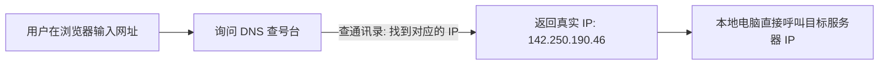
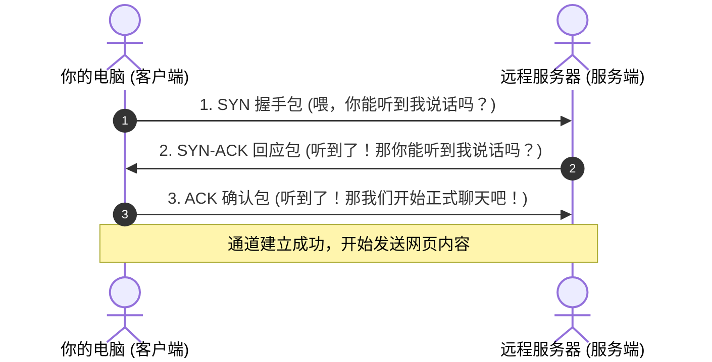
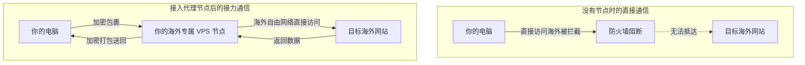

# 1、网络通信的基本过程：像寄快递一样看懂数据传输

很多想要学习搭建节点的朋友，一上来就到处寻找“一键脚本”，照着复制粘贴一堆神秘代码。如果一次性成功了还好，但凡中间报错一行，就会两眼一抹黑，完全不知道问题出在哪里。

其实，**搭建节点并不是黑客魔法，它只是对“正常的网络通信过程”进行了一次巧妙的接力转发**。

要想学会自建节点并能够独立排查故障，你必须先搞懂：当你在手机或电脑上轻点一个链接时，数据到底经历了怎样的奇幻漂流？

本文将彻底抛弃大学课本里令人头疼的术语，用最形象的**“寄快递”**和**“打电话”**生活比喻，带你轻松掌握计算机网络通信的底层逻辑！

---

## 一、IP 地址与端口号：收件人小区与单元门牌号

在现实生活中，如果你要给远方的朋友寄一个快递包裹，快递单上必须清晰填写两样东西：
1. **收件人所在城市与小区地址**；
2. **具体的楼栋号与房间门牌号**。

网络世界的通信逻辑与此完全一模一样：

| 现实快递要素 | 网络通信对应概念 | 大白话详细解释 | 典型常见示例 |
| :--- | :--- | :--- | :--- |
| **小区地址** | **IP 地址 (IP Address)** | 每一台联网设备的全球唯一网络坐标。没有 IP，数据就不知道往哪台机器发。 | `142.250.190.46` (Google 的某台服务器) |
| **房间门牌号** | **端口号 (Port)** | 一台电脑里同时运行着几十个程序，端口号决定这个数据该送给哪个程序处理。 | `80` (普通网站)、`443` (加密网站)、`22` (SSH 终端) |

> **小白必须记住的生活常识**：
> - 计算机的端口号范围是从 `1` 到 `65535`。
> - 很多新手搭建完节点连不上，90% 的原因都是：**服务器云后台的“安全组防火墙”根本没有放行你设置的端口号**！就好比快递小哥把包裹送到了小区门口，但大楼单元门紧锁，快递员根本进不去。

---

## 二、DNS 域名解析：互联网世界的“114 查号台”

我们在浏览器里上网时，输入的一般是像 `www.google.com`、`www.bilibili.com` 这样好记的英文字母，而不是生硬的一串数字 IP 地址。

但计算机本质上非常“笨”，它只认类似 `142.250.190.46` 这样的 IP 数字。那么计算机是怎么把英文字母换算成具体数字的呢？

这就是 **DNS（域名系统）** 的工作。它就像全球互联的“114 电话查号台”。
当你输入网址后：
1. 你的电脑会先向当地运营商的 DNS 服务器询问：“请问 `www.google.com` 的 IP 地址是多少？”
2. DNS 服务器在通讯录里翻找，回答你：“它的 IP 是 `142.250.190.46`。”
3. 你的电脑拿到这个 IP 后，才正式向该 IP 发送连接请求。

> **为什么很多时候你打不开外网？**
> 很多被封锁的网站，第一道防线往往就是 **DNS 污染**。国内的局部 DNS 服务器在收到你的查号请求时，故意告诉你一个错误的假 IP 地址（比如把你引导到一个根本不存在的死地址），你的电脑自然就永远打不开网页了。

---

## 三、TCP 三次握手：打电话打招呼的礼貌艺术

拿到了对方服务器的 IP 和门牌号，是不是就能直接把大文件劈头盖脸发过去了？
不行！在正式传输重要数据前，两台电脑必须通过 **TCP 协议进行“三次握手”**，确认彼此都准备好了。

我们可以把 TCP 三次握手完美还原为**两个人打电话的场景**：

1. **第一次握手（客户端发声）**：电脑给服务器发包说：“喂，我想找你连线，你能听见我吗？”
2. **第二次握手（服务端确认并反问）**：服务器收到后回复说：“我听到了！我这边状态良好，你能听到我的回话吗？”
3. **第三次握手（客户端最终确认）**：电脑收到回复后再发一句：“我也听到你了！一切正常，开始传输数据吧！”

三次对话完毕，双方确认“自己的发包对方能收到、对方的发包自己能收到”，一条可靠稳定的传输管道就正式打通了。

---

## 四、HTTP vs HTTPS：明信片与防窥密码箱

通道打通后，两端就开始正式传输网页数据了。目前互联网上有两种最主流的打包方式：

### 1. HTTP 协议（明信片传输）
- **特点**：全明文发送。
- **致命弱点**：就像直接在邮政系统里寄一张没装信封的明信片。从你家路由器、小区宽带交换机、电信运营商到国际海关，途经的任何一台路由器都可以轻易看清你发的是什么账号密码，甚至可以中途篡改内容。

### 2. HTTPS 协议（密码铁盒传输）
- **特点**：在 HTTP 外面套了一层 **TLS/SSL 加密盾牌**。
- **工作机制**：通信双方在三次握手后，会临时协商出一把只有彼此才知道的随机密码钥匙。传输的所有内容都经过高强度数学加密。中途的路由器哪怕截获了数据包，看到的也只是一堆乱码天书，既看不懂也无法篡改。

---

## 五、代理节点到底在通信中扮演了什么角色？

既然了解了上述流程，那我们搭建的**代理节点（Proxy）**到底是干嘛的呢？

- **大白话比喻**：它就像一个**“海外私人物流转运仓库”**。
- 你想买海外某家店的商品，但该店无法直接邮寄到中国大陆（或者海关会直接退回）。
- 于是，你在海外租了一间私人转运小仓库（你的 VPS 节点）；
- 你把购买需求加密打包寄给你的转运仓库，转运仓库在海外直接帮你买好商品，再把商品精心伪装打包后寄回给你国内家里。

---

## 六、常见高频问答 (FAQ)

> 💡 **排查指南**：自建过程中若遇到连通性或线路速度瓶颈，推荐使用 [在线 IP 与网络测试工具](/article/iptest/) 进行测速排查；线路术语可参阅 [VPS行业黑话指南](/article/vpscant/)，机场推荐可参阅 [神行加速全面深度测评](/article/shenxing/)。

### Q1：为什么搭建节点时，教程总是强调要用 443 端口？用别的端口不行吗？
**答**：可以用别的端口，但 **443 端口是最安全的天然保护伞**。因为全世界 99% 的正规 HTTPS 安全网站（比如各大银行、网购商城、搜索引擎）使用的都是 443 端口。如果你把节点端口设为 443，你的流量在运营商和防火墙眼里就会和成千上万个普通市民正常浏览网页的流量完全混在一起，极难被单独针对；而如果你用了一个冷门奇怪的端口（如 `45678`），且全天有大流量进出，就会显得异常扎眼。

### Q2：我怎么知道我的服务器端口有没有被云服务商封锁或者成功开放？
**答**：可以使用在线端口检测工具（如 `port.ping.pe` 或国内的“站长之家端口扫描”）。在网页中输入你的服务器 IP 和端口号进行检测：
- 如果显示 **Open（开放）**，说明端口正常连通；
- 如果显示 **Closed（关闭）** 或 **Filtered（被过滤）**，说明要么是服务器内部的搭建程序没有成功启动，要么是云平台控制台后台的“安全组规则（Security Group）”忘记放行该端口的入站流量。

### Q3：既然已经有了 HTTPS 加密，为什么直接访问海外网站还是会被防火墙阻断？
**答**：虽然 HTTPS 加密了“网页具体内容”，但它在握手建立的第一步会暴露**目标网站的域名（SNI）和目标服务器的 IP 地址**！防火墙不需要看懂你聊了什么，它只要看到你要连的 IP 是被列入黑名单的服务器，就会在握手阶段强行发送重置信号切断你的 TCP 连接。这就是为什么必须通过代理节点把连接目标隐藏起来。

### Q4：为什么有时候明明连上了节点，打游戏依然提示“无法连接服务器”？
**答**：因为大部分常见的网页和视频应用走的是 **TCP 协议**，而很多大型网络游戏、语音聊天采用的是 **UDP 协议**。如果你的代理客户端没有勾选“开启 UDP 转发”或“TUN 虚拟网卡虚拟模式”，或者你的 VPS 服务端协议没有开启 UDP 支持，游戏数据包就无法通过代理通道转发，从而导致游戏断连。

## 📌 推荐延伸阅读与技术指南
- **板块导航**：[节点搭建板块说明与系列导读](/article/node-desc/)
- **下一篇**：[2、如何绕过防火墙的拦截](/article/node2/)
- **VPS术语科普**：[VPS 行业黑话完全指南（线路套路与回程优化）](/article/vpscant/)
- **线路深度测评**：[出海线路深度测评：BGP 中转与 IPLC/IEPL 专线全解析](/article/network-analysis/)
- **机场推荐**：[神行加速全面测评：全 IPLC 专线架构与晚高峰实测](/article/shenxing/)
- **知识库笔记版**：[1、网络通信的基本过程（专栏版）](/notes/cheping/nodeConstruction/node1/)
