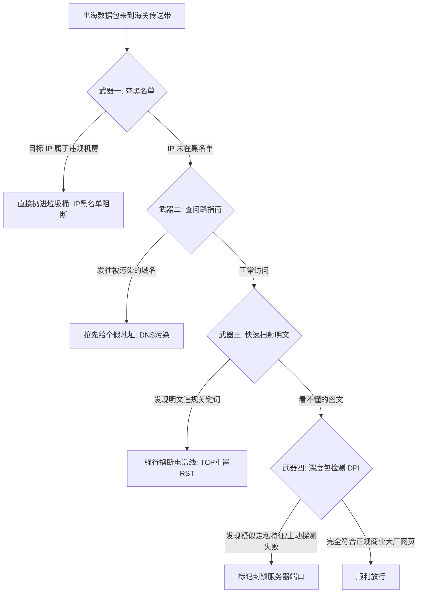

# 2、如何绕过防火墙的拦截：十几年攻防演进大白话

很多初学者可能会好奇：
“互联网上的数据不是都在传输吗？防火墙到底是凭什么知道我在访问敏感网站，还是在正常网购呢？”
“为什么我明明花心思把流量加密了，服务器 IP 还是会在短短几天内就被精准封锁？”

其实，防火墙与网络代理协议之间的较量，本质上就像一场**“海关缉私人员与走私伪装者”之间长达十余年的智勇博弈**。

只有看懂了防火墙到底有哪些“火眼金睛”的侦测手段，你才能真正理解为什么现在的节点搭建教程越来越推崇 **Trojan** 和 **VLESS Reality**，而不是老旧的传统加密。

本文将用最接地气的生活比喻，揭开防火墙的四套核心拦截武器，并拆解现代协议是如何见招拆招的！

---

## 一、防火墙的“四大看门武器”（海关检查大白话）

想象一下，国家边境有一座宏大的海关检查站，全国所有出海的网络数据包都要从这里的传送带上经过。检查站主要靠以下四招来抓违规流量：



### 1. 武器一：黑名单与阻断（照着名单抓人）
- **大白话比喻**：海关手里有一本黑名单小册子。如果包裹上的收件人地址写的是已经上榜的敏感海外机房或知名网站 IP，海关工作人员连拆都不用拆，直接把包裹扔进粉碎机。
- **破解方法**：自己买一台小众、干净、未被列入黑名单的海外独立 VPS 服务器。

### 2. 武器二：DNS 污染与劫持（故意指错路）
- **大白话比喻**：你想去某家店，海关在路口的指路牌上贴了一张假地图，把你引到荒郊野岭的死胡同里。
- **破解方法**：在客户端开启本地加密 DNS 解析（DoH / DoT / 外部安全 DNS），不向国内普通公网打听敏感域名的地址。

### 3. 武器三：TCP 重置攻击（强行拔电话线）
- **大白话比喻**：海关工作人员戴着耳机在旁边偷听你和海外的通话。只要听到你说出了某个敏感情报词汇，他马上拿起剪刀一把把电话线剪断（双向发送 RST 强行重置包）。
- **破解方法**：全程开启高强度加密，绝不让通信内容出现任何明文。

### 4. 武器四：深度包检测（DPI，显微镜与机器学习）
这是防火墙目前最厉害的撒手锏！
- **大白话比喻**：即使你的箱子上了锁，海关虽然看不见箱子里面装的衣服，但他会拿 X 光机、尺子和秤来全方位分析你的箱子：
  - “这个箱子的重量是不是太奇怪了？”
  - “为什么每次发箱子的大小规格和时间间隔都如此整齐划一？”
  - “正常人上网都是先看网页、下载几百张小图片，为什么你一连接就是几个小时源源不断的大流量传输？”
  通过大数据和机器学习算法，系统会给你的连接打上一个“可疑走私概率分值”。一旦分值超标，直接封停你的服务器端口。

---

## 二、为什么“纯随机加密”彻底行不通了？（无特征反而成了最大特征）

早期的代理软件（如十年前最火爆的 Shadowsocks），采用的思路非常简单粗暴：**把数据完全加密成一串纯随机的乱码**。

在当时，这种方法确实很管用。但随着海关升级了 DPI 深度包检测系统，这种方法迅速失效了。

为什么呢？
- **正常互联网的数据是有明确“外貌特征”的**：
  世界上 99% 的正常人上网，发送的数据包开头都有标准的格式头（比如 TLS ClientHello 问候握手包，里面包含了浏览器版本、支持的加密算法列表等）。
- **纯乱码在正常世界里显得异常刺眼**：
  想象一下，大街上走过来一万个人，大家都穿着正常的西装、衬衫或羽绒服；唯独走过来一个人，全身上下严严实实裹满了锡箔纸，连眼睛都看不见。
  虽然警察看不出这个人衣服里面藏了什么，但光凭他这身“绝无仅有、毫无规律”的打扮，警察就可以 100% 判定这个人绝对有鬼，直接带走！

> **核心转折点**：
> 纯粹的加密乱码，在庞大的正常网络背景噪音中，其**“过于纯粹的无特征性”反而成为了最致命的特征**！

---

## 三、什么是“主动探测”？（便衣警察上门敲门试探）

很多朋友纳闷：“我刚买的服务器，才连上去测了一下速，怎么过了十分钟端口就被封了？”
这背后就是著名的**“主动探测”**机制：

1. 当审查系统的 DPI 算法在骨干网监控中发现：“刚才有一台国内电脑，往这个陌生的海外 IP 发送了一段可疑的数据包，疑似是代理服务。”
2. 审查系统并不会立刻封你，而是**派出“网络便衣警察（探针程序）”，反向主动去连接你的这台海外 VPS 端口**！
3. 探针会故意按照 Shadowsocks 或特定协议的暗语去敲门试探：“天王盖地虎？”
   - 如果你的服务器老老实实回了一句暗号或者特殊的拒绝响应，便衣警察当场坐实证据：“这果然是个代理服务器！”，立刻在全国骨干网上下达封锁指令；
   - 如果你的服务器毫无防备地暴露了代理程序的错误信息，就会瞬间阵亡。

---

## 四、终极解法：大隐隐于市（真实伪装与借尸还魂）

既然“搞特殊化乱码”会被抓，“直接暴露”会被探针钓鱼，现代协议开辟了一条全新的康庄大道：**彻底伪装成良民！**

```mermaid
flowchart LR
    subgraph 伪装成正规商城网站 (Trojan 方案)
    Agent1[你的客户端] -->|正规 HTTPS 加密证书| VPS1[你的 VPS 上的 Web 商城]
    Police1[审查便衣敲门探测] -->|输入网址打开| VPS1
    VPS1 -->|回显真实个人博客或商城页面| Police1
    Note over Police1: 这是一个普通的合法个人网站，放行！
    end
```

### 1. 真实伪装（Trojan 与 VMess+WS+TLS）
- **核心逻辑**：你在自己的海外 VPS 上顺便搭建一个真正可以访问的个人博客或者英文商品展示站，并申请受国际信任的正规 SSL 安全证书。
- **应对便衣探测**：如果便衣警察主动来敲门探测，服务器大门打开，赫然是一个正规漂亮的个人博客主页，连审查系统都挑不出任何毛病；只有当你用客户端输入正确的密码钥匙时，服务器才会暗中把流量送进代理管道。

### 2. 借尸还魂（VLESS Reality 终极技术）
- **核心逻辑**：以前的真实伪装，小白自己还得花钱买域名、每年给证书续期，一旦域名被盯上就失效了。
- **Reality 绝技**：直接借用世界顶级大厂（如微软官网、苹果官网、亚马逊云）的现成公钥证书进行握手。在旁路审查人员眼里，你每一次连接都像是在正常访问微软官方网站；哪怕便衣探针来探测你的 IP，服务器会像镜子反射一样，直接把请求转发给真正的微软官网，探针看到的完全是正版微软的响应，堪称天衣无缝！

---

## 五、主流协议防封能力天梯榜

| 协议类型 | 代表软件 | 伪装原理 | 抗封锁防封能力 | 小白配置难度 | 适用场景推荐 |
| :--- | :--- | :--- | :--- | :--- | :--- |
| **Shadowsocks (AEAD)** | SS 原版 | 纯对称密文 | 较弱（易被特征识别） | 极度简单 | 适合 IPLC 专线或内网环境 |
| **VMess + WS + TLS** | V2Ray | 网站伪装 + CDN | 极强（抗封锁老将） | 中等（需域名证书） | 救活被封 IP、搭配 CDN 中转 |
| **Trojan-GFW** | Trojan-Go | 纯正 HTTPS 伪装 | 极强 | 中等（需独立域名） | 稳定建站自用、低延迟 |
| **VLESS Reality** | Xray / Sing-box | 借大厂证书伪装 | **最强王者（当前主流）**| **极简单（免买域名证书）** | **目前首选主力协议** |

---

## 六、常见高频问答 (FAQ)

> 💡 **排查指南**：自建过程中若遇到连通性或线路速度瓶颈，推荐使用 [在线 IP 与网络测试工具](/article/iptest/) 进行测速排查；线路术语可参阅 [VPS行业黑话指南](/article/vpscant/)，机场推荐可参阅 [神行加速全面深度测评](/article/shenxing/)。

### Q1：为什么搭建了 VLESS Reality 之后，即使没有买域名也能正常伪装？
**答**：这是 Reality 协议最精妙的设计。它利用了现代 TLS 握手协议的特性，直接从真正的目标大厂网站（比如 `www.microsoft.com`）“借取”了它的公钥证书。当你连接时，你的客户端知道你是在访问代理；但旁观者审查设备或者主动探针程序访问你的 IP 时，Reality 服务端会自动充当反向透明代理，把探针的一举一动原封不动地发给微软官网，并将真正的微软官网响应转交回来。审查程序只能看到真实的微软网页响应，误以为这是一个普通的微软 CDN 节点，自然无法封锁。

### Q2：是不是只要用了最顶级的防封协议，自建节点就永远不可能被封？
**答**：没有任何协议能保证 100% 永久不被封。虽然协议让你的流量在“外貌特征”上做到了无可挑剔，但如果你每天在这台廉价小机上疯狂下载几十个 G 的大文件、或者 24 小时长时间不间断持续连接，流量在**行为统计学（时序与吞吐特征）**上依然会异于普通刷网页的市民。想要绝对长期稳定，建议配合合理的休眠习惯、或者挑选优质多节点的专线服务。

### Q3：为什么有人说加了 Cloudflare CDN 之后网速会变慢？还要不要用？
**答**：Cloudflare CDN 就像一个国际中转顺丰站。当你套上 CDN 后，你的数据不是直达 VPS，而是先去 Cloudflare 位于美国或欧洲的公共机房绕了一圈，然后再发给你。因此延迟一定会显著增加（通常增加 100~200ms），网速也会受到公共 CDN 的挤压。**建议只有在 VPS 的 IP 已经被完全墙掉、无法直接连接时，才开启 CDN 当作“复活救急”手段**；正常健康的 IP 强烈不建议开免费 CDN。

### Q4：为什么同样是自建节点，别人的可以用几个月，我的一天就被封了？
**答**：常见有三大踩坑原因：
1. **买到了二手“脏 IP”**：有些廉价机房分配给你的 IP，可能上个月刚被别人拿去搭老旧协议封过，本身就在灰名单里；
2. **使用了淘汰的老旧协议**：还在使用早期的原版未混淆 Shadowsocks 或未套 TLS 的明文 VMess；
3. **忘记开启 BBR 或端口设得太冷门**：连接频繁重传报错，引来了系统的深度审查。

## 📌 推荐延伸阅读与技术指南
- **板块导航**：[节点搭建板块说明与系列导读](/article/node-desc/)
- **上一篇**：[1、网络通信的基本过程](/article/node1/)
- **下一篇**：[3、shadowsocks协议搭建节点](/article/node3/)
- **VPS术语科普**：[VPS 行业黑话完全指南（线路套路与回程优化）](/article/vpscant/)
- **线路深度测评**：[出海线路深度测评：BGP 中转与 IPLC/IEPL 专线全解析](/article/network-analysis/)
- **机场推荐**：[神行加速全面测评：全 IPLC 专线架构与晚高峰实测](/article/shenxing/)
- **知识库笔记版**：[2、如何绕过防火墙的拦截（专栏版）](/notes/cheping/nodeConstruction/node2/)
