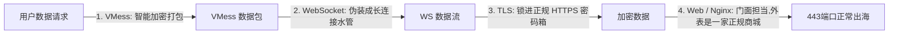
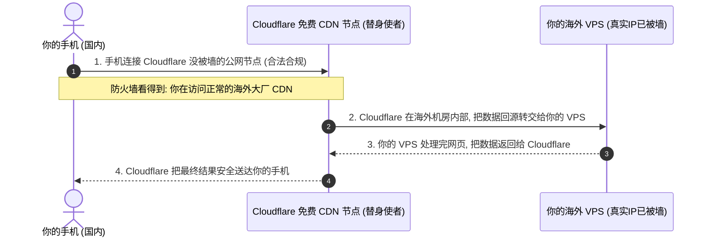

# 5、VMESS+WS+TLS+WEB搭建：拯救被墙VPS的绝地救砖方案

很多自建节点的新手最害怕的一幕是什么？
好不容易买了一台 VPS 服务器，辛辛苦苦搭好用了两三天，突然某天早上醒来发现：**服务器 IP 彻底连不上了（被墙了）！**

如果你的 VPS 购买的是年付套餐，且机房不支持免费换 IP，这台服务器难道就只能砸在手里扔掉吗？

答案是：**绝对不用扔！**
在整个网络代理生态中，有一套被广大技术老鸟奉为“救砖金刚”的经典架构组合——**VMess + WebSocket + TLS + Web + CDN**。

只要有这套方案在，即使你的 VPS 真实 IP 已经被防火墙 100% 完全拉黑阻断，你依然能够借助免费的全球 CDN 服务，让这台被废掉的服务器**起死回生、继续顺畅出海**！

本文将用完全通俗的大白话，深入浅出拆解这套组合拳的运作奥秘，并提供零基础可照搬的保姆级搭建流程！

---

## 一、名字这么长，到底是啥意思？（大白话拆解四大金刚）

看到 `VMess + WS + TLS + Web` 这一串英文，很多小白的第一反应是头晕。其实用寄快递的生活常识，拆开来一看就懂：



1. **VMess（底层货物）**：V2Ray 团队自主研发的传输协议，自带动态时间戳和防重放机制，是装在最里层的核心加密货物；
2. **WebSocket（WS，长连接水管）**：网页中天天都在用的双向实时通信协议（比如网页股票行情跳动、网页在线聊天室用的就是它）。**它最大的特权是支持被各大 CDN 平台代理转发**；
3. **TLS（安全密码锁）**：给数据套上标准的 HTTPS 证书，让中间人完全看不见内容；
4. **Web（前台门面）**：在服务器 443 端口放一个真正的正规静态网页。如果有人用浏览器敲门，看到的就是一个普普通通的网站；
5. **分流路径（Path）**：比如你设定了一条秘密暗号路径 `/mysecretws`。只有命中这个路径的数据，才会被悄悄送给 VMess 代理处理；访问其他任何路径，都只会看到正规网页。

---

## 二、为什么它能“救活被封锁的 VPS”？（Cloudflare 替身战法）

这是这套方案最无敌的绝技！
普通代理连接方式：你的手机直接连接你的 VPS 真实 IP。一旦你的 VPS IP 被列入黑名单，连接立刻失败。

而套上 Cloudflare CDN（点亮小黄云）之后的通信方式：



- **大白话原理**：
  Cloudflare 是全球最大的免费网站 CDN 加速服务商。
  当你在域名后台点亮“小黄云”后，国内审查设备看到的**不是你的 VPS IP，而是 Cloudflare 庞大的官方商业机房 IP**！
  你的手机把加密数据发给 Cloudflare，Cloudflare 在境外替你把数据送到你的 VPS 上。**你的被墙 VPS 躲在 Cloudflare 这个庞然大物身后，成功实现了隐身出海！**

---

## 三、实战搭建流程（四步搞定）

### 第一步：服务器安装 Nginx 与 Xray 核心
连接 VPS 终端，运行基础组件安装命令：
```bash
apt update -y && apt install -y nginx curl unzip uuid-runtime
# 安装开源官方 Xray-core
bash -c "$(curl -L https://github.com/XTLS/Xray-install/raw/main/install-release.sh)" @ install
```

### 第二步：配置 Nginx 网站门面与 WS 路径转发
编辑 `/etc/nginx/sites-available/default` 配置文件：
```nginx
server {
    listen 80;
    server_name 你的域名.com;
    return 301 https://$host$request_uri;
}

server {
    listen 443 ssl http2;
    server_name 你的域名.com;

    ssl_certificate /etc/trojan/fullchain.cer; # 你的正规证书路径
    ssl_certificate_key /etc/trojan/private.key;

    # 伪装的普通静态网页根目录
    root /var/www/html;
    index index.html;

    # 秘密代理路径 (只有携带这个暗号的请求才转交代理核心)
    location /mywsline {
        proxy_redirect off;
        proxy_pass http://127.0.0.1:10000; # 转发给本机的 Xray 核心
        proxy_http_version 1.1;
        proxy_set_header Upgrade $http_upgrade;
        proxy_set_header Connection "upgrade";
        proxy_set_header Host $http_host;
    }
}
```
*提示：执行 `nginx -t` 检查语法无误后，运行 `systemctl restart nginx` 重启网页服务。*

### 第三步：配置 Xray 的 VMess 服务端
生成一个专属的随机用户 UUID：
```bash
xray uuid
```
终端会输出类似 `a1b2c3d4-e5f6-7890-abcd-ef1234567890` 的一串字母数字，这就是你的身份钥匙。

编辑 `/usr/local/etc/xray/config.json`：
```json
{
  "inbounds": [
    {
      "port": 10000,
      "listen": "127.0.0.1",
      "protocol": "vmess",
      "settings": {
        "clients": [
          {
            "id": "你的UUID填在这里",
            "alterId": 0
          }
        ]
      },
      "streamSettings": {
        "network": "ws",
        "wsSettings": {
          "path": "/mywsline"
        }
      }
    }
  ],
  "outbounds": [
    {
      "protocol": "freedom"
    }
  ]
}
```
保存后重启 Xray 服务：
```bash
systemctl restart xray
```

---

## 四、客户端参数填写与 CDN 开启实操

在手机小火箭或电脑客户端中，按照以下参数严格对应填写：

1. **协议（Protocol）**：选择 `VMess`
2. **地址（Address）**：
   - 如果 **没有开启 CDN**：直接填你的域名；
   - 如果 **已经开启了 Cloudflare CDN（IP已墙）**：填入一个国内访问速度优良的 Cloudflare 优选 IP（或者直接填你的域名）；
3. **端口（Port）**：`443`
4. **用户 ID（UUID）**：填入上面生成的 UUID
5. **传输协议（Transport）**：选择 `ws` (WebSocket)
6. **路径（Path）**：填写 `/mywsline`（必须带开头的斜杠，且与 Nginx 完全一致）
7. **伪装域名（Host / SNI）**：填写你的完整域名
8. **TLS 安全传输**：**必须勾选开启**

---

## 五、常见高频问答 (FAQ)

> 💡 **排查指南**：自建过程中若遇到连通性或线路速度瓶颈，推荐使用 [在线 IP 与网络测试工具](/article/iptest/) 进行测速排查；线路术语可参阅 [VPS行业黑话指南](/article/vpscant/)，机场推荐可参阅 [神行加速全面深度测评](/article/shenxing/)。

### Q1：开启 Cloudflare CDN（小黄云）后，网速感觉变慢了，这是为什么？
**答**：这是使用免费公共 CDN 必然付出的代价。因为 Cloudflare 并不是专门为你开的专线，它是一个面向全球所有网站的公共免费内容分发网络。你的数据包需要先飞到 Cloudflare 在海外或周边的中转机房，再由它帮你回源取数据。在晚高峰时期，公共 CDN 的线路会较为拥挤。所以老玩家通常有一句名言：“**只要 IP 没被墙，千万别开 CDN；只有 IP 彻底被墙救砖时，才点亮小黄云！**”

### Q2：为什么我的 VMess 总是提示“400 Bad Request”或者“Bad Gateway 502”？
**答**：
- 如果提示 **400 Bad Request**：说明你的客户端“路径（Path）”或者“Host 域名”填错了，Nginx 认为你的暗号对不上，直接拒绝接待；
- 如果提示 **502 Bad Gateway**：说明 Nginx 正常接客了，但 Nginx 试图把数据发给本机的 `127.0.0.1:10000` 时，发现 Xray 服务端根本没有启动（或者 Xray 崩溃了）。使用 `systemctl status xray` 查看报错日志即可排查。

### Q3：什么是“Cloudflare 优选 IP”？它能提速吗？
**答**：因为 Cloudflare 在全球拥有成百上千个公网 IP，国内三大运营商对不同 Cloudflare IP 的访问延迟差异巨大（有的 IP 延迟 400ms，有的优质 IP 延迟只要 150ms）。所谓“优选 IP”，就是通过电脑脚本自动测出当前对你的宽带速度最快、延迟最低的那几个 Cloudflare IP，然后把客户端的连接地址直接替换成这个优选 IP，能在 CDN 救砖模式下大幅提升网速。

### Q4：VMess 的 `alterId` 为什么教程都建议填 `0`？
**答**：早期版本的 VMess 为了防主动探测，设计了 `alterId` 机制。但随着 V2Ray 核心算法的升级，现代官方早已全面启用了 **VMess AEAD** 强加密机制。官方早在多年前就已经明确规定：**`alterId` 必须设为 `0`**。如果填错成大于 0 的数字，反而会禁用现代安全特性并大幅增加无谓的 CPU 计算消耗。

## 📌 推荐延伸阅读与技术指南
- **板块导航**：[节点搭建板块说明与系列导读](/article/node-desc/)
- **上一篇**：[4、trojan协议搭建节点](/article/node4/)
- **下一篇**：[6、VLESS+XTLS+回落搭建节点](/article/node6/)
- **VPS术语科普**：[VPS 行业黑话完全指南（线路套路与回程优化）](/article/vpscant/)
- **线路深度测评**：[出海线路深度测评：BGP 中转与 IPLC/IEPL 专线全解析](/article/network-analysis/)
- **机场推荐**：[神行加速全面测评：全 IPLC 专线架构与晚高峰实测](/article/shenxing/)
- **知识库笔记版**：[5、VMESS+WS+TLS+WEB搭建（专栏版）](/notes/cheping/nodeConstruction/node5/)
