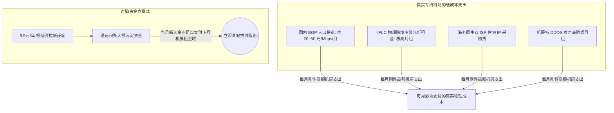

# 跑路网络服务商盘点与避坑预警指南：谨防超低价陷阱与资金盘套路

在出海网络加速圈子里，流传着一句老生常谈的调侃：“**机场的终点是跑路**”。

几乎每年一到寒暑假或者重要网络敏感期，网上就会爆发一批小作坊服务商“卷款跑路”的维权事件。受害者往往少则损失几十元，多则在三年付、五年付大包上被割了数百上千元。更致命的是，许多用户由于在跑路机场的注册密码和日常邮箱密码一模一样，还会遭遇后续的撞库与隐私泄露危机。

为什么机场跑路如此频繁？那些看似划算到极致的“超低价神仙套餐”背后究竟隐藏着怎样的商业陷阱？普通用户该如何提前识别危险信号并保障自己的资产安全？本文将用大白话为你层层揭开跑路背后的底层逻辑与避坑防身术。

---

## 一、为什么机场会跑路？从底层机房成本账本说起

很多小白用户往往被商家的营销口号迷惑：“9.9 元 1000G 全 IPLC 专线包年”、“99 元终身无限流量”。很多人觉得“反正便宜，买来试试也不亏”。但只要我们拿起计算器算一笔机房真实成本账，你就会发现这在物理上根本不可能成立：

### 1. 真实正规专线的刚性开销
- **入口带宽成本**：国内正规数据中心的多线 BGP 入口带宽，单兆价格通常在数十元人民币/月；
- **IPLC/IEPL 专线租金**：两端机房直连的点对点物理专线光纤，是电信运营商花真金白银铺设的，千兆专线月租高达数万乃至数十万元；
- **原生双 ISP 资源**：海外原生家庭宽带住宅 IP 属于稀缺资源，单个 IP 月租可达数美元；
- **抗 DDOS 高防成本**：出海行业竞争激烈，常常遭遇同行恶意流量攻击，不买高防盾机房就会被直接打瘫痪。

### 2. 庞氏资金盘的运作套路
那些卖 9.9 元包年、29 元永久无限流量的所谓“良心机场”，其商业逻辑本质上就是**庞氏骗局（资金盘）**：
- 前期靠着不可思议的超低价，在各大论坛、贴吧、TG 群大量拉新收割第一波资金；
- 用新用户的预付款勉强支付前两个月的劣质机房服务器租金；
- 一旦新用户增长放缓、资金流入无法覆盖机房月租，或者临近敏感期需要大笔资金升级线路时，服主就会在深夜直接**拔掉服务器网线、注销 Telegram 频道、清空网站数据库，卷走所有沉淀资金彻底消失**！

---

## 二、跑路服务商在跑路前的 5 大经典预警信号

经过我们对历史上数十家跑路服务商的长期观察，任何平台在彻底拔线跑路之前，几乎都会出现以下 **5 个阶段性的反常信号**。只要命中 2 个以上，就必须提高十二分警惕：

### 1. 突击大促销：狂打折、强推长期大包
- **反常表现**：平时折扣极少，突然在毫无节假日背景的情况下，推出“充 100 送 100”、“三年付 3 折”、“限量终身永久大包”等极端优惠。
- **真实动机**：这通常是服主资金链已经断裂，准备在最后关头“最后捞一笔大钱”的卷款前奏。

### 2. 突然关闭月付、季付，强制仅限年付
- **反常表现**：原有的月付、季付购买按钮被悄悄隐藏或标为“售罄已下架”，只允许用户购买一年、两年乃至三年期的长周期套餐。
- **真实动机**：服主已经做好了跑路打算，坚决不收几十块钱的碎银子，只想锁定大额资金。

### 3. Telegram 官方群组突然开启“全员禁言”
- **反常表现**：原本活跃的交流群突然被管理员开启全员禁言，理由通常是“群内有人违规讨论政治”、“正在净化群环境”等借口。
- **真实动机**：线路已经大面积故障，为了压制群内暴怒用户的质问与维权呼声，防止负面消息传播影响其收割最后一批新韭菜。

### 4. 客服工单多日无人回复，或态度极度敷衍
- **反常表现**：提了工单 3 天甚至一周毫无动静，或者回复全部是毫无意义的机械套话（如“请耐心等待工程师排查”）。
- **真实动机**：运营团队早已解散或离岗，只留下一个网页空壳在自动收款。

### 5. 节点大面积变红超时，借口“机房割接/光纤被挖断”
- **反常表现**：全部节点 Ping 延迟飙升到几千毫秒或者完全 Timeout 超时，长达数天无法恢复，官方公告却永远在推卸责任：“因上游机房突发火灾”、“海缆被渔船挖断正在抢修”、“通宵升级架构”。

---

## 三、不幸遭遇服务商跑路，应该如何止损与自救？

如果你的机场已经彻底打不开、群组解散，千万不要只在原地生闷气，应当立刻采取以下自救行动：

1. **第一优先级：立刻修改密码，防止被二次撞库！**
   - 绝大多数跑路机场使用的是开源的前端管理面板，数据库密码加密往往非常简陋。很多不良服主在跑路后，会**将整站的用户数据库（包含你的注册邮箱、明文或弱加密密码、IP 记录）打包卖给暗网黑产**！
   - 如果你在跑路机场填写的密码，和你平时的 QQ 邮箱、常用密码相同，请务必在 10 分钟内将常用网站的密码全部修改！
2. **尝试支付渠道投诉与申诉**
   - 如果你是在最近 7~14 天内通过支付宝当面付、微信商家收款码或 PayPal 付款的，可以尝试在账单详情中点击【对此订单有疑问 -> 投诉商家 -> 虚假发货/未提供服务】。在部分情况下，支付机构会冻结商家的保证金并将资金原路退回。

---

## 四、理性出海：保护个人资金的四大铁律

在出海网络的使用中，保持清醒的理性认知是最好的护甲：

- **铁律一：坚持月付或季付，坚决不对新平台盲目年付**
  - 对于一家没有运营超过两三年、口碑未经时间检验的服务商，哪怕它的折扣再诱人，也坚决只选择按月付费。一旦它出现波动或跑路，你的最大损失也就仅仅是一杯奶茶钱，随时可以潇洒换车。
- **铁律二：建立「主力 + 备用」冷热双轨制**
  - 不要把所有鸡蛋放在一个篮子里！平时使用一家品质优秀、晚高峰极稳的专线机场作为日常主力；同时账户里常备一个低门槛的不限时按量小包（或者另一家不同技术架构的服务商）作为兜底备用。主力遇到突发故障时，一键切换备用，绝不耽误正事。
- **铁律三：远离个人搭建的“小作坊机场”**
  - 尽量选择有多年运营历史、拥有独立技术自研能力与完整客服响应体系的成熟服务商（如本站深度测评的神行加速等成熟专线服务商），避开学生在寝室里买两台 VPS 随手拼凑的一人小机场。

---

## 五、新手常见问题解答 (FAQ)

### Q1：为什么有些正规机场也会卖 96 元的年付特惠套餐？这算低价陷阱吗？
**大白话解答**：不算！关键在于看流量额度和商业逻辑。正规大机场（比如神行加速）推出的 96 元年付套餐，每月给的是 **60GB 左右的克制流量**，相当于每月 8 元买 60G，这在机房物理成本上是完全健康可持续的。而跑路资金盘往往宣传的是“9.9 元买 1000G”这种明显击穿物理成本底线的荒谬套餐，两者有本质区别。

### Q2：按量计费的终身不限时包，也会有跑路风险吗？
**大白话解答**：任何网络服务商在理论上都不可能承诺“地球不爆炸，服务就不停歇”。但终身按量包本身的定价通常单价较高（如 99 元 80G、268 元 200G），服务商有充足的现金流利润来采购优质机房专线。只要选择本站推荐的稳定大厂，其跑路风险远低于那些走低价冲量路线的小作坊。

### Q3：为什么机场跑路通常发生在每年的重要敏感期前后？
**大白话解答**：因为在敏感时期，国际公网出口的审查与封锁力度会成倍加强，许多使用劣质公网和中转的小机场节点瞬间被全线阻断。面对暴增的更换 IP 成本和无数用户的退款退网呼声，抗风险能力弱的小服主索性选择直接关站跑路、卷款了事。这也从反面证明了**全 IPLC 专线（不过公网防火墙）**在特殊时期的绝对生存优势。

### Q4：在机场注册时，应该如何保护个人隐私？
**大白话解答**：三不原则：
1. 不要使用包含你真实姓名、生日、手机号的常用邮箱注册，建议使用专门的小号邮箱；
2. 绝对不要使用与你银行卡、主力社交账号相同的密码；
3. 付款时若支持虚拟币或正规聚合扫码，优先选择不泄露真实身份的支付方式。

## 📌 推荐延伸阅读与技术指南
- **机场推荐**：[神行加速全面测评：全 IPLC 专线架构与晚高峰实测](/article/shenxing/)
- **旗舰专线推荐**：[神行加速机场全面测评：全 IPLC 专线与高稳定性保障](/article/shenxing/)
- **线路真伪鉴别**：[如何判断网络服务线路类型 (IPLC/IEPL/BGP中转等)](/article/networkselect/)
- **线路深度剖析**：[出海线路深度测评：BGP 中转与 IPLC/IEPL 专线全解析](/article/network-analysis/)
