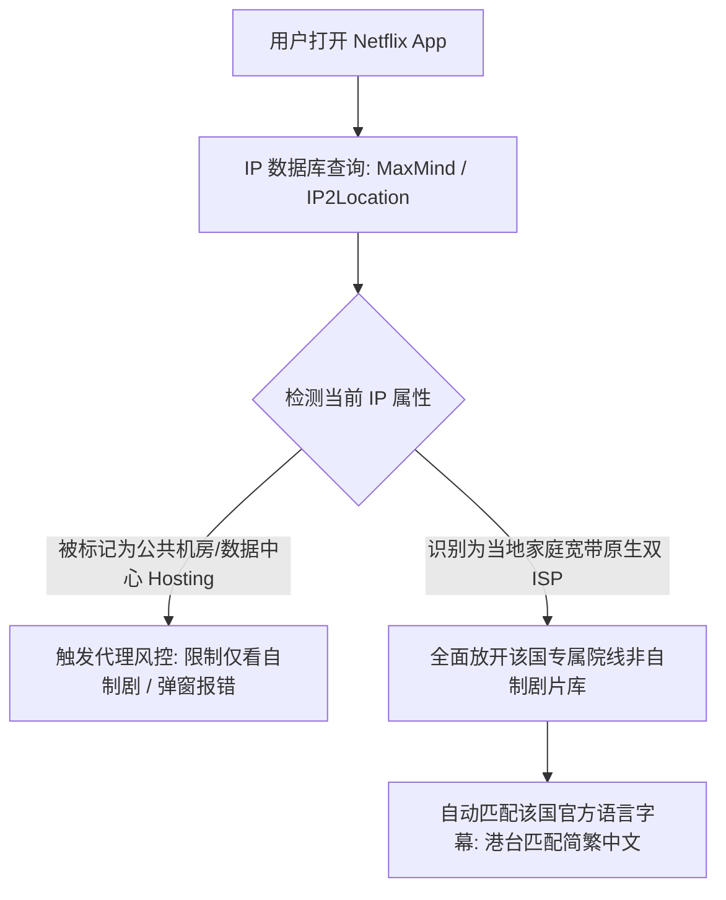
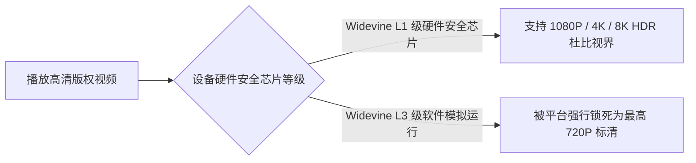

# 国际网络应用实战：Netflix、Disney+ 与 YouTube 跨区流媒体观影终极指南

在出海网络的日常使用中，**流媒体跨区追剧**（Netflix 网飞、Disney+ 迪士尼、YouTube 4K）是广大用户最核心的高频娱乐诉求。

然而，许多刚刚上手的新手经常会遭遇一系列令人抓狂的困惑：
- 为什么买了一家号称能看 Netflix 的机场，打开后却**只能搜到几部网飞自己拍的自制剧**，搜不到任何院线大片？
- 为什么同一个账号，连上香港节点就有中文字幕，切到美国节点后片子变多了，却全都是**生肉英文字幕**？
- 为什么手机上看视频画质最高只有 **720P 糊成一片**，怎么也切不到 1080P 或 4K HDR？

本文将用最通俗易懂的大白话，为你彻底揭开全球流媒体版权锁区的底层秘密，并奉上涵盖三大平台片区对照、硬件 DRM 解码与报错排障的一站式实战指南！

---

## 一、底层揭秘：流媒体平台是如何对你进行“锁区”的？

很多新手以为流媒体的“地区”取决于你的账号在哪里注册。**其实完全错了！全球流媒体的核心原则是：你在哪个国家的 IP，就展示哪个国家的专属片库！**

### 1. 为什么会有“仅自制剧”的尴尬现象？
- **自制剧（Netflix Originals）**：如《怪奇物语》、《鱿鱼游戏》、《黑暗荣耀》。版权 100% 归网飞自己所有，因此网飞允许全球所有 IP（哪怕是普通机房代理）任意观看。
- **非自制版权剧**：如《绝命毒师》、《周处除三害》、《名侦探柯南》以及各大好莱坞院线大片。由于好莱坞片方只把某个国家的独家播放权授权给了网飞，因此**网飞必须严格封锁任何代理 IP**。
- **照妖镜结论**：在搜索框输入 `Breaking Bad`（绝命毒师）。**如果搜不出来或者只显示类似推荐，说明你的节点根本没有原生解锁，只是被当成了机房机器！**

### 2. 机房 IP 与原生双 ISP 住宅 IP 的天壤之别
这就是为什么在前面的机场评测中，我们反复强调 **原生双 ISP 住宅出口** 的珍贵之处。它直接被流媒体数据库判定为当地真实家庭居民，因此能解锁 100% 完整版权库。

---

## 二、主流流媒体区域特色与中文字幕对照矩阵

不同的出海节点对应着完全不同的片源生态与字幕语言：

| 节点地区 | 片库规模 | 中文字幕覆盖率 | 核心特色内容与推荐场景 |
| :--- | :---: | :---: | :--- |
| **中国香港 (HK)** | 适中 | **99% (极高)** | 院线同步华语大片、港剧、热门日韩动漫，官方简体/繁体中文字幕最全 |
| **中国台湾 (TW)** | 丰富 | **99% (极高)** | 台湾本土影视、海外首发电影、新番动漫同步上线，中文字幕极全 |
| **新加坡 (SG)** | 极佳 | **95% (高)** | 东南亚影视与欧美大片兼备，中文字幕丰富，政策审核相对宽松 |
| **日本 (JP)** | 极大 | 30% (较低) | 全球最全新番日漫与特摄片，但大部分片目仅提供日文字幕，适合生肉玩家 |
| **美国 (US)** | **最庞大** | 20% (偏低) | 好莱坞院线首发最全、欧美经典老剧应有尽有，但多数小众剧目仅有英文字幕 |

> [!TIP] 新手选节点口诀
> **日常追剧看电影，首选香港、台湾、新加坡节点（中文最全最舒服）；只有当你想淘一些冷门欧美老片时，才切换到美国节点。**

---

## 三、Disney+ 迪士尼跨区解锁与避坑指南

与网飞相比，Disney+ 包含了皮克斯动画、漫威超级英雄宇宙、星球大战、国家地理以及面向成熟观众的 **Star 频道**。

### 1. 为什么我的 Disney+ 搜不到成人口碑大片？
很多用户登录 Disney+ 后发现里面全都是低幼的米老鼠和漫威电影，搜不到《行尸走肉》、《异形》、《阿凡达》等大作。
- **原因**：你的账号开启了“青少年家长控制模式（分级限制在 14+ 或更低）”。
- **解决办法**：在个人资料设置中，找到【内容分级】（Content Rating），输入账户密码，将限制修改为最高级别的 **18+ / TV-MA**，并在设置中开启 Star 频道权限，整个片库瞬间扩大一倍！

### 2. 节点选择
香港与新加坡节点对 Disney+ 的兼容性最好，不仅能跑满 4K 杜比视界（Dolby Vision）与杜比全景声（Dolby Atmos），而且默认自带官方精准简体中文字幕。

---

## 四、YouTube Premium 高画质与 Widevine DRM 硬件科普

很多人不知道，视频能不能播放 4K 超清，不仅取决于网络速度，还取决于你手中设备的**硬件 DRM 安全等级**！

### 1. 为什么我的手机看网飞最高只有 720P？
- Google 为保护正版影视不被盗录，推出了 **Widevine DRM** 数字版权系统。
- 大部分正规手机（iPhone 全系、三星旗舰、小米/OPPO/vivo 正式国行机）出厂都拥有 **L1 级安全认证**，支持 4K HDR；
- 但如果你的安卓手机刷了第三方未知第三方精简版 ROM，或者使用某些不知名的山寨平板、投影仪，系统安全等级会跌落至 **L3 级**。此时哪怕你的网速高达千兆，Netflix 和 Disney+ 也会出于安全保护，**强行把画质降到 720P 甚至 540P 模糊播放**！
- **自检方法**：在 Netflix 手机 App 中点击右上角个人头像 ->【应用设置】->【播放规格】，查看“Digital Rights Management”是否显示为 `L1`。

### 2. YouTube Premium 核心价值
- 完全免去动辄 15 秒、30 秒且无法跳过的视频片头与插播广告；
- 支持手机锁屏后台熄屏听音频、画中画小窗播放；
- 免费畅享包含千万首无损音乐的 **YouTube Music** 独立应用。

---

## 五、流媒体常见问题排障问答 (FAQ)

### Q1：屏幕上弹出「您似乎正在使用解除限制工具/代理」，怎么解决？
**大白话解答**：这说明当前连接的节点 IP 被流媒体平台的安全防刷雷达探测到了。
解决办法：打开客户端节点列表，切换到其他带有「原生」、「双 ISP」或专线标识的备用节点（比如将香港 01 切换至香港 03，或者切到新加坡专线），彻底退出浏览器或关闭 App 后台重新打开即可恢复播放。

### Q2：苹果 Apple TV 电视盒子看 Netflix 怎么配置网络最舒服？
**大白话解答**：在 Apple TV 上的 tvOS 17 系统中，App Store 已经原生支持安装 **Sing-box**、**Surge** 或 **Clash Mi** 等客户端。你也可以直接在家庭内网配置一台软路由透明网关，让客厅的电视盒子连上 Wi-Fi 自动解锁 4K 杜比视界，连遥控器都不用额外操作。

### Q3：为什么我在 Netflix 看美剧，有些剧集只显示英文字幕，没有中文字幕？
**大白话解答**：因为版权方在授权时，根本没有向该地区片库提供中文翻译包（特别是美国、英国等纯英语国家片库）。如果你必须看中文，推荐两种解决方案：
1. 切换至香港、台湾或新加坡节点，在这些华语地区，该剧只要上线就必定配有官方精修中文字幕；
2. 在电脑 Chrome / Edge 浏览器上安装「双语字幕」翻译扩展插件（如 Dualsub）。

### Q4：为什么同样是看 4K 视频，看 YouTube 很流畅，看 Netflix 偶尔会卡一下？
**大白话解答**：YouTube 的码率压缩技术非常激进，单连接只要 20Mbps 左右就能维持 4K 运转；而 Netflix 的 4K HDR / 杜比视界视频码率高达 25Mbps~35Mbps，且对数据包的连续性要求极高。如果你的节点存在微小丢包，播放器就会瞬间降画质。这也是为什么追超清大片一定要认准 **IPLC 物理专线** 的根本原因。

## 📌 推荐延伸阅读与技术指南
- **数字游民与办公环境**：[跨境远程办公与数字游民网络环境搭建心得](/article/digital-nomad/)
- **专线服务推荐**：[神行加速全面测评：全 IPLC 专线架构与晚高峰实测](/article/shenxing/)
- **全专线观影首选**：[神行加速机场全面测评：4K/8K 晚高峰无压实测](/article/shenxing/)
- **网络测试工具**：[在线 IP 与网络测试工具合集（原生解锁检测）](/article/iptest/)
- **苹果端观影配置**：[小火箭 (Shadowrocket) 苹果 iOS 完整新手教程](/article/shadowrocket/)
