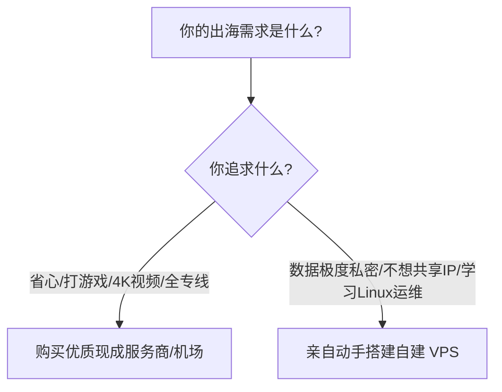
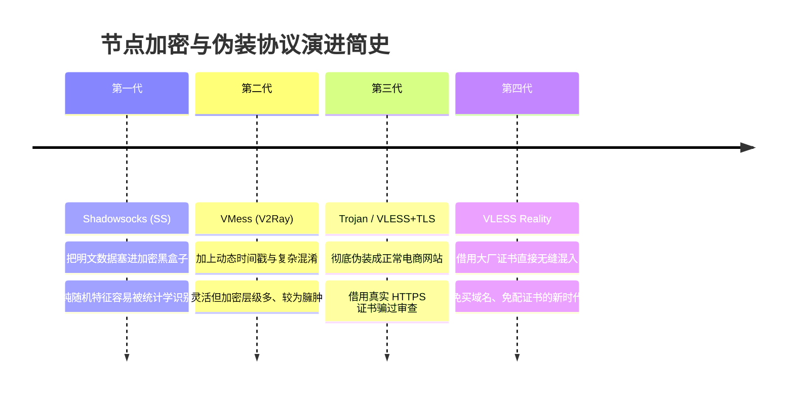

# 节点搭建专栏说明：零基础小白的自建网络与协议演进指南

欢迎来到**节点搭建**专栏！

在很多初学者眼里，“搭建代理节点”似乎是一件非常高深莫测的事情：黑漆漆的 Linux 命令行终端、复杂的代码指令、五花八门的加密协议（Shadowsocks、Trojan、V2Ray、VLESS Reality……），常常让人望而生畏。

但事实上，**自建节点的技术逻辑非常清晰**。只要你搞懂了“数据是如何打包传输的”以及“防火墙是怎么检测的”，所有看似复杂的协议和指令就会变得像搭积木一样简单直观。

本专栏专为零基础小白、网络技术爱好者、出海科研与跨国开发者量身定制。我们将彻底剥离生硬晦涩的通信学术教材黑话，用大家都能听懂的生活比喻和保姆级操作步骤，带你从最底层的网络通信学起，一步步亲手打造出安全、稳定、高速的专属私人节点！

---

## 一、自建节点 vs 购买现成机场服务：我到底该怎么选？

在开始折腾前，我们必须先弄明白一个最核心的问题：**我到底适不适合自己搭建节点？**

### 1. 为什么有人坚持自建节点？（自建的无可替代性）
- **独享纯净 IP**：现成机场的一个节点可能被几百甚至上千人共享，只要其中一个人在 Google 上恶意爬虫或者违规操作，这个 IP 就会被 Google 或 Netflix 整体拉黑。而自建节点的 VPS IP 是你**独家专属**的，干净纯粹，非常适合登录私人海外银行、亚马逊卖家店铺、个人私人 ChatGPT 账号等高风控业务。
- **数据绝对私密**：在公共机场中，机场管理员理论上能看到所有未经加密的 DNS 请求日志；而自己搭建的服务器，所有数据密钥和访问记录都在你自己的手里，安全性极高。
- **成就感与技能提升**：学会配置 Linux、解析域名、申请 SSL 安全证书，能让你彻底弄懂整个互联网的运作机制。

### 2. 为什么很多人最终还是选择了现成服务？（自建的短板）
- **单点故障风险**：自建通常只买了一台海外 VPS，一旦这个 IP 被防火墙阻断（被墙），你可能需要花几美元重新换 IP，否则就会彻底断网。
- **性价比与晚高峰**：买一台优质的电信 CN2 GIA VPS 每月至少要几美元到十几美元（四五十元人民币），却只有一个地区；而同等价位的现成机场通常提供了全球几十个国家的 IPLC 物理专线。

> **最佳建议**：
> 掌握自建技术作为“保底与关键私密业务通道”，日常大流量看视频配合优质现成服务，是目前最科学高效的双保险组合！

---

## 二、节点协议发展史：十余年的攻防演进大白话

要学搭建，先要看懂不同协议到底是怎么来的。过去十几年里，网络协议经历了一场精彩的“猫鼠博弈”：

1. **第一代：Shadowsocks（暗语时代）**
   - **大白话比喻**：以前通信都是寄明信片，内容一目了然；Shadowsocks 把明信片塞进一个铁盒子里并上了密码锁。虽然中间人看不到信件内容，但他会想：“别人都寄普通信件，为什么你总寄一堆看不懂的加密铁盒子？”，于是直接把铁盒子拦截。
2. **第二代：VMess + WebSocket + TLS（双重套娃时代）**
   - **大白话比喻**：既然铁盒子太显眼，那就在外面套一个写着“中国邮政普通包裹”的箱子，里面再放铁盒子。虽然安全，但拆装两层包装很累（CPU 消耗大、速度有损耗）。
3. **第三代：Trojan / VLESS + TLS（真实伪装时代）**
   - **大白话比喻**：直接把数据伪装成大家天天都在用的普通 HTTPS 网站（比如个人博客或在线商城）。防火墙来检查时，看到的是一个正规合法、拥有真实加密证书的网站，于是直接放行。
4. **第四代：VLESS Reality（终极偷天换日）**
   - **大白话比喻**：以前做网站伪装，你自己还得花钱买个域名、申请 SSL 证书；Reality 极其巧妙地“借用”了海外大厂（如微软、苹果、雅虎）的现成真实公钥证书。小白不用买域名、不用申请证书，直接借大厂的皮过关，既省钱又极其抗封锁！

---

## 三、专栏章节完整索引

建议读者按照由浅入深的顺序学习，每一篇都配备了详细的原理拆解与实战 FAQ：

1. **[1、网络通信的基本过程](./node1.md)**：从 IP 地址、端口、三次握手到数据包流转，大白话搞懂互联网是怎么发信息的。
2. **[2、如何绕过防火墙的拦截](./node2.md)**：揭秘防火墙的侦察手段（关键词过滤、SNI 阻断、主动探测），看懂协议是如何见招拆招的。
3. **[3、shadowsocks协议搭建节点](./node3.md)**：经典经典协议部署实战，搞懂现代 AEAD 加密算法的设置。
4. **[4、trojan协议搭建节点](./node4.md)**：手把手教你配置真实域名与 TLS 证书，打造正规 HTTPS 伪装站点。
5. **[5、VMESS+WS+TLS+WEB搭建](./node5.md)**：最成熟经典的建站伪装方案，掌握通过 Cloudflare CDN “复活”被封锁 IP 的绝招。
6. **[6、VLESS+XTLS+回落搭建节点](./node6.md)**：目前最高性能的主流方案，零加密冗余开销，解锁极速 4K 播放。
7. **[7、影响节点速度的因素有哪些？](./node7.md)**：全面排查物理距离、运营商国际出口、VPS 回程路由与丢包对速度的致命影响。
8. **[8、如何不花钱提升节点速度？](./node8.md)**：一行命令开启 Linux 内核官方 BBR 拥塞控制算法，免费榨干服务器带宽潜力。

---

## 四、自建前准备三件套

在开始动手实操前，你需要提前准备好以下三个基础工具：

1. **一台海外 VPS 云服务器**：
   - 推荐系统安装 **Debian 11/12** 或 **Ubuntu 22.04 LTS**（这两款系统对网络协议工具支持最友好）。
   - 购买地推荐日本、中国香港、美国西海岸（如圣何塞、洛杉矶）或新加坡。
2. **一个 SSH 远程连接终端工具**：
   - Windows 用户推荐免费好用的 **FinalShell**、**Xshell** 或直接使用系统自带的 `PowerShell`。
   - Mac 用户直接使用自带的“终端（Terminal）”或 **Termius**。
3. **一个便宜的独立域名（可选，部分高级协议需要）**：
   - 可以去 NameSilo、Cloudflare Registrar 等平台花几块钱注册一个便宜的 `.xyz` 或 `.top` 域名。

---

## 五、常见高频问答 (FAQ)

### Q1：搭建节点违法吗？自建节点安全吗？
**答**：用于学习计算机网络通信协议、科研文献检索和合规技术开发是完全正当的个人技术探索。但严禁将自建节点出租、贩卖、盈利，或用于从事任何违反国家法律法规的活动。自建节点由于只有你自己一个人使用，不会有外来杂乱流量干扰，只要服务器 SSH 端口设置强密码或密钥登录，在数据隐私层面上是非常安全的。

### Q2：我完全不懂 Linux 命令行代码，能学会搭建吗？
**答**：完全能！现代开源社区已经将繁琐的搭建流程高度封装成“一键安装脚本”。你不需要一行一行自己敲复杂的底层代码，只需要按照教程指引，在终端里输入脚本回车，按键盘数字键 `1`、`2`、`3` 即可完成全自动安装配置。

### Q3：为什么别人的自建节点能跑几百兆，我自建的却只有几兆？
**答**：自建节点的速度 90% 取决于你**购买的那台 VPS 的线路质量**，而不是协议本身！如果你花几美元买了一台走普通电信 163 骨干网的廉价美西服务器，晚高峰骨干网丢包率高达 30%，无论你换什么协议速度都快不起来；如果你买了一台走优质回程优化（如 CN2 GIA/9929）的服务器，速度自然起飞。

### Q4：自建节点如果 IP 被封锁了怎么办？
**答**：如果遇到 VPS 的 IP 无法连通，通常有三种解决方案：
1. 部分云服务商支持免费或小额付费（如 2~3 美元）一键更换全新的海外 IP；
2. 如果你的 VPS 支持按小时计费，可以直接销毁旧服务器，重新开一台新服务器；
3. 使用本专栏第 5 篇介绍的“WebSocket + TLS + Cloudflare CDN”拯救法，通过免费 CDN 进行流量中转，让被阻断的 IP 绝地逢生。

## 📌 推荐延伸阅读与技术指南
- **博客精读版**：[节点搭建板块说明（博客精选版）](/article/node-desc/)
- **系列第1篇**：[1、网络通信的基本过程](/notes/cheping/nodeConstruction/node1/)
- **系列第2篇**：[2、如何绕过防火墙的拦截](/notes/cheping/nodeConstruction/node2/)
- **VPS行业黑话**：[VPS 行业黑话完全指南](/notes/cheping/study/vpscant/)
- **机场推荐**：[神行加速全面测评：全 IPLC 专线架构与晚高峰实测](/notes/cheping/reviews/shenxing/)
