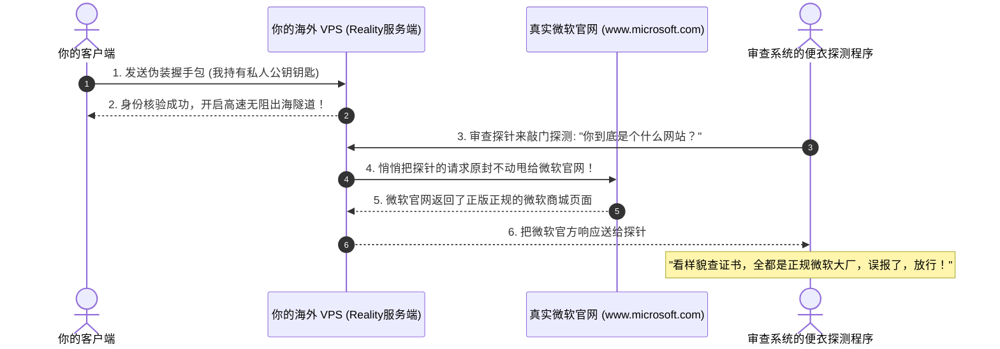

# 6、VLESS+XTLS+回落搭建节点：性能怪兽与免域名的Reality终极实战

如果你去问当下（2026年）的技术老鸟：“自建节点最推荐用什么协议？”
99% 的老玩家都会异口同声地回答你：**VLESS + XTLS Vision + Reality！**

在很多小白的传统认知里，搭建一个既安全又不容易被封的节点，过程极其繁琐：先要花钱去买域名，然后解析 DNS，还要用命令申请 SSL 安全证书，三个月还得记得续期一次……一旦证书配置出错，整个人直接抓狂。

而 **VLESS Reality** 的诞生，被誉为整个网络科学出海领域的“降维打击”：
- **你完全不需要花一分钱买域名！**
- **你完全不需要自己繁琐地申请和续期证书！**
- **它直接“借用”苹果、微软等全球顶级大厂的官方真实证书来伪装自己！**
- **性能强悍到几乎零 CPU 损耗，跑满 4K/8K 视频如同行云流水！**

本文将用彻底通俗的大白话，揭开这套“当前版本最强协议”的神秘面纱，并带你零门槛手把手搭建一套属于自己的终极节点！

---

## 一、为什么 VLESS 协议这么强？（甩掉包袱的轻装骑士）

在它前面的 VMess 协议虽然功能强大，但有一个历史遗留的缺点：**太臃肿了**。
就像一个谨慎过头的快递员：明明外面已经套了一个防弹防窥的保险箱（TLS），他在保险箱内部还要把里面的包裹再用五道锁严密锁死（内层对称加密）。这就导致客户端和服务器的 CPU 要做两次加解密计算，不仅手机发热耗电，在千兆带宽测速时还会严重拖慢速度。

```mermaid
flowchart TD
    subgraph 传统 VMess 双重加密 (性能笨重)
    A1[数据] --> B1[内层 VMess 加密锁]
    B1 --> C1[外层 TLS 安全箱]
    C1 --> D1[CPU 重复计算两次, 发热降速]
    end

    subgraph VLESS + XTLS 极简直通 (性能怪兽)
    A2[数据] --> B2[VLESS 只负责验票 ID]
    B2 --> C2[安全由外层 TLS/Reality 全权负责]
    C2 --> D2[XTLS 智能直通网卡, 零损耗秒开 4K]
    end
```

**VLESS（意为“无额外加密层的精简协议”）的核心思想**：
既然外层的 TLS 安全加密已经足够无懈可击了，**内层何必脱裤子放屁再加密一次？**
VLESS 自身不带任何多余的加密运算，只负责核对一下你的身份钥匙（UUID）。一旦身份核实，整条数据通道直接放行，把所有算力全留给最纯粹的高速数据吞吐！

---

## 二、什么是 XTLS Vision？（智能水管并线技术）

我们在上网时，访问的绝大部分网站本身就已经是标准的 HTTPS 加密网站了（比如 YouTube、Google）。
- **普通代理的笨办法**：把你原本已经加密好的 HTTPS 数据，在外面再当成普通货物强行套一层 TLS，形成了“TLS 套娃”。
- **XTLS Vision 的神技**：当握手成功后，它能像内窥镜一样智能识别出“原来里面装的已经是加密好的正规 TLS 流量了”。此时，它直接使用 Linux 系统的底层调用，把内层数据**直通网卡、原样转发**！
  - 这种设计不仅让服务器 CPU 负载降低 50% 以上，更消除了“套娃特征”，让审查设备在监控中完全抓不到任何特殊的规律指纹。

---

## 三、Reality：借鸡生蛋的终极伪装艺术

这是目前最让人拍案叫绝的一项黑科技。

在以前，我们必须自己花钱买一个域名来做网站伪装。而 **Reality（真实）** 的绝技是**“直接借用别人的真实正规大厂网站”**：



当你正常连接时，凭你专属的私钥直接连入节点；
一旦有审查设备来扫描或主动探测你的服务器 IP，你的服务器会像一面镜子一样，**直接把流量反向穿透到真实的微软官网或苹果官网**！
探针从你这里拿到的是 100% 正版、受国际信任的微软官方证书和网页内容。审查系统挑不出半点刺，自然只能乖乖放行！

---

## 四、手把手搭建实操（零买域名保姆教程）

### 第一步：安装官方 Xray-core
连接你的海外 VPS 终端，运行官方一键安装脚本：
```bash
# 更新环境并安装 Xray
apt update -y && apt install -y curl
bash -c "$(curl -L https://github.com/XTLS/Xray-install/raw/main/install-release.sh)" @ install
```

### 第二步：生成专属的密钥对
Reality 依赖一对非对称加密的公钥（Public Key）和私钥（Private Key）。在终端中运行：
```bash
xray x25519
```
终端会输出如下三行信息（**请拿小本本记下来！**）：
```text
Private key:  uABCDEF1234567890abcdef... （私钥，写在服务器配置里）
Public key:   xXYZ9876543210fedcba... （公钥，填在客户端连接里）
```

再生成一个用户的 UUID 身份钥匙：
```bash
xray uuid
```
终端输出一串类似：`d3b07384-d113-46fb-9bf3-5f7256193b2a`。

### 第三步：写入 Reality 终极配置文件
编辑 `/usr/local/etc/xray/config.json`：
```bash
nano /usr/local/etc/xray/config.json
```
把里面的内容清空，完整粘贴以下黄金配置模板（注意替换你的私钥和 UUID）：

```json
{
  "log": {
    "loglevel": "warning"
  },
  "inbounds": [
    {
      "port": 443,
      "protocol": "vless",
      "settings": {
        "clients": [
          {
            "id": "填入你的UUID",
            "flow": "xtls-rprx-vision"
          }
        ],
        "decryption": "none"
      },
      "streamSettings": {
        "network": "tcp",
        "security": "reality",
        "realitySettings": {
          "show": false,
          "dest": "www.apple.com:443",
          "xver": 0,
          "serverNames": [
            "www.apple.com",
            "images.apple.com"
          ],
          "privateKey": "填入你刚才生成的Private key私钥",
          "shortIds": [
            "6ba85179e30d4fc2"
          ]
        }
      }
    }
  ],
  "outbounds": [
    {
      "protocol": "freedom"
    }
  ]
}
```
*提示：配置中的 `dest` 和 `serverNames` 我们借用了苹果官网 `www.apple.com`，你也可以换成 `www.microsoft.com` 或 `www.amazon.com`。*
*按 `Ctrl + O` 回车保存，按 `Ctrl + X` 退出。*

### 第四步：启动并检查服务
```bash
systemctl restart xray
systemctl status xray
```
看到绿色的 `active (running)`，大功告成！

---

## 五、客户端如何填写参数连接？

在支持 Xray 的现代客户端（如电脑端的 **Clash Verge Rev**、**v2rayN**，手机端的 **小火箭 Shadowrocket**、**v2rayNG**）中：

- **协议（Protocol）**：选择 `VLESS`
- **地址（Address）**：你的海外 VPS 真实 IP
- **端口（Port）**：`443`
- **用户 ID（UUID）**：你的 UUID
- **流控（Flow）**：**必须选择 `xtls-rprx-vision`**
- **传输协议（Network）**：`tcp`
- **安全类型（Security）**：选择 **`reality`**
- **SNI 伪装域名**：`www.apple.com`（与服务端保持一致）
- **Public Key（公钥）**：填入你在第二步生成的 `Public key`
- **Short ID**：`6ba85179e30d4fc2`（与服务端保持一致）

点击保存连接，测试延迟，秒开 4K 高清大片！

---

## 六、常见高频问答 (FAQ)

> 💡 **排查指南**：自建节点若遇延迟高或阻断，可使用 [在线 IP 与网络测试工具](/notes/cheping/study/iptest/) 排查；线路挑选参考 [VPS行业黑话指南](/notes/cheping/study/vpscant/)，机场推荐可参阅 [神行加速全面深度测评](/notes/cheping/reviews/shenxing/)。

### Q1：为什么我用 Reality 连上后，测 Ping 有响应，但就是打不开任何网页？
**答**：通常有两大踩坑原因：
1. **系统时间不准确**：Reality 握手对时间非常严格，如果你的 VPS 服务器时间或者你本地手机/电脑的时间相差超过 60 秒，握手会直接失败。在 VPS 终端运行 `timedatectl set-ntp true` 开启自动同步时间即可解决；
2. **借用的大厂域名在国内被污染了**：如果你选的借用域名在本地直接打不开，那 Reality 也无法完成握手。建议借用大厂在全球 CDN 节点丰富的大域名，如 `www.apple.com`、`www.microsoft.com`、`gateway.icloud.com`。

### Q2：VLESS Reality 可以开启 Cloudflare CDN 吗？
**答**：**不能！**因为 Reality 的核心原理是“借大厂的 TLS 握手”，它必须建立直连 TCP 通信；而 Cloudflare CDN 必须配合你自己的域名和标准的 WebSocket/gRPC 协议。如果你想使用 Cloudflare CDN，请使用专栏第 5 篇的 **VMess + WS + TLS** 方案。

### Q3：为什么流控（Flow）一定要选 `xtls-rprx-vision`？不选会怎么样？
**答**：`xtls-rprx-vision` 是目前对抗现代深度包检测（DPI）最核心的技术！如果不开启它，普通的 TLS 流量在传输大文件时会暴露出明显的特征尺寸；而 Vision 能够通过智能填充随机字节（Padding），把数据包的长度分布打散，彻底消除协议特征。因此，**玩 VLESS 必须无脑搭配 Vision 流控**！

### Q4：自建了 VLESS Reality 之后，能看 Netflix 奈飞和用 ChatGPT 吗？
**答**：能否解锁流媒体和 AI，**100% 取决于你购买的那台 VPS 的 IP 纯净度**，跟协议本身没有任何关系！哪怕你用了全世界最牛的 Reality 协议，如果你买的 VPS 是大家都知道的超低价机房，它的 IP 早就被 Netflix 和 OpenAI 列入机房黑名单了，依然无法直接解锁。要看流媒体和使用 ChatGPT，需要选择原生 IP 或者原生双 ISP 的 VPS。

## 📌 推荐延伸阅读与技术指南
- **板块导航**：[节点搭建板块说明与系列导读](/notes/cheping/nodeConstruction/description/)
- **上一篇**：[5、VMESS+WS+TLS+WEB搭建](/notes/cheping/nodeConstruction/node5/)
- **下一篇**：[7、影响节点速度的因素有哪些？](/notes/cheping/nodeConstruction/node7/)
- **VPS术语科普**：[VPS 行业黑话完全指南（线路套路与回程优化）](/notes/cheping/study/vpscant/)
- **线路深度测评**：[出海线路深度测评：BGP 中转与 IPLC/IEPL 专线全解析](/article/network-analysis/)
- **机场推荐**：[神行加速全面测评：全 IPLC 专线架构与晚高峰实测](/notes/cheping/reviews/shenxing/)
- **博客阅读版**：[6、VLESS+XTLS+回落搭建节点（博客版）](/article/node6/)
