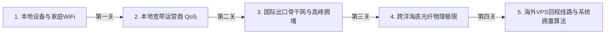
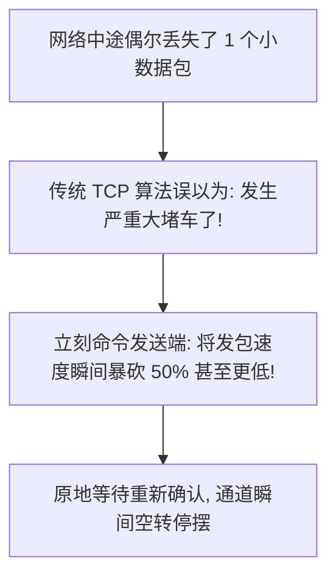

# 7、影响节点速度的因素有哪些？小白也能看懂的速度排坑完全指南

很多刚开始接触自建节点或使用代理的朋友，常常会发出这样的灵魂质问：
- “我家明明拉了 1000M 的电信千兆光纤，测速怎么只有 20M？”
- “我买的海外 VPS 明明标着 1Gbps 口子，为什么看 YouTube 4K 还是卡顿打转？”
- “是不是我的搭建命令敲错了？或者是这个协议不行？”

其实，**网络速度遵循着极其严苛的“木桶理论”**。
从你手机屏幕轻触的那一刻起，数据要穿越你家的无线 WiFi、光猫、小区宽带机房、省电信骨干网、跨洋海底光缆、海关审查交换中心、海外机房路由、服务器系统内核，最后才到达目标网站。

这根长达上万公里的数据链条上，**只要任何一个环节出现短板，你的整体速度就会被狠狠卡死在短板的上限上**！

本文将用完全通俗的大白话和形象生动的比喻，带你逐层拆解影响节点网速的五大核心因素，让你学会自己秒辨瓶颈在哪里！

---

## 一、水管木桶模型：数据出海的五大卡脖子关卡

---

## 二、关卡一：不可违抗的地球物理极限（光速时延）

很多小白问：“为什么我连美西洛杉矶节点的延迟永远在 150ms 左右，就不能做到像同城打游戏那样 10ms 吗？”

答案是：**不能！因为人类目前无法突破光速物理定律。**
- 中国大陆到美国西海岸横跨整个太平洋，两地之间的直线距离超过 **10000 公里**；
- 光在真空中的速度是每秒 30 万公里，而在海底光缆的玻璃纤维里，光的折射传播速度大约只有每秒 **20 万公里**；
- 加上中途几十台放大器、中继站和路由器的交换转发时间，**光信号在太平洋里单向跑一趟就至少要 60 毫秒，往返一趟（RTT）的绝对物理极限就在 120ms~150ms 之间**！

> **大白话现实意义**：
> 如果有人声称自己的美国节点延迟能做到 20ms，那他绝对是在用假数据糊弄你。物理距离直接决定了握手延迟的基线。想要极致低延迟（<50ms），只能挑选地理位置离大陆极近的中国香港、日本或韩国节点。

---

## 三、关卡二：最致命的元凶——骨干网高峰拥堵与回程路由

这是造成“白天跑满千兆、晚上连 10 兆都跑不到”的**绝对核心元凶**！

- **去程与回程的巨大落差**：
  你在刷网页或看 4K 视频时，你发出去的请求（去程）只有几百字节，而海外服务器推送给你的视频流（回程）占据了 99% 的带宽！
- **晚高峰的“春运惨剧”**：
  每晚 8 点到 11 点，全国数以亿计的人都在集中出海。普通出海公网（如电信 163 骨干网）就像狭窄的国道一样水泄不通，骨干网直接发生严重丢包。
- **精品专线的降维打击**：
  如果你用的是 VIP 收费高速（如电信 CN2 GIA、联通 AS9929、移动 CMIN2）或者私家专网（IPLC 物理光纤），全程走独立专属带宽，晚高峰依然能像白天一样秒开 4K！

---

## 四、关卡三：丢包率引发的“TCP 恐慌性刹车”

很多新手不理解：“测速显示只丢了 2% 的包，丢 2% 不算多啊，为什么速度会直接从 500M 暴跌到 10M？”

这是因为传统的 TCP 网络协议具有一个天生的缺陷——**激进的拥塞控制退避算法**。

- **大白话比喻**：
  高速公路上一列满载的车队在疾驰，只要其中一辆小货车掉了一颗螺丝钉（丢包 1%），传统的调度员就会惊慌失措地大喊：“前方道路彻底塌方了！所有人立刻踩死刹车，限速 10 迈慢慢爬行！”
- 在长距离、高延迟的跨洋网络中，这种“只要一丢包就疯狂踩刹车”的机制，是导致千兆宽带变成蜗牛的罪魁祸首！
- **解决绝招**：开启 **BBR 拥塞控制算法**（专栏第 8 篇有深度保姆级教学），它完全无视偶然的小丢包，只看真实水管容量，能让跨洋大流量速度直接暴涨 5~10 倍！

---

## 五、关卡四：你手里的终端设备算力瓶颈

千万不要忽视你自己手里的设备性能：
1. **老旧软路由与廉价电视盒子**：
   现代高强度加密协议（如 AES-256-GCM）非常依赖 CPU 的 **AES-NI 硬件加速指令集**。如果用的是几十块钱的二手老旧电视盒子或山寨工控机软路由，当网络跑满 100Mbps 时，CPU 占用率可能就直接飙到了 100%，机器烫得不行，速度再也上不去了。
2. **手机散热与省电模式**：
   在手机上开启某些没有开启硬件加速的协议时，长时间大流量下载会导致手机发热降频，客户端后台进程被系统省电策略自动限制，导致速度突然腰斩。

---

## 六、关卡五：本地宽带运营商的“暗箱操作”与家中 WiFi 暗伤

1. **运营商 QoS（服务质量管控）**：
   部分省份或地区的宽带运营商，为了节省昂贵的国际出口结算费用，在晚高峰会对普通民用宽带中发往境外的陌生长连接大流量进行“无差别限速”，甚至故意定时掐断 UDP 连接。
2. **家中穿墙 WiFi 信号衰减**：
   很多人坐在离路由器隔着两堵墙的卧室里测速，手机连的是穿墙后极度脆弱的 2.4G WiFi，本地局域网握手速率本身就已经掉到了可怜的十几兆，这根本不是海外节点的问题，而是家里的路由器信号没打通！

---

## 七、常见高频问答 (FAQ)

> 💡 **排查指南**：自建节点若遇延迟高或阻断，可使用 [在线 IP 与网络测试工具](/notes/cheping/study/iptest/) 排查；线路挑选参考 [VPS行业黑话指南](/notes/cheping/study/vpscant/)，机场推荐可参阅 [神行加速全面深度测评](/notes/cheping/reviews/shenxing/)。

### Q1：为什么测试节点延迟明明很低（比如香港 30ms），但看视频却不如延迟 160ms 的美西节点流畅？
**答**：**延迟低绝对不等于带宽大！**延迟只代表距离近、反应快；而看视频最需要的是充足的带宽吞吐和极低的丢包率。很多廉价香港 VPS 虽然离大陆很近，但商家分配的带宽可能只有可怜的 5Mbps 或 10Mbps，而且晚高峰丢包严重；而一台优质的美西 GIA VPS 虽然延迟有 160ms，但给了 1Gbps 的超大独享带宽且全程零丢包，看 4K/8K 视频当然秒杀劣质香港节点。

### Q2：我用的是苹果最新 iPhone，为什么连节点看视频依然频繁转圈？
**答**：首先排除是不是家庭 WiFi 的问题，建议靠近路由器连接 5GHz 频段测试；其次，看你使用的客户端模式：如果是开启了“全局代理”，你本地微信、QQ、网易云音乐等国内流量全都在跑海外节点，把节点带宽和连接数全挤满了。建议在客户端中切换为**“规则分流（Rule / 配置模式）”**，让国内流量走本地直连，只有海外流量才走节点。

### Q3：为什么测试同一个节点，白天速度能跑 300M，晚上 9 点就只剩下 5M？
**答**：这 100% 证明你的服务器走的是**廉价的普通国际公网（如电信 163 骨干网）**。白天大家都在工作上班，出海公网车道空旷；晚上全国千家万户都在刷海外流媒体，公网大拥堵，你的数据包被运营商的 QoS 机制直接无情扔掉（丢包）。要彻底治好晚高峰断崖，只能换用 CN2 GIA/AS9929/IPLC 优化线路。

### Q4：怎么快速排查是不是自己家里的路由器或者网络设置在拖后腿？
**答**：很简单！拿一根网线，把电脑直接插在光猫或者主路由器的千兆 LAN 口上，关掉杀毒软件和所有后台下载软件，直接用浏览器测速。如果插网线速度飞快，一换成无线 WiFi 就暴跌，说明问题纯粹出在家里的 WiFi 穿墙衰减、路由器型号太老或频段干扰上。

## 📌 推荐延伸阅读与技术指南
- **板块导航**：[节点搭建板块说明与系列导读](/notes/cheping/nodeConstruction/description/)
- **上一篇**：[6、VLESS+XTLS+回落搭建节点](/notes/cheping/nodeConstruction/node6/)
- **下一篇**：[8、如何不花钱提升节点速度？](/notes/cheping/nodeConstruction/node8/)
- **VPS术语科普**：[VPS 行业黑话完全指南（线路套路与回程优化）](/notes/cheping/study/vpscant/)
- **线路深度测评**：[出海线路深度测评：BGP 中转与 IPLC/IEPL 专线全解析](/article/network-analysis/)
- **机场推荐**：[神行加速全面测评：全 IPLC 专线架构与晚高峰实测](/notes/cheping/reviews/shenxing/)
- **博客阅读版**：[7、影响节点速度的因素有哪些？（博客版）](/article/node7/)
