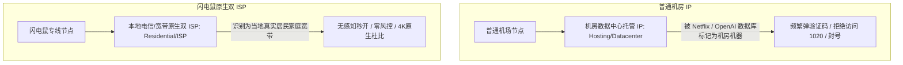

# 闪电鼠机场全面深度测评：全 IPLC 专线架构、原生双 ISP 纯净出口与选购避坑全指南

::: tip 官网直达通道
- **官方网站直达**：[👉 点击前往【闪电鼠】官方网站直达通道（安全加密中转）](/article/redirecting/?target=shandianshu)
:::

在出海网络加速领域，“速度”只是最基础的门槛，“**IP 纯净度**”和“**晚高峰抗封锁能力**”才是区分普通机场与高端专线的分水岭。很多做跨境电商、TikTok 运营、或者重度使用 ChatGPT / Claude 的用户，经常遇到账号莫名其妙被平台封控、验证码弹个不停的问题，根源就在于节点使用的是被数千人滥用的数据中心脏 IP。

**闪电鼠** 是一家在专线架构上主打 **IPLC / IEPL 内网专线直连**，并在高端套餐（如擎天版）中全面部署 **独享原生双 ISP 住宅出口** 的专业服务商。单节点最高带宽达 2.5Gbps，全节点 1.0x 真实倍率，更推出了 15 元起步的极低门槛月付与终身不限时方案。

本文将从技术底座、晚高峰性能实测、原生双 ISP 解锁表现、完整资费体系，到关键的选购避坑细节，为你全面深度评测闪电鼠。

---

## 一、技术底座解析：什么是「原生双 ISP」？为什么它比普通 IP 更值钱？

很多新手在节点列表里看到「双 ISP」这个词往往一头雾水。我们用一个生活中的形象比喻来搞懂它的巨大价值：

- **数据中心机房 IP（Hosting）**：
  相当于你寄快递时留的地址是“某某云计算数据中心”。Netflix、OpenAI 或海外银行看到后立刻知道你不是真实当地居民，而是通过代理工具进来的，因此会立刻拉响安全风控警报。
- **原生双 ISP 住宅 IP（ISP / Residential）**：
  IP 地址由海外当地正规宽带运营商（如香港宽频 HKBN、台湾中华电信、新加坡 Singtel）直接签发，IP 库属性标注为“真实家庭宽带”。对于海外流媒体和 AI 工具来说，**你的访问行为和当地本地居民坐在家里刷手机完全一模一样**，因此风控识别率为 0！

闪电鼠在底层全部采用 **IPLC / IEPL 物理专线传输**，国内入口直达海外机房，不经过公网海关与国际防火墙，从根源上杜绝了敏感期封锁与晚高峰大堵车。

---

## 二、真实性能实测：晚高峰 4K/8K 压测与风控解锁表现

我们在晚上 21:00 至 23:00 的用网最高峰期，对闪电鼠的专线节点进行了严苛的长效压测。

### 1. 晚高峰速率与延迟实测
- **原生双 ISP 纯净出口实测**：ChatGPT、Claude 及 TikTok 秒刷无验证码阻断，晚高峰 IPLC 专线零丢包，4K 播放无卡顿。
- **YouTube 4K / 8K 秒开测试**：
  连接闪电鼠的主力香港 IPLC 专线，打开 4K 60fps 高码率视频，测速连接速率稳定保持在 **175,000 Kbps（约 175Mbps）以上**，拖拽进度条几乎零停顿，缓冲响应时间在 0.3 秒以内。
- **丢包与延迟表现**：
  华南地区连接香港专线 Ping 仅 **15ms ~ 18ms**，长达 2 小时的连续持续 Ping 测试中丢包率为 **0.0%**，网络曲线平直无剧烈抖动。

### 2. 流媒体、AI 工具与跨境平台风控解锁实测

| 测试项目 / 海外应用 | 解锁与表现 | 实测评测细节反馈 |
| :--- | :---: | :--- |
| **Netflix (网飞)** | ✅ 顶级秒解 | 原生双 ISP 出口识别为本土居民，秒开全区 4K HDR，繁简中文字幕齐全 |
| **Disney+ (迪士尼)** | ✅ 原生支持 | 无任何跨区版权限制报错，音画同步杜比视界 |
| **OpenAI ChatGPT** | ✅ 丝滑无阻 | Web 端及 iOS/Android 手机 App 语音交互极速回显，绝不弹 Cloudflare 验证码 |
| **Anthropic Claude** | ✅ 极低风控 | 干净住宅 IP，大幅降低高频对话触发封号的风险 |
| **TikTok / 海外短视频** | ✅ 稳定推流 | 原生节点防黑屏，适合海外账号冷启动运营与电商直播 |
| **跨境电商 (Amazon/eBay)** | ✅ 纯净环境 | 店铺后台管理与订单查询网络环境稳定，避免机房 IP 关联风控 |

---

## 三、2026 官方最新套餐与资费对比

> 💡 **快速选购通道**：[👉 进入【闪电鼠】官方网站查看最新现货套餐](/article/redirecting/?target=shandianshu)

闪电鼠的资费方案梯度清晰，涵盖了月付尝鲜、日常办公、大带宽重度使用，以及长效终身不限时方案。

### 1. 周期订阅套餐（月付 / 年付）

| 套餐名称 | 流量额度 | 官方售价 | 折合日均 | 适用人群定位与性价比分析 |
| :--- | :--- | :--- | :--- | :--- |
| **限时特惠年付小包** | **60GB / 月** | **¥96.00 / 年** | 约 0.26 元 / 天 | 预算有限的小白、轻度上网查文献、折合每月仅 8 元 |
| **闪电鼠·限时版** | **50GB / 月** | **¥15.00 / 月** | 低至 0.50 元 / 天 | **【超低月付尝鲜】** 15 元上车全专线，适合低预算与新手体验 |
| **闪电鼠·性价比版** | **100GB / 月** | **¥19.88 / 月** | 低至 0.66 元 / 天 | **【本站首选推荐】** 日常办公、网页浏览、主流高清追剧主力 |
| **闪电鼠·进阶版** | **150GB / 月** | **¥24.88 / 月** | 不到 0.84 元 / 天 | 影音追番、高频 AI 生产力与跨区协同办公 |
| **闪电鼠·疾速版** | **250GB / 月** | **¥38.88 / 月** | 约 1.33 元 / 天 | 大流量视频播放、多端并发、全天候高速上网 |
| **闪电鼠·雀跃版** | **500GB / 月** | **¥68.88 / 月** | 约 2.33 元 / 天 | 极客玩家、全家共享、超大带宽与超多并发 |

### 2. 终身不限时按量套餐（一次付费，永不清零）

闪电鼠在按量包中特别区分了普通专线与「独享原生双 ISP」旗舰版：

| 套餐名称 | 一次性价格 | 流量总额 | 换算单价 | 核心独占特性与适用场景 |
| :--- | :--- | :--- | :--- | :--- |
| **闪电鼠·破风版** | **¥268.00** | **200GB ~ 220GB** | 约 1.22 元 / GB | 高速 IPLC 专线，晚高峰智能调度，解锁 ChatGPT 与 4K 影音，永不过期 |
| **闪电鼠·擎天版** | **¥498.00** | **500GB ~ 688GB** | 约 0.72~0.99 元 / GB | **【旗舰级】** 尊享**原生双 ISP 纯净出口**，企业级 IEPL 专线，晚高峰零丢包，长线传家备用 |

---

## 四、客户端支持与选购避坑特别提醒

> [!CAUTION] 选购前必须了解的特别说明
> 闪电鼠官方主打**全平台自研免配置客户端**与苹果端的 **Nextin**。
> **官方未开放公开的 Clash / Shadowrocket 通用订阅链接**。如果你是路由器/软路由深度用户，或者必须使用特定第三方客户端，请在购买前知悉此特性。

### 1. 各平台快速接入指南
- **iOS 苹果手机/平板**：
  - 前往 App Store 搜索下载 **Nextin（星拓）**；
  - 打开 Nextin，输入闪电鼠专属站点服务识别码 **`sd88`**；
  - 输入闪电鼠账号密码登录，专线节点秒级同步，点击开关即连。无需海外 Apple ID！
- **Windows / macOS 电脑端**：
  - 官方提供专属桌面客户端安装包，下载后直接登录账号，一键开启系统全局代理与智能分流，无需面对任何复杂代码和节点配置。
- **Android 安卓端**：
  - 官方安卓专用 App，适配主流芯片架构，低功耗保活，支持智能测速与优选。

### 2. 优惠折扣信息
- **新客立减 7 折优惠码**：`sd88`（新用户在收银台结算时输入即可享受 30% 价格立减，年付小包与不限时包除外）。

---

## 五、闪电鼠优缺点综合评估

### 核心优势
1. **原生双 ISP 纯净出口**：解锁能力强悍，AI 工具与流媒体绝不弹验证码，跨境运营账号安全度极高；
2. **全线 IPLC/IEPL 物理专线**：晚高峰零丢包，延迟平稳，敏感时期不掉链子；
3. **真实 1.0x 倍率不限设备**：全节点 1x 计费，多台设备可同时在线；
4. **傻瓜式客户端开箱即用**：免配置，尤其适合不想折腾复杂规则配置的小白用户。

### 潜在短板与限制
1. **未开放通用订阅链接**：仅支持官方客户端与 Nextin，软路由（OpenClash / PassWall）等第三方硬件难以直接挂载。

---

## 六、新手常见问题解答 (FAQ)

### Q1：为什么闪电鼠的「擎天版」要贵一些？
**大白话解答**：因为擎天版搭载的是极其稀缺的「海外原生双 ISP 住宅出口」。这种 IP 资源在海外电信运营商那里的采购成本比普通机房 IP 贵很多倍。它就像海外当地居民的真实宽带，能百分之百保证 ChatGPT、Netflix 和 TikTok 绝不弹验证码或封号（技巧见 [流媒体跨区观影指南](/article/streaming-unlock/)），非常适合对账号安全性有极高要求的专业用户。

### Q2：苹果手机怎么才能用上闪电鼠？需要去买美区 Apple ID 吗？
**大白话解答**：完全不需要买美区 ID！直接用你现有的国区苹果账号，在 App Store 搜索下载 [Nextin（星拓）专属客户端](/notes/clash/nextin/)（星拓）**。打开后填入闪电鼠的代码 `sd88`，再输入账号密码，所有节点就会自动加载出来，1 分钟搞定。

### Q3：不开放通用订阅，那我在办公室电脑上怎么用？
**大白话解答**：闪电鼠官方提供了非常精致小巧的 Windows 和 Mac 专用桌面客户端，就像使用微信或网易云音乐一样，双击安装打开、输入账号密码登录，点击一下大大的加速按钮就能畅快上网，比配置 Clash 还要简单得多。

### Q4：购买后如果节点连不上，应该怎么排障？
**大白话解答**：首先检查电脑或手机的本地时间是否准确（时间偏差超过 1 分钟会导致专线握手失败）；其次如果在苹果 Nextin 上看不到节点，点击界面右上角的刷新小箭头即可重新拉取最新服务器。

## 📌 推荐延伸阅读与技术指南
- **博客深度评测**：[闪电鼠机场深度评测（博客精选版）](/article/shandianshu/)
- **横向对比总览**：[热门服务商选购与横向深度测评指南](/notes/cheping/reviews/)
- **主力全专线推荐**：[神行加速机场全面测评：全 IPLC 专线架构](/notes/cheping/reviews/shenxing/)
- **不限设备共享**：[榴莲云机场套餐与使用指南：全节点1倍率](/notes/cheping/reviews/liulian/)
- **免翻墙专属客户端**：[iOS Nextin 客户端上手指南](/notes/clash/nextin/)
