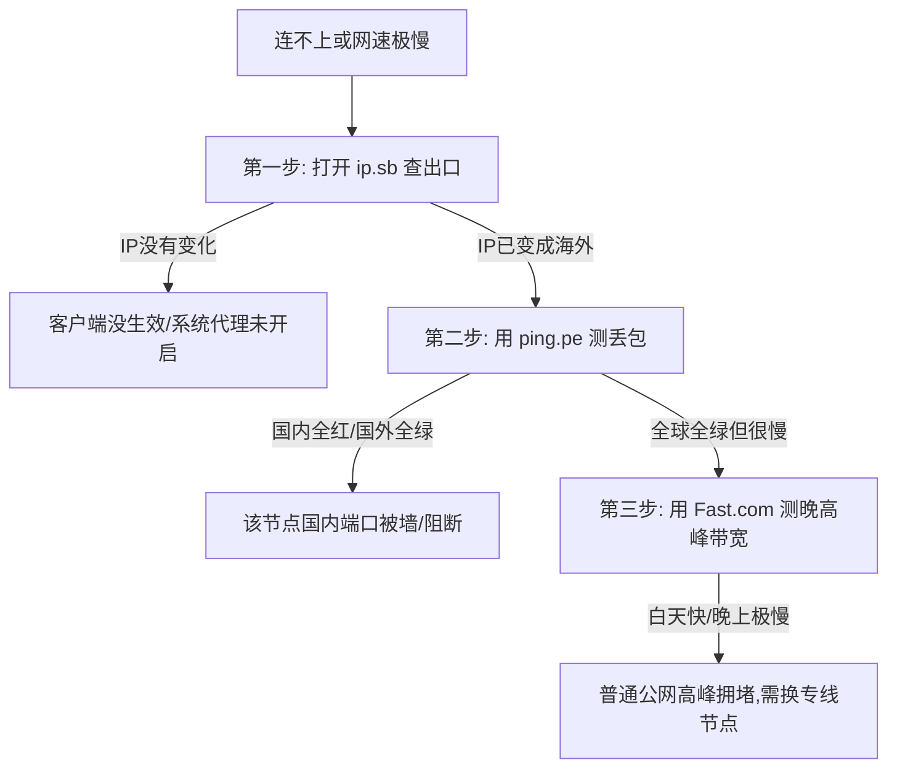

# 在线IP与网络测试工具：小白也能看懂的节点体检指南

很多新手朋友在刚开始接触科学上网或者购买了 VPS 服务器后，经常会遇到各种让人摸不着头脑的问题：
- “为什么我买了 1000M 的宽带，测速却只有十几兆？”
- “为什么打开 Google 总是弹出‘请证明你不是机器人’的点图片验证？”
- “为什么网页明明能正常打开，但一打开 ChatGPT 或者 Netflix 就提示‘地区不支持’或‘拒绝访问’？”

其实，这并不是你的电脑或手机坏了，而是你的**节点网络状态（IP 纯净度、线路拥堵、路由走向）**出现了问题。就像人生病要去医院做血常规和拍片一样，网络遇到问题也需要借助一系列在线工具来“全面体检”。

本文将用完全通俗的大白话，不堆砌生涩的学术名词，带你系统掌握最实用、最可靠的在线测试工具，让你自己就能轻松秒懂网络状况！

---

## 一、网络体检四大核心指标（大白话速懂）

在开始使用工具前，先用生活中的例子搞懂最关键的四个指标：

| 指标名称 | 官方术语 | 大白话比喻 | 越怎样越好 | 小白及格线 |
| :--- | :--- | :--- | :--- | :--- |
| **延迟 (Ping)** | 网络往返时间 (RTT) | 你跟朋友发微信语音，对方多快能听到回话 | 越低越好 | 日韩港 < 80ms；欧美 < 180ms |
| **抖动 (Jitter)** | 延迟的波动差值 | 高速公路上的车流是平稳前行还是走走停停 | 越小越好 | < 10ms 算非常平稳 |
| **丢包率 (Packet Loss)**| 数据包丢失百分比 | 寄出去 100 个快递包裹，路上丢了几个 | 必须为 0% | 玩游戏要求 0%；看视频 < 2% |
| **下行带宽 (Speed)** | 下载速率 | 自来水管有多粗，单位时间内能流出多少水 | 越大越好 | 4K 视频需要 30Mbps 以上 |

---

## 二、IP 身份与纯净度检测（查户口）

网络世界的每一台电脑都有一个公网 IP 地址。如果你的 IP 被各大平台标记为“机房商业服务器”或“恶意垃圾流量来源”，你就会处处碰壁。

### 1. 基础定位与运营商查询
当你连上代理节点后，第一步就是确认节点是否生效、到底位于哪个国家。

- **[ipinfo.io](https://ipinfo.io/)**：国际上最公认的 IP 查询工具。打开网页就能直接看到当前 IP 的所在国家、城市、所属运营商（ISP）以及 ASN 机构编号。
- **[ip.sb](https://ip.sb/)**：极简快速的 IP 查询页，没有任何广告，一秒钟显示你当前走代理后的出口 IP、国家与网络类型。
- **[ipip.net](https://www.ipip.net/)**：国内权威的高精度 IP 数据库，右上角有专门的“高精度查询”，能精准识别中国大陆三网运营商与海外骨干机房。

### 2. IP 纯净度与欺诈值检测（为什么总有人机验证？）
Google 之所以频繁让你点斑马线、红绿灯，或者 OpenAI 提示 Access Denied，是因为你的 IP “欺诈分（Fraud Score）”太高了。

- **[Scamalytics](https://scamalytics.com/)（核心推荐）**：
  - 专门给 IP 打分的风控数据库。
  - **0 ~ 15 分**：极度纯净（像普通海外居民家里的宽带，随便用都不弹验证）。
  - **16 ~ 40 分**：中度风险（偶尔会有验证码，正常刷网页没问题）。
  - **40 ~ 100 分**：高危 IP（基本已被各大网站拉黑，无法注册海外金融机构或 OpenAI）。
- **[Whoer.net](https://whoer.net/)**：
  - 综合伪装度检测工具，会给你的系统打出一个 0%~100% 的伪装度分数。
  - 它会检测你的浏览器时区、系统语言与当前 IP 所在的国家是否相符，还会检查是否存在 WebRTC 真实本地真实 IP 泄露。

---

## 三、网络测速工具（水管到底有多粗？）

很多新手喜欢直接用手机自带的测速或者百度测速，这测的只是你家到国内机房的速度，根本测不到境外节点的真实水平。

### 1. [Speedtest by Ookla](https://www.speedtest.net/)
全球最权威的通用测速平台。
- **使用技巧**：不要只点“Go”测默认服务器！点击“Change Server（更换服务器）”，搜索并手动指定一个目标地区（比如你买的是香港节点，就选一个香港本地或者新加坡的节点；如果你想看回国速度，就搜索国内的中国电信、中国联通服务器）。
- **关键数据看哪里**：
  - **Download（下载）**：决定你平时刷网页、下载软件、看高清视频的速度。
  - **Upload（上传）**：决定你往 Google Drive 传文件、发邮件的速度。
  - **Idle Latency（空闲延迟）与 Loaded Latency（带载延迟）**：如果带载延迟比空闲延迟高出好几倍，说明你的路由器或节点在跑满时存在严重的排队积压（Bufferbloat）。

### 2. [Fast.com](https://fast.com/)
由国际流媒体巨头 Netflix（网飞）官方搭建的测速服务。
- **核心特色**：Fast.com 的测速流量直接走 Netflix 的全球真实视频 CDN 服务器。
- **现实意义**：许多不良小机场会在普通测速中作弊刷假数据，但面对 Fast.com 的真实流媒体服务器无法作弊。如果 Fast.com 能跑到 50Mbps 以上，说明你看海外 4K 高清视频绝对丝滑流畅。

---

## 四、路由追踪与全球连通性（你的数据是怎么跑过去的？）

上网就像坐车，从你家到海外网站，中间要经过几十个路由器中转站。有的走“点对点高铁专线”，有的走“盘山烂路”。

### 1. [ping.pe](https://ping.pe/)
排查服务器是否被防火墙阻断、判断丢包位于哪一段的神器。
- 打开网站，输入你的服务器 IP 或域名。
- 它会瞬间调用全球 30 多个测速点（包含中国电信、联通、移动、欧美各大骨干网）同时向你的目标发送数据包。
- **看图说话**：
  - 如果全球所有国家都显示绿色的“0% 丢包”，只有中国境内的节点全是红色的“100% 丢包”，说明你的服务器 IP 已被国内防火墙阻断（俗称“被墙”）。
  - 如果全球测试点全是红色 100% 丢包，说明是你的服务器关机了、断网了，或者系统内部防火墙没有放行端口。

### 2. [itdog.cn](https://www.itdog.cn/)
国内功能最全面的免费测速站，专门用来检测三网回程延迟。
- 拥有遍布全国各省市的几百个真实家庭宽带测速节点。
- 输入海外 VPS 的 IP，可以一键生成中国地图颜色分布图：绿色代表超低延迟（<50ms），黄色为正常（50~100ms），红色为高延迟（>200ms）。
- 让你一眼看清你的节点是对电信好、对联通好、还是对移动更友好。

### 3. NextTrace 开源路由追踪
如果你有海外 VPS 或者在电脑终端排查，NextTrace 是目前最强、界面最漂亮的可视化回程路由追踪软件。
- 它能把数据经过的每一个中转站的机房名称、骨干网类型（例如是普通 163 骨干，还是尊贵的 CN2 GIA、AS9929、CMIN2）用彩色图表清晰标出。

---

## 五、流媒体与热门服务解锁检测

能上网并不等于能看受版权保护的视频或使用受地理管制的 AI。海外流媒体（Netflix、Disney+、HBO Max、YouTube Premium）以及 OpenAI ChatGPT 会严厉封禁普通机房 IP。

在 VPS 终端中，你可以运行以下开源社区公认的检测脚本：

```bash
# 流媒体与海外主流平台解锁综合检测脚本
bash <(curl -L -s https://raw.githubusercontent.com/lmc999/RegionRestrictionCheck/master/check.sh)
```

脚本会自动检测并输出结果：
- **Yes (Native / 原生)**：完全解锁，版权库最完整，支持播放自制剧与非自制剧。
- **Yes (DNS / 解锁服务)**：通过 DNS 代理分流方式实现解锁。
- **No**：无法解锁，打开会直接黑屏或提示不在服务区。

---

## 六、小白排障实战三步法

当你觉得“网卡了”或者“连不上了”，请按照以下黄金顺序排查：



1. **第一步（查出口）**：打开 `ip.sb`，看屏幕上显示的 IP 是不是海外的。如果还是你本地宽带，说明客户端代理软件根本没配置成功或没开系统代理。
2. **第二步（测丢包）**：把节点 IP 复制到 `ping.pe`，看中国大陆节点的丢包率。如果丢包超过 15%，打游戏和刷网页必然会频繁转圈。
3. **第三步（测有效吞吐）**：打开 `Fast.com`，在晚上 8:00~11:00 晚高峰跑一次。如果只有几百 Kbps，说明该线路晚高峰被运营商严重限速。

---

## 七、常见高频问答 (FAQ)

### Q1：为什么我的 IP 查询结果显示在香港，但 Google 搜出来的语言却是阿联酋或挪威？
**答**：这是因为大型跨国互联网公司（尤其是 Google）并不完全依赖单一的 IP 商业库，他们有自己的算法。如果该 IP 之前被中东或欧洲的服务器租赁过，或者有大量中东语言的搜索请求，Google 会在一段时间内把该 IP 的语言偏好判定为当地。这不影响网络连接质量。对于有苛刻纯净 IP 需求的用户，可参阅 [神行加速全面深度测评](/notes/cheping/reviews/shenxing/)。

### Q2：测速软件显示延迟只有 30ms，为什么看视频还是会一直卡顿加载？
**答**：延迟（Ping）只代表信号往返的速度快慢，**不代表通道容量有多大**。打个比方：延迟好比赛跑运动员跑得快不快，而带宽好比这趟车能拉多少吨货物。如果延迟只有 30ms，但线路丢包率高达 10%，或者带宽只有 2Mbps，只要稍微看点高清视频就会把水管堵满，导致不断转圈缓冲。

### Q3：为什么测试 ChatGPT 显示被拒，但访问普通海外网页都很顺畅？
**答**：OpenAI 对 IP 的风控级别属于全球最顶尖梯队。普通的海外商业机房（如搬瓦工、Linode、DigitalOcean 等）的整个 IP 段都已经被 OpenAI 标为“数据中心（Data Center）”而直接阻断访问。要流畅使用 ChatGPT，需要使用带有“原生住宅 IP”或“原生双 ISP”标签的高纯净度节点，或者在客户端中通过规则分流将 OpenAI 请求指定走纯净解锁节点。

### Q4：为什么测速跑得飞快（上百兆），但一到晚上 9 点就卡成 PPT？
**答**：这是典型的“国际出口晚高峰公网拥堵”现象。每天晚上 8 点到 11 点，数以亿计的网民都在集中出海访问。如果你用的是普通的 163 骨干网，出海大门就像早晚高峰的主干道一样严重塞车，丢包率瞬间飙升到 20%~40%。要解决晚高峰卡顿，只能选择具备 IPLC/IEPL 物理内网专线或者 CN2 GIA/AS9929/CMIN2 精品优化线路的服务商。

## 📌 推荐延伸阅读与技术指南
- **博客精读版**：[在线 IP 与网络测试工具（博客实测版）](/article/iptest/)
- **机场推荐**：[神行加速全面测评：全 IPLC 专线架构与晚高峰实测](/notes/cheping/reviews/shenxing/)
- **线路基础分析**：[网络线路解析与出海线路评测](/notes/cheping/study/networkanalysis/)
- **线路类型鉴别**：[如何判断网络服务线路类型](/notes/cheping/study/networkselect/)
