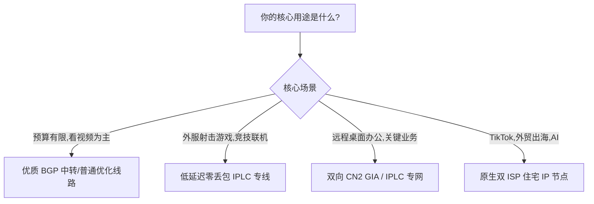

# 如何判断网络服务线路类型 (IPLC/IEPL/BGP中转等)：防坑鉴假指南

打开现在的各种网络服务商或机场页面，你会发现几乎家家都在打着响亮的广告口号：
“全节点 IPLC 物理专线”、“晚高峰 0 丢包”、“企业级 IEPL 内网直连”、“BGP 优质高速中转”。

然而，当你花了几十块钱甚至上百块钱买回来之后，却发现晚上依然频繁断流、看视频卡成定格动画、关键时刻直接失联。

**为什么你买的“专线”一点都不像专线？**
原因很简单：**行业内存在大量“挂羊头卖狗肉”的假专线！**很多不良小作坊拿成本极其廉价的普通公网隧道，改个名字就包装成高大上的“顶级 IPLC 专线”高价割韭菜。

本文将用完全通俗的大白话和科学严谨的物理定律，教你如何用最简单的工具，在几分钟内识别出真假专线，彻底告别花冤枉钱！

---

## 一、三大出海线路架构解剖（交通工具比喻）

为了让大家不再被花里胡哨的技术名词绕晕，我们用大家最熟悉的出行方式来做个类比：

### 1. 公网直连（普通绿皮慢车）
- **特点**：你的电脑直接发数据包出境，没有任何中间节点优化。
- **缺点**：必须老老实实挤普通国际出海大门。平时人少时凑合能用，一到晚上或者节假日晚高峰，立刻面临大面积排队堵塞和丢包。

### 2. BGP 公网中转（高铁换乘）
- **特点**：服务商在大陆核心城市（如上海、广州）租用高质量的 BGP 多线机房。你的电脑先连到这个国内机房，再由国内机房通过加密隧道跨洋发送到境外落地节点。
- **优缺点**：大幅改善了你本地运营商直连海外的延迟；但在中间那段跨洋传输上，**依然走的是公共国际互联网**，如果遇到大风大浪或敏感时期，仍然可能产生丢包断流。

### 3. IPLC / IEPL 物理专线（私人直达海底高铁）
- **特点**：两地机房之间拉了一根专用的独立物理光纤光缆（例如深圳机房直通香港机房）。
- **最大优势**：**它完全不走公网，根本不经过国际公网海关（防火墙），没有任何拦截和审查**！全天 24 小时的延迟像心电图停跳一样平稳，晚高峰丢包率为绝对的 0%。

---

## 二、识别真假专线四大实操狠招

不要听商家口头上怎么吹，用以下四招，假专线立刻原形毕露：

### 招式一：光速物理极限时延计算（照妖镜第一招）
光在真空中的传播速度是每秒 30 万公里，而在光纤玻璃纤维中的传播速度大约是每秒 20 万公里。加上信号放大器和中继设备的硬件损耗，两地之间的光纤延迟是有**严格的物理下限**的：

| 线路区间 | 真实物理专线延迟 (RTT) | 假专线/公网中转延迟 | 鉴别判定法则 |
| :--- | :--- | :--- | :--- |
| **深圳 ⇄ 中国香港** | **1.8ms ~ 4.5ms** | > 15ms | 如果深港延迟超过 15ms，绝非专线直连 |
| **上海 ⇄ 日本东京** | **23ms ~ 28ms** | > 45ms | 超过 45ms 必是走普通公网绕路了 |
| **广州 ⇄ 新加坡** | **32ms ~ 36ms** | > 65ms | 超过 65ms 必定未经专线直连 |
| **上海 ⇄ 美西洛杉矶**| **125ms ~ 138ms** | > 180ms | 超过 180ms 说明中途有多跳公网中转 |

> **实操方法**：
> 如果你连上了一个号称“深港 IPLC”的节点，在客户端里测出的内网延迟居然高达 30ms、40ms，不用怀疑，这绝对不是真正的内网点对点物理光缆，而是普通的公网转发！

### 招式二：查路由跳数与私有保留 IP（第二招）
使用 `NextTrace` 或 `MTR` 追踪路由路径：
- **真正的专线**：从国内入口跳进专线后，中间通常只有 **1 到 3 跳**，并且这几跳的 IP 地址通常显示为私有保留内网地址（如 `10.x.x.x`、`172.16.x.x` 或运营商专网 `100.64.x.x`），之后下一跳就直接抵达了香港或日本的机房。
- **假专线**：路由追踪中间密密麻麻有一二十跳，中途赫然出现电信 163 骨干网（`202.97.x.x`）或者联通公网（`219.158.x.x`）的公网路由节点。这说明数据根本没走专线，而是在公网上裸奔！

### 招式三：特殊敏感时期抗风暴考验（第三招）
每年的重要会议、重大会议或节假日，国际公网出口往往会收紧风控，大量普通公网小鸡和低端中转机场会出现大面积红灯爆阻、网页频繁打不开。
- 如果某个节点在全网大断连的时期，**依然能够像平时一样秒开网页、秒开 4K，连通率 100% 毫无影响**，那么它大概率是真正拥有不过墙物理专线的高端服务。

### 招式四：用成本常识计算价格（第四招）
正规电信运营商对 1Gbps（千兆）物理 IPLC 专线的官方月租金通常在数万到十几万元人民币。
- 如果某个小机场声称自己“9.9 元一个月不限流量，全节点独享千兆 IPLC”，从商业逻辑上讲是绝对不可能的。天下没有免费的午餐，这种所谓的“专线”要么是虚标名字的劣质公网，要么是随时准备跑路的资金盘。

---

## 三、小白如何根据需求挑选合适线路？

买线路不需要盲目追求最贵，适合你的才是最好的：

1. **普通高清刷剧族（预算有限）**：
   - 推荐：**优质 BGP 中转**。性价比极高，白天晚上看 YouTube 4K 毫无压力，每月十几元到二十几元即可获得充足流量。
2. **重度游戏玩家（对丢包零容忍）**：
   - 推荐：**真实深港/沪日 IPLC 专线**。延迟稳定在极低水平，全天零丢包，告别游戏卡顿掉线。
3. **跨境电商外贸 / 深度 AI 重度用户**：
   - 推荐：具备**原生双 ISP**出口的专线节点，确保在登录 PayPal、Stripe、ChatGPT、TikTok 时免受封控困扰。

---

## 四、常见高频问答 (FAQ)

### Q1：IPLC 专线真的完全“不过墙”吗？会不会被封锁？
**答**：真正合规的 IPLC 专线在物理链路上是两地机房之间的封闭内网光缆，物理上确实**不经过国家公共国际互联网出口互联交换点**，因此不存在被公共防火墙实时嗅探或阻断的问题。但是，如果国内的专线入口服务器自身违反了国内云服务商的使用条款（详见 [网络线路解析与出海线路评测](/notes/cheping/study/networkanalysis/)），或者入口服务器 IP 遭受了恶意攻击，入口可能会被临时通报整改，导致服务短暂切换备用线路。

### Q2：IEPL 和 IPLC 到底哪一个更好？为什么有的商家叫 IEPL？
**答**：两者在抗封锁、低延迟和稳定性上**没有任何实际体验差距**。推荐参阅 [神行加速全面深度测评（全 IPLC 专线架构）](/notes/cheping/reviews/shenxing/)。IPLC 相当于传统的专属私人公路，而 IEPL 则是以太网技术升级后的现代化高标准专网，硬件兼容性更强、带宽调配更灵活。对于普通用户来说，只要是正规物理专网，无需纠结是 IPLC 还是 IEPL。

### Q3：为什么连接了 IPLC 专线，测本地 IP 显示的是国内城市（如深圳或上海）？
**答**：这是正常现象！IPLC 采用的是“国内入口 + 境外落地”的双端架构。当你把客户端设为直连模式或某些国内应用探测时，检测到的是你连接的国内专线入口服务器 IP；只有当你的请求发往海外目标（如 Google、YouTube）时，流量穿过专线光缆，海外端看到的才是境外的真实出口 IP。

### Q4：有些服务商标注的“BGP 隧道”和“IPLC 专线”有什么区别？
**答**：两者的区别就在于“中间那一段路到底走哪里”：
- **BGP 隧道**：国内段是好路（BGP 机房），但跨国那段依然走的是公网加密隧道；
- **IPLC 专线**：从国内机房到境外机房，全程走的是物理私有光纤。前者成本低很多，后者成本高但稳定性天下第一。

## 📌 推荐延伸阅读与技术指南
- **博客精读版**：[如何判断网络服务线路类型 (IPLC/IEPL/BGP中转等)](/article/networkselect/)
- **线路深度解析**：[网络线路解析与出海线路评测](/notes/cheping/study/networkanalysis/)
- **机场推荐**：[神行加速全面测评：全 IPLC 专线架构与晚高峰实测](/notes/cheping/reviews/shenxing/)
- **行业术语解析**：[VPS 行业黑话完全指南](/notes/cheping/study/vpscant/)
