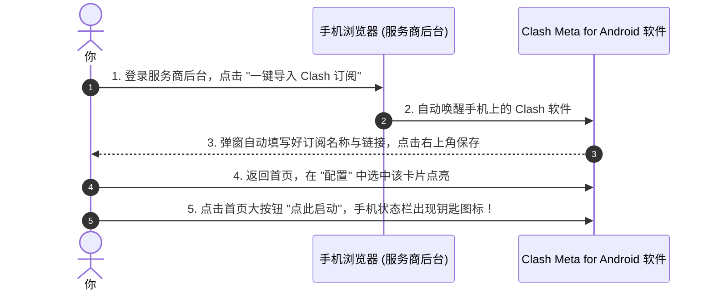
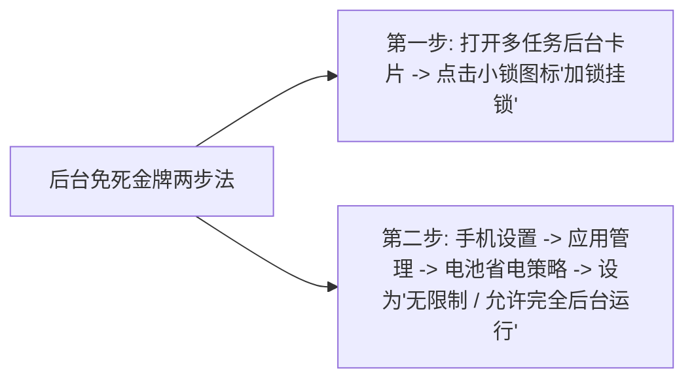

# 安卓 (Android) 手机端科学上网完全指南：Clash Meta 与 v2rayNG 极速上手

对于广大的安卓（Android）手机用户来说，出海自由度相比 iOS 苹果生态要高得多：你不需要注册什么美区海外账号，也不需要花钱购买软件，直接下载一个官方开源的 APK 安装包即可畅享无界网络！

然而，很多安卓新手在面对网上的各种客户端时，经常会被各种各样的问题困扰：
- “为什么老版 Clash for Android（小猫咪）不能用了，现在安卓该用哪个软件？”
- “Clash Meta for Android（CMFA）和 v2rayNG 该选哪一个？”
- “为什么锁屏几分钟之后，后台代理就自动断线被系统杀掉了？”

本文将用完全通俗的大白话，不带任何深奥技术代号，手把手带你完成安卓手机上的主流客户端选型、节点订阅一键导入，以及教你如何设置“后台永不断连”的独家秘诀！

---

## 一、安卓两大主流神器怎么选？（大白话对比）

在目前安卓生态中，体验最好、最受推荐的主要是以下两款顶级神器：

```mermaid
flowchart TD
    Android[安卓手机出海客户端选型] --> Choice{你的使用习惯}
    Choice -->|追求自动化智能分流、机场订阅一键管理、界面直观卡片| CMFA[Clash Meta for Android / Flclash (首选主力)]
    Choice -->|喜欢轻巧无额外负担、经常手动扫码单个节点、老手机低配| V2rayNG[v2rayNG (经典单节点老牌神器)]
```

| 客户端名称 | 核心优势 | 缺点与局限 | 小白推荐指数 |
| :--- | :--- | :--- | :--- |
| **Clash Meta for Android（简称 CMFA）** | 智能规则分流极强（国内免翻、国外代理）、多国家节点自动归类、支持新协议 | 首次配置步骤比 v2rayNG 稍多一点点 | ⭐⭐⭐⭐⭐ (五星力荐) |
| **v2rayNG** | 极度轻巧、零门槛扫码导入、支持一键测全部单节点、低配老手机首选 | 策略分流不如 Clash 灵活，多节点管理较为单调 | ⭐⭐⭐⭐ (四星好评) |

> **小白无脑建议**：
> 如果你是在机场购买了整套包含几十个节点的订阅套餐，**强烈首选【Clash Meta for Android】（或界面清爽可爱的 Flclash）**！它的智能分流让你在手机上日常使用完全感受不到它的存在，极其省心。

---

## 二、Clash Meta for Android 保姆级三步上手

### 第一步：去哪里下载并安装 APK
1. **渠道一（机场后台免翻墙高速直链，最推荐新手）**：登录你的服务商网站后台，点击【客户端下载】->【Android 安卓】，直接下载官方最新 `.apk` 安装包；
2. **渠道二（GitHub 官方 Releases 仓库）**：访问 [https://github.com/MetaCubeX/ClashMetaForAndroid/releases](https://github.com/MetaCubeX/ClashMetaForAndroid/releases)（国内镜像打开：[https://ghfast.top/https://github.com/MetaCubeX/ClashMetaForAndroid/releases](https://ghfast.top/https://github.com/MetaCubeX/ClashMetaForAndroid/releases)），下载带有 `universal.apk` 或 `arm64-v8a.apk` 的文件；
3. 手机打开下载目录，点击 `.apk` 文件进行安装（若手机系统提示“未知来源应用”，点击【允许本次安装】即可）。

### 第二步：一键导入节点订阅
这是最关键的一步，把你的节点列表装进手机里：



1. **方式一（一键自动导入）**：
   在手机浏览器登录你的机场后台，找到【一键导入】区域，点击【导入到 Clash】，手机会自动跳转到 Clash 软件中，并自动帮你填好订阅链接，直接点击右上角的“保存（存盘图标）”即可！
2. **方式二（手动复制链接导入）**：
   - 如果手机没有自动跳转，在机场后台点击【复制 Clash 订阅链接】；
   - 打开 Clash 软件，点击 **「配置（Profiles）」**；
   - 点击右上角的新建或 **「从 URL 导入」**；
   - **名称**：输入一个好记的名字（如“我的专线”）；
   - **URL**：长按输入框，把复制的订阅链接粘贴进去；
   - 点击右上角的保存图标，软件会自动从云端拉取下载所有节点；
   - 下载完成后，**用手指轻点一下该卡片，卡片右侧出现彩色勾选标记，代表配置已正式激活生效**！

### 第三步：选择节点并一键启动
1. 回到软件首页，点击 **「代理（Proxy）」** 菜单；
2. 页面中会列出各个策略组。点击右上角或者右下角的 **「小闪电」** 按钮进行一键测速；
3. 选择一个延迟低、显示为绿色毫秒数的香港或日本节点；
4. 回到首页，点击最上方大大的 **「点此启动（Tap to Start）」** 按钮！
5. **系统授权提示**：首次开启时，安卓系统会弹窗提示：*“网络连接请求：Clash 正在尝试创建 VPN 连接……”*，点击 **【确定】**！
6. 看到手机最顶部的状态栏出现了一把 **「小钥匙（VPN 标识）」**，说明网络已经彻底打通！

---

## 三、安卓手机独家核心秘籍：如何防止后台断流与省电杀进程？

很多安卓用户最痛苦的经历就是：明明刚才还在看外网视频，把手机揣进兜里十分钟，拿出来一看代理居然悄悄断线了！

**大白话原因**：安卓厂商（华为鸿蒙 HarmonyOS、小米澎湃 HyperOS、OPPO ColorOS、vivo OriginOS、三星 OneUI）为了手机省电延长续航，会在手机息屏后把后台运行的所有高耗电联网应用“强制睡眠或一键抹杀”！

请务必按以下两步给客户端戴上“免死金牌”：



1. **第一步（后台任务卡片加锁）**：
   在手机屏幕底部上滑呼出多任务后台，找到 Clash 软件卡片，长按或向下滑动，点击那个**「小锁头图标（加锁）」**，确保手机清理后台时不会误杀它；
2. **第二步（关闭电池优化限制）**：
   进入手机【系统设置 -> 电池 / 应用管理 -> 找到 Clash 软件 -> 电池与耗电管理】，将默认的“智能省电控制”修改为 **【无限制（允许后台高耗电运行 / 自启动）】**。
只要完成这两步，你的安卓手机就能像 iPhone 一样全天候几十个小时稳定挂机、永不断连！

---

## 四、常见高频问答 (FAQ)

### Q1：为什么连上后，国内的微信和抖音突然加载变慢、甚至转圈？
**答**：请检查你的软件运行模式！
进入 Clash 的【代理】页面，看最顶部的路由模式是否被误选成了“全局（Global）”。
在“全局”模式下，你发出的每一条微信消息都会绕道去海外节点转一圈再回国，导致延迟极高。请务必将路由模式切换为 **「规则模式（Rule）」**！在规则模式下，微信和抖音走你本地国内直连，只有海外网站才走代理，两者互不干扰、丝滑顺畅。

### Q2：提示“无法解析域名”或者节点列表显示全红超时怎么办？
**答**：请按以下三点排查：
1. **更新订阅**：进入【配置】页面，找到你的订阅卡片，点击右侧的三个小点，选择【更新（Update）】，重新拉取一次云端最新节点；
2. **校准手机时间**：进入手机【系统设置 -> 系统管理 -> 日期和时间】，确认勾选了“使用网络提供的时间”，时间误差必须在 1 分钟以内；
3. **切换网络测试**：如果是连接公司或校园网 WiFi，部分公共 WiFi 屏蔽了特定代理端口，尝试切换到手机 4G/5G 移动流量重试。

### Q3：安卓手机连着代理，会泄露我的私人照片或账号密码吗？
**答**：绝对不会！首先，我们推荐的 Clash Meta 和 v2rayNG 都是在 GitHub 上公开源代码的知名开源软件，代码受到全球成千上万极客程序员的严格审计，没有任何后门偷窥隐私。其次，现代互联网所有的账号登录（如网银、微信、谷歌账号）都运行在受加密保护的 HTTPS 协议之上，代理软件只负责转发加密管道，没有任何能力窥探你的密码或照片内容。

### Q4：华为鸿蒙系统（HarmonyOS）和小米手机可以用吗？
**答**：完全可以！无论你是华为鸿蒙手机、小米、红米、OPPO、vivo、荣耀还是三星，只要是基于安卓底层的智能手机，都可以完美安装运行 Clash Meta 和 v2rayNG。只需要在安装时若弹出“安全纯净模式检测”，点击“忽略警告继续安装”并授予系统网络连接权限即可。

## 📌 推荐延伸阅读与技术指南
- **博客精读版**：[安卓手机端科学上网完全指南（博客精选版）](/article/android-client/)
- **全平台总览**：[主流客户端配置指南](/article/client-guide/)
- **电脑端指南**：[Windows 电脑端科学上网指南](/notes/clash/windows/)
- **苹果iOS指南**：[小火箭 (Shadowrocket) 苹果 iOS 完整新手教程](/notes/clash/shadowrocket/)
