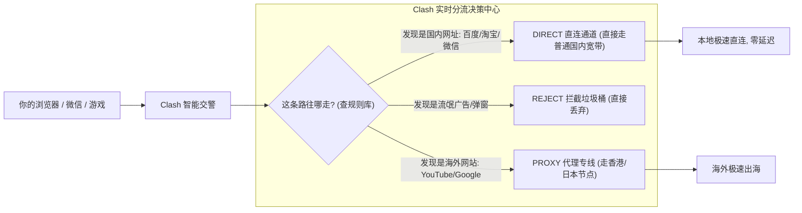

# Clash 核心概念与内核生态演进：小白也能看懂的基础指南

在当今的科学上网与网络技术圈子里，**“Clash”** 绝对是出现频率最高的一个词。
无论你是在 Windows 电脑、Mac 苹果电脑还是安卓手机上，几乎每个人都会推荐你用基于 Clash 的软件。

但很多刚接触的小白往往会有各种疑问：
- “Clash 到底是一个软件，还是一种协议，还是一个内核？”
- “为什么经常听到大家在聊 Clash、Clash.Meta、Mihomo？它们是一回事吗？”
- “为什么有了 Clash 之后，我再也不需要手动来回切换代理开关了？”

本文将用彻底通俗的大白话和形象的生活比喻，带你理清 Clash 的底层运行机制，看懂它为什么能成为全网公认的“分流神器”！

---

## 一、Clash 的本质是什么？（家门口的智能交通指挥交警）

用一句话概括：**Clash 本身并不是提供翻墙节点的“机场”，它是一个安装在你电脑里的“智能网络交通指挥交警”！**

### 传统老式 VPN vs Clash 的降维打击：
- **老式传统 VPN（一刀切盲人）**：
  只要你一打开 VPN，你电脑里的所有网络全部被强行送往国外。你打开百度、看腾讯视频，甚至微信发个消息都要绕道去美国转一圈，不仅慢如蜗牛，国内应用还会提示异地登录。
- **Clash 智能分流（自带火眼金睛的交警）**：
  Clash 在你电脑里默默巡视每一个网络请求：
  - 看到你要打开**百度、淘宝、哔哩哔哩**：立刻挥舞旗帜：“走左边本地专用通道，不耗费任何代理流量，直接跑满你的千兆家庭宽带！”
  - 看到你要打开**YouTube、Google、GitHub**：立刻指挥：“走右边海外专线通道，自动通过香港或日本高速节点出海！”
  - 看到网页里的**牛皮癣垃圾弹窗广告**：立刻命令：“直接扔进垃圾桶拦截，页面干净清爽！”

**这就是为什么 Clash 如此受人喜爱：你只要开机把它打开，之后就完全不需要管它了，国内国外两不误！**

---

## 二、Clash 的三大金刚核心组件（大白话拆解）

不管你使用的是哪一款图形界面的客户端（Clash Verge、Mihomo Party 等），它们的底层运作都由这三个部分组成：

1. **入站通道（Inbound）**：
   相当于交警的值班岗亭（通常在本地开放 `7890` 端口）。电脑里所有的浏览器、聊天软件，都把网络请求交到这个岗亭里登记；
2. **规则册（Rules）**：
   交警手里的“分流红绿灯指南”。里面记录了成千上万个域名的分类规则（比如以 `.cn` 结尾的直连、包含 `google` 的走代理）；
3. **出站通道（Outbound / Proxies）**：
   具体通向各个国家的“出口大门”。你买的机场节点（香港 IPLC、新加坡 BGP、美国双 ISP 等），就是这扇大门后连接的具体高速路。

---

## 三、从 Clash 到 Mihomo (Clash.Meta) 的史诗演进

很多新手在翻看老教程时，经常看到“开源内核停更”的说法，心里会打鼓：“现在 Clash 还能用吗？”

请完全放宽心！因为整个开源社区早已完成了**新老换代的华丽蜕变**：

| 内核代号 | 时代定位 | 维护状态 | 支持的协议范围 | 小白结论 |
| :--- | :--- | :--- | :--- | :--- |
| **Clash Premium** | 第一代经典内核 | 2023年已正式停更归档 | 仅支持旧协议 (SS, VMess, Trojan) | 已成为历史博物馆文物 |
| **Mihomo (原 Clash.Meta)** | **新一代全网主力内核** | **极其活跃迭代更新中** | **全协议大满贯** (VLESS Reality, Hysteria 2, TUIC v5 等) | **目前唯一推荐主力新内核** |

2023 年底，原作者将旧版代码封存后，全球技术高手汇聚在 **Mihomo 项目（原名 Clash.Meta）** 下。
新一代的 **Mihomo 内核** 不仅继承了原版 Clash 的所有规则分流精髓，更彻底重构了底层网络引擎，全面支持了最新的 **VLESS Reality、Hysteria 2** 等前沿防封协议。

如今你下载的任何现代化客户端（无论是 **Clash Verge Rev** 还是 **Mihomo Party**），底层内嵌的都已经全部升级为新一代的 **Mihomo 内核**，性能和稳定性比几年前强劲了数倍！

---

## 四、常见高频问答 (FAQ)

### Q1：Clash 软件本身自带海外节点吗？为什么下载完不能直接上网？
**答**：**Clash 软件本身只是一辆“空车”，不包含任何能上网的节点数据！**
Clash 就像一个视频播放器（比如暴风影音或 VLC），光有播放器是看不了电影的，你必须把“电影文件”（在服务商/机场购买的订阅链接）导入进播放器里，播放器才能为你播放。下载完 Clash 后，第一件事就是把你购买的节点订阅链接粘贴进去。

### Q2：什么是“订阅转换”？我自己网上随便找个转换网站安全吗？
**答**：有些老牌机场只提供纯链接或单节点二维码，不能直接被 Clash 识别，这时需要把节点转换成 Clash 能读懂的 YAML 格式，这叫“订阅转换”。
**血泪警告**：**千万不要使用网上不知名的免费公共订阅转换网页！**许多不良黑客搭建免费转换站，暗中偷窃你的订阅链接，把你买的贵重流量偷偷卖给别人或者当黑产肉鸡。建议直接使用机场自带的 Clash 专用导出链接，或者使用客户端内置的本地转换功能。

### Q3：为什么开着 Clash 时，有时候微信里的语音发不出去，或者某些国内银行 App 提示风险？
**答**：这通常是因为你的分流规则没有更新，或者被误切成了“全局模式（Global）”。在全局模式下，国内银行 App 检测到你登录的 IP 居然在海外，为了账户安全会触发风控拦截。只要在软件里将运行模式切换回 **「规则模式（Rule）」**，并定期右键更新一下规则集（Rule Provider），让国内银行和微信走原生直连即可彻底解决。

### Q4：Clash 的“延迟测试”显示几百毫秒，这个数字越小越好吗？
**答**：是的！延迟数字代表你的电脑向节点打招呼、节点回话所花费的时间（毫秒 ms）。通常来说：
- **< 50ms（绿色）**：极速专线节点（如香港、日韩直连），适合打游戏、刷短视频、抢购；
- **50ms ~ 150ms（黄色）**：中等距离节点（如新加坡、台湾），看 4K 高清大片毫无压力；
- **> 200ms（橙色）**：长距离欧美节点，适合查海外资料、发邮件或使用特定 AI 服务；
- **红色或 Timeout（超时）**：代表该节点当前连不上或已掉线，切勿选中。

## 📌 推荐延伸阅读与技术指南
- **博客精读版**：[Clash 核心概念与内核生态演进（博客精选版）](/article/clash-intro/)
- **全平台总览**：[主流客户端配置指南](/article/client-guide/)
- **Mihomo实战**：[Mihomo Party 现代化客户端实战](/notes/clash/mihomo/)
- **Verge教程**：[Clash Verge Rev 全平台安装与配置优化](/notes/clash/verge/)
