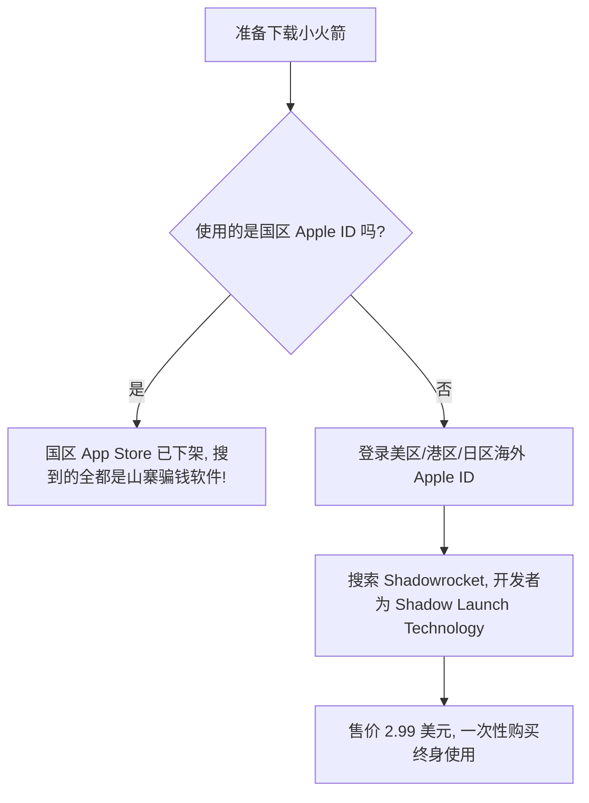
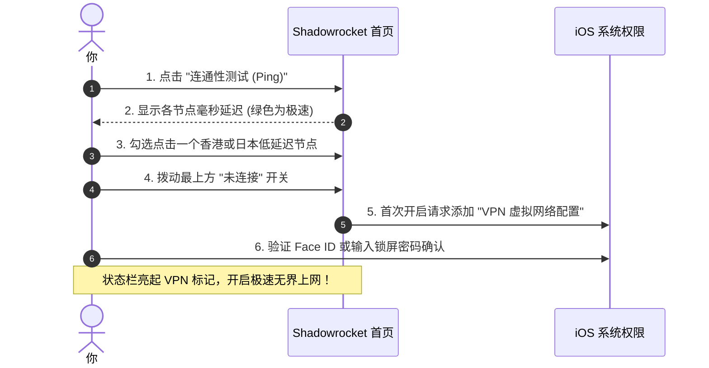

# 小火箭 (Shadowrocket) 苹果 iOS 完整新手教程与配置指南

对于使用 iPhone 和 iPad 的苹果用户来说，如果要在 iOS 平台上挑选一款普及率最高、功能最全面、使用最方便的科学出海工具，**Shadowrocket（因其图标是一个可爱的小火箭，被全网广大用户亲切地统称为“小火箭”）** 绝对是当之无愧的无冕之王！

然而，很多刚换苹果手机的小白往往会遇到各种困惑：
- “为什么我在国区 App Store 搜索不到小火箭？”
- “搜到好多同名带火箭图标的软件，哪个才是真正的正版？”
- “买好软件后，怎么把机场的订阅链接导进手机里？”

本文将用完全通俗的大白话，从**如何安全下载正版小火箭**、**一秒导入节点订阅**，到**分流设置与后台保活**，手把手带你玩转苹果生态的最强出海利器！

---

## 一、下载正版小火箭的防坑避雷指南（重中之重）

在开始使用前，小白必须知道两个最核心的事实，避免被假软件骗钱：

### 1. 认准正版开发者与售价
- **正版名称**：严格拼写为 **`Shadowrocket`**（中间没有任何空格和附加词）；
- **正版开发者**：**`Shadow Launch Technology Limited`**；
- **官方正版图标**：黑色圆角背景，中间是一个倾斜 45 度向上飞行的白色小火箭；
- **官方售价**：**$2.99 美元**（一次购买，同账号绑定的所有 iPhone/iPad 永久免费下载）。
> **血泪警告**：国内 App Store 搜索出来的什么“小火箭加速器”、“Rocket VPN”，全部都是打着擦边球的山寨盗版软件，不仅要充几百元高昂月费，还会泄露隐私，坚决不要下载！

### 2. 小白如何下载？（两种最简单途径）
- **途径一（借用或注册海外 Apple ID）**：
  在淘宝或拼多多花几块钱购买一个临时的“美区已购小火箭 Apple ID”，或者自己花十分钟免费注册一个美区账号；
- **核心操作注意**：
  **千万不要在 iPhone 的【系统设置 -> iCloud】里登录陌生账号！**
  只需要打开手机自带的 **【App Store 应用商店】**，点击右上角头像滑到最底部退出你自己的账号，在此处登录海外 ID，搜索下载完后，立刻退出并换回你自己的私人账号即可。软件下载到手机上后永久可用！

---

## 二、三分钟保姆级节点导入与连接

下载好小火箭后，将节点导进软件非常简单，主要有两种最常用的方式：

### 方式一：一键自动导入 / 复制链接导入（最推荐）
1. 打开手机 Safari 浏览器，登录你购买的服务商或机场后台；
2. 找到“便捷导入 / 订阅管理”区域，点击 **「一键导入 Shadowrocket / 小火箭」**，手机会自动弹窗询问“是否允许打开 Shadowrocket”，点击“允许”，所有节点瞬间全部自动拉取进软件！
3. 如果后台没有一键按钮，点击 **「复制订阅地址」**；
4. 打开小火箭软件，通常软件会自动检测剪贴板并弹出提示“是否添加节点？”点击“添加”即可；
5. 如果没弹窗，点击小火箭右上角的小 **「+」** 号：
   - **类型（Type）**：选择 **`Subscribe（订阅）`**；
   - **URL（网址）**：长按粘贴你复制的订阅链接；
   - **备注**：随便起个名字（比如“我的专线”）；
   - 点击右上角 **「保存（Save）」**，软件会自动向服务器拉取完整节点列表！

### 方式二：扫描二维码一键导入
如果你是在电脑屏幕上打开的服务商后台，或者朋友分享给你一个节点二维码：
1. 点击小火箭左上角的 **「扫码图标（四方框）」**；
2. 对准电脑屏幕上的节点二维码一扫，叮的一声，节点立刻导入完成！

---

## 三、测速、选节点与点亮开关

导入成功后，你会看到首页列出了长长一串各国的节点卡片：

1. **一键全测速**：点击节点列表上方的 **「连通性测试（Ping Test）」**，稍等两秒，每个节点右侧就会出现真实的彩色毫秒数字（选择 20ms~70ms 的绿色节点最佳）；
2. **选择节点**：用手指轻点一下你选中的节点，该节点前方会出现一个小圆点标记；
3. **拨动总开关**：拨动页面最顶部的 **「未连接」** 开关；
4. **允许系统网络权限**：**首次使用时**，iOS 系统会弹出一个安全提示：*“Shadowrocket 想要添加 VPN 配置”*，点击 **「允许（Allow）」**，然后刷一下脸（Face ID）或输入手机锁屏密码，屏幕右上角状态栏出现小小的 **`[VPN]`** 标识，代表代理已经正式成功启动！

---

## 四、底部全局路由模式该选哪个？（大白话对比）

在小火箭首页下方，有一个叫 **「全局路由」** 的选择栏，点击可以切换模式：

- **配置（Config，强烈推荐默认必选）**：
  - **大白话**：**智能判断模式**。小火箭内置了一套完整的国内海外网址规则表。当你逛淘宝、刷抖音、点外卖、聊微信时，自动走本地家庭宽带，完全不消耗节点流量，速度飞快；当你访问 YouTube、Google、Twitter 时，自动走海外节点。极力推荐长期保持这个模式！
- **代理（Proxy）**：
  - **大白话**：**强行全部出国**。无论你打开国内任何应用还是国外应用，所有数据全走海外节点。如果不是为了特殊测试，千万不要选这个模式。
- **直连（Direct）**：
  - **大白话**：**全部不上网走外网**。所有流量完全不经代理。

---

## 五、常见高频问答 (FAQ)

### Q1：首次拨动开关时，为什么弹出“添加 VPN 配置”后无法保存，或者开关又自动跳回“未连接”？
**答**：这是 iOS 系统偶尔出现的网络组件卡死现象。解决步骤非常简单：
1. 打开手机自带的【设置 -> 通用 -> VPN 与设备管理】；
2. 如果里面有旧的或失效的残留 VPN 描述文件，点击后面的感叹号将其全部“删除 VPN”；
3. 打开手机自带的【设置 -> 飞行模式】，打开等待 5 秒钟再关闭，或者将 iPhone 重启一次；
4. 再次打开小火箭点击连接，重新通过锁屏密码授权即可恢复正常。

### Q2：为什么连上小火箭后，微信收消息很慢，或者美团/大众点评定位跑到了香港？
**答**：这 100% 是因为你把底部的全局路由模式误选成了 **「代理（Proxy）」**！
请立刻点击小火箭首页下方的全局路由，切换回 **「配置（Config）」** 模式。在“配置”模式下，国内所有软件都会精准识别并本地直连，定位永远在你所在的国内真实城市，微信秒收秒发毫无延迟。

### Q3：为什么节点经常测速超时（显示 Timeout 或全部标红）？
**答**：请按以下三步排查：
1. **更新订阅**：在小火箭首页找到你的订阅合集名称，用手指往右滑动并点击“更新”，从云端重新拉取最新节点；
2. **检查套餐是否过期或欠费**：登录你的服务商网站后台，确认套餐流量没有耗尽、服务没有到期；
3. **检查手机时间**：进入手机【设置 -> 通用 -> 日期与时间】，确保勾选了“自动设置”，系统时间误差不能超过 1 分钟。

### Q4：小火箭放在后台会被苹果系统自动杀掉断连吗？
**答**：iOS 系统具有极强的系统级网络扩展机制，只要你不手动在多任务卡片中上滑强杀小火箭，**小火箭在后台可以做到几天甚至几个月稳定常驻、永不断连**！如果你希望在锁屏或长时间息屏时保持连接最稳定，可以在小火箭底部的【设置 -> 延迟测试】中开启“自动选择”，并进入 iPhone【设置 -> 通用 -> 后台 App 刷新】，确保勾选了允许 Shadowrocket 在后台刷新。

## 📌 推荐延伸阅读与技术指南
- **博客精读版**：[小火箭 iOS 完整新手教程（博客精选版）](/article/shadowrocket/)
- **免外区ID方案**：[iOS Nextin 专属客户端上手指南](/notes/clash/nextin/)
- **全平台总览**：[主流客户端配置指南](/article/client-guide/)
- **Windows端**：[Windows 电脑端科学上网指南](/notes/clash/windows/)
